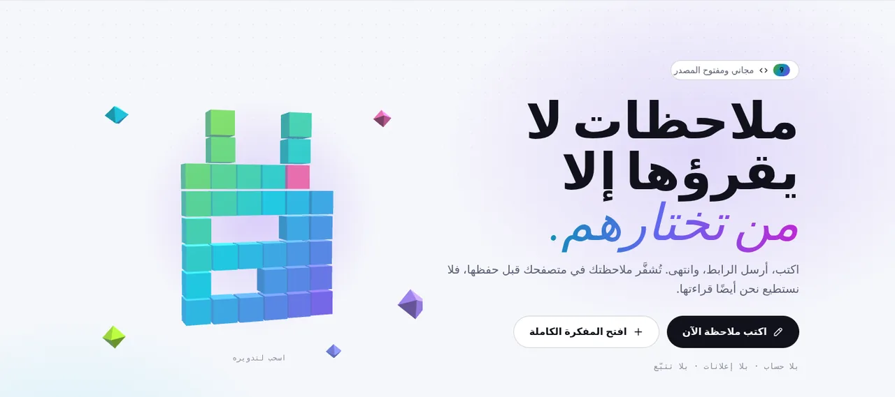

<p align="center">🌐 <a href="README.md">English</a> · <a href="README.zh.md">简体中文</a> · <a href="README.es.md">Español</a> · <b>العربية</b> · <a href="README.pt.md">Português</a> · <a href="README.fr.md">Français</a> · <a href="README.ja.md">日本語</a> · <a href="README.ru.md">Русский</a> · <a href="README.id.md">Bahasa Indonesia</a></p>

<p align="center"><picture><source media="(prefers-color-scheme: dark)" srcset="docs/readme/hero-ar-dark.webp"></picture></p>

<div dir="rtl">

<p align="center">
  <b>اكتب ملاحظة، أرسل الرابط، وانتهى.<br>تُقفل في متصفحك قبل حفظها، فلا يستطيع حتى الخادم قراءتها.</b>
</p>

<p align="center">
  <a href="https://note.hel.ink"><b>✍️ جرّبه على الإنترنت</b></a> ·
  <a href="#run-your-own">استضفه بنفسك</a> ·
  <a href="#features">الميزات</a> ·
  <a href="#faq">الأسئلة الشائعة</a> ·
  <a href="docs/SELF-HOSTING.md">دليل الخادم (EN)</a> ·
  <a href="docs/REFERENCE.md">المرجع (EN)</a> ·
  <a href="CHANGELOG.md">سجل التغييرات</a>
</p>

<p align="center"><sub>ملف Go واحد + ملف SQLite واحد · 9 لغات · بلا إعلانات ولا تتبّع · مجاني ومفتوح المصدر (MIT)</sub></p>

> [!IMPORTANT]
> **المفتاح موجود في الرابط.** من يملك الرابط يستطيع قراءة الملاحظة، وإذا ضاعت كل الروابط فلن يستطيع أحد فتحها أبدًا: لا أنت، ولا الخادم، ولا نحن. أرسل الروابط لمن تقصدهم فقط، واحفظ رابط المالك في مكان آمن.

---

## ما هو NoteHop؟

تخيّل الملاحظة رسالةً داخل صندوق مقفل. يقفل NoteHop الصندوق **في متصفحك**، ويضع المفتاح في الرابط، وبعد ذلك فقط يرسل الصندوق إلى الخادم. يحتفظ الخادم بصندوق لا يستطيع فتحه. ومن تعطيه الرابط يفتحه في متصفحه هو، في مكانه.

وفوق ذلك، تفعل الملاحظة أكثر بكثير من مفكرة: روابط بصلاحيات مختلفة (قراءة فقط، أو كتابة، أو رد فقط، أو تأشير فقط)، وحذف نفسها بعد قراءتها، والكتابة معًا مباشرة، وقوائم تأشير، واستطلاعات، ونماذج، وشيفرة، بل وصفحات ويب صغيرة تعمل داخل صندوق معزول.

**يناسبك إذا كنت:**
- ترسل كلمات مرور أو عناوين أو ملاحظات خاصة عبر الدردشة ولا تريد أن تبقى في السجل،
- تشارك قائمة تسوق أو محضر اجتماع أو قائمة تسجيل دون أن تُلزم الجميع بإنشاء حساب،
- تريد pastebin أو مفكرة يمكنك تشغيلها على خادمك، في ملف واحد.

</div>

<p align="center"><picture><source media="(prefers-color-scheme: dark)" srcset="docs/readme/demo-dark.webp"></picture></p>

<details dir="rtl">
<summary><b>نظرة أقرب</b> (الواجهة بالإنجليزية)</summary>

<p align="center"><picture><source media="(prefers-color-scheme: dark)" srcset="docs/readme/note-dark.webp"></picture></p>
<p align="center"><picture><source media="(prefers-color-scheme: dark)" srcset="docs/readme/share-dark.webp"></picture></p>
<p align="center"><picture><source media="(prefers-color-scheme: dark)" srcset="docs/readme/tour-dark.webp"></picture></p>
<p align="center"><picture><source media="(prefers-color-scheme: dark)" srcset="docs/readme/web-dark.webp"></picture></p>
<p align="center"><picture><source media="(prefers-color-scheme: dark)" srcset="docs/readme/phone-dark.webp"></picture></p>

</details>

<div dir="rtl">

## ما الذي يراه الخادم، وما الذي لا يراه أبدًا

| 🙈 لا يصل إلى الخادم أبدًا | 👀 ما يراه الخادم فعلًا |
|---|---|
| عنوان الملاحظة ونصها | نص مبعثر (مشفّر) وحجمه |
| المفتاح (بعد علامة `#` في الرابط، وهي لا ترسلها المتصفحات أبدًا) | متى أُنشئت الملاحظة وعُدّلت وفُتحت، وكم مرة |
| المرفقات ورسائل الدردشة والتعديلات المباشرة (مقفلة أيضًا) | نوع الرابط المستخدم (قراءة فقط، كتابة…) |
| كلمة مرور حسابك وقائمة ملاحظاتك | أي مربعات التأشير مؤشَّرة، وعدد الردود |
| النص الذي ترسله إلى المساعدة في الكتابة بالذكاء الاصطناعي (يذهب من متصفحك مباشرة إلى المزوّد الذي تختاره) | عنوان IP الخاص بك، لحدود الاستخدام |

<a id="features"></a>

## الميزات

- **🔒 تُقفل في متصفحك.** AES-256-GCM بمفتاح عشوائي طوله 256 بت لا يوجد إلا في الرابط. ويمكنك إضافة كلمة مرور أخرى.
- **🔗 روابط كثيرة، صلاحيات مختلفة.** قراءة فقط، أو كتابة، أو رد فقط (مثل دفتر الزوار)، أو تأشير فقط (للقوائم). تسرّب رابط؟ أوقفه، والبقية تعمل.
- **🔑 رابط المالك.** رابط منفصل لتعديل الملاحظة ومشاركتها وتجميدها وحذفها.
- **🔥 حذف بعد القراءة.** تُفتح 1 أو 3 أو 10 مرات ثم تُدمَّر. روبوتات معاينة الروابط في تطبيقات الدردشة لا تستهلك مرات الفتح.
- **⏳ انتهاء الصلاحية وكبسولات الزمن.** تختفي بعد 10 دقائق حتى 30 يومًا، أو تبقى مقفلة حتى التاريخ الذي تختاره.
- **🏷️ عنوان خاص + رمز QR.** ‎`/monday-meeting`، ورمز QR يُنشأ في متصفحك.
- **📌 نسخ ثابتة وتوقيع.** جمّد نسخة لا يستطيع أحد تغييرها، ودع القرّاء يوافقون عليها بأسمائهم.
- **🧑‍🤝‍🧑 الكتابة معًا.** مؤشر كل شخص واسمه مباشرة، ودردشة جانبية، و"اتبع المقدّم". الخادم يمرّر بيانات مقفلة فقط.
- **✅ كتل ذكية.** قوائم تأشير، واستطلاعات (صوت لكل شخص)، ونماذج، وآلة حاسبة، ومخططات Mermaid، ولوحة Kanban من العناوين، وكتل سرية برمز PIN أو تدمّر نفسها.
- **📝 أنواع الملاحظات.** نص عادي (مثل المفكرة)، ومستند (Markdown مع قائمة `/` وقائمة تنسيق بالنقر الأيمن)، وشيفرة (أرقام أسطر، لا تُشغَّل أبدًا، تُنزَّل بصيغة `.txt`)، وويب.
- **🌐 ملاحظات الويب.** ملفات HTML وCSS وJS في ملاحظة واحدة، مع زر تشغيل ونتيجة ووحدة تحكم. تعمل الشيفرة فقط داخل صندوق معزول في متصفحك، بلا إنترنت ولا وصول إلى الصفحة، ويُسأل القارئ دائمًا قبل تشغيل شيفرة شخص آخر.
- **✨ مساعدة في الكتابة (اختيارية).** تلخيص وإعادة صياغة وترجمة وتصحيح إملاء. استخدم الذكاء الاصطناعي المدمج في المتصفح (يبقى النص على جهازك) أو مفتاح API الخاص بك (Claude أو ChatGPT أو Gemini أو OpenRouter أو Ollama). لا يرى NoteHop النص ولا المفتاح أبدًا.
- **📎 المرفقات.** اسحب ملفات أو صورًا إلى الملاحظة؛ تُقفل أيضًا وتُحفظ 24 ساعة.
- **👤 الحساب اختياري.** مع الحساب، تُقفل قائمة ملاحظاتك بمفتاح لا تفتحه إلا كلمة مرورك. ورموز الاسترداد تعيدك إن نسيتها.
- **🕵️ خصوصية إضافية.** كلمة مرور مموّهة (تفتح ملاحظة مزيفة)، ومن شبكات معيّنة فقط، ومتتبّع يخبرك أي رابط تسرّب، وسجل مع الفروق.
- **📶 الأجهزة القريبة.** أرسل ملاحظة أو ملفات إلى جهاز على شبكة الواي فاي نفسها، مباشرة من متصفح إلى متصفح.
- **🧑‍💻 للمطورين.** ‎`/raw` لأداة curl، وأداة `notehop` التي تشفّر في الطرفية، وواجهة API وهمية من JSON داخل ملاحظة، وWebhooks واردة وصادرة، وSSH، وروبوت Telegram.
- **🌍 9 لغات.** English و简体中文 وEspañol والعربية (من اليمين إلى اليسار) وPortuguês وFrançais و日本語 وРусский وBahasa Indonesia، تُختار تلقائيًا من متصفحك.
- **🛡️ صارم افتراضيًا.** سياسة أمان محتوى صارمة، بلا شيفرات من أطراف ثالثة، بلا إعلانات ولا تتبّع، `noindex`، وحدود للطلبات. يعمل دون اتصال كتطبيق قابل للتثبيت (PWA).

<a id="run-your-own"></a>

## استضفه بنفسك

NoteHop هو **ملف Go تنفيذي واحد وملف SQLite واحد**. بلا Node، وبلا خطوة بناء، وبلا خدمات أخرى.

**الخيار 1: على خادم VPS** (systemd مع Caddy أو nginx، ونسخ احتياطي يومي)

</div>

```bash
git clone https://github.com/navi-crwn/NoteHop.git && cd NoteHop
sudo DOMAIN=note.example.com ./deploy/install.sh
```

<div dir="rtl">

الدليل الكامل، مع HTTPS والتحديثات والنسخ الاحتياطي والاستعادة، في **[docs/SELF-HOSTING.md](docs/SELF-HOSTING.md)** (بالإنجليزية).

**الخيار 2: على حاسوبك** (يتطلب Go 1.27 أو أحدث)

</div>

```bash
go run ./cmd/notehop -addr 127.0.0.1:8090 -db data/dev.db
```

<div dir="rtl">

افتح http://127.0.0.1:8090. لا تسمح المتصفحات بهذا التشفير إلا على **HTTPS أو localhost**.

**الخيار 3: Docker**

</div>

```bash
docker build -t notehop .
docker run -d -p 127.0.0.1:8090:8080 -v notehop:/data -e NOTEHOP_BASE_URL=https://note.example.com notehop
```

<div dir="rtl">

كل إعداد هو متغير بيئة (`NOTEHOP_*`). تجدها كلها في **[docs/REFERENCE.md](docs/REFERENCE.md)**، مع نموذج التشفير وواجهة API.

## ملاحظتك الأولى

1. افتح الصفحة الرئيسية، واكتب في المربع، وشاهد النص المبعثر الذي سيستلمه الخادم.
2. اختر من يستطيع فعل ماذا: **عرض فقط** أو **يمكنه الكتابة** أو **يمكنه الرد**. أشّر على **قراءة مرة واحدة** للأسرار.
3. اضغط **أنشئ الرابط** وأرسله. هذا كل شيء، بلا حساب.
4. تريد المزيد (التوقيت، خصوصية إضافية، الكتابة معًا)؟ استخدم **افتح المفكرة الكاملة**، أو زر **مشاركة** في أي ملاحظة تملكها.

<a id="faq"></a>

## الأسئلة الشائعة

**هل يستطيع من يدير الخادم قراءة ملاحظاتي؟**
لا. تُقفل الملاحظة في متصفحك قبل إرسالها، والمفتاح في جزء الرابط بعد `#`، وهو جزء لا ترسله المتصفحات إلى أي خادم أبدًا. الخادم لا يملك إلا نصًا مبعثرًا.

**ماذا لو ضاع الرابط؟**
حينها لا يستطيع أحد فتح الملاحظة. إن كان لديك حساب، فملاحظاتك مُدرجة في **ملاحظاتي** ويمكنك فتحها من هناك. بلا حساب، تُتذكّر الملاحظات الأخيرة في هذا المتصفح فقط.

**هل "حذف بعد القراءة" آمن من معاينات الروابط؟**
نعم. فتح الصفحة وحده لا يعرض المحتوى؛ يضغط القارئ زرًا أولًا. روبوتات المعاينة في تطبيقات الدردشة تحصل على بطاقة معاينة، لا على مرة قراءة.

**هل يقرأ الذكاء الاصطناعي ملاحظاتي؟**
المساعدة في الكتابة متوقفة حتى تختارها. الذكاء المدمج في المتصفح يعمل على جهازك. ومع مفتاح API الخاص بك يذهب النص من متصفحك مباشرة إلى ذلك المزوّد، ولا يمر عبر NoteHop أبدًا. ويستطيع مدير الخادم إيقاف الذكاء الاصطناعي بـ `NOTEHOP_AI=off`.

**هل يمكن لشيفرة في ملاحظة أن تهاجم من يفتحها؟**
ملاحظات الشيفرة لا تُشغَّل أبدًا: تُعرض كنص وتُنزَّل بصيغة `.txt`. أما ملاحظات الويب فتعمل فقط داخل إطار معزول بلا إنترنت ولا ملفات تعريف ارتباط ولا وصول إلى صفحة الملاحظة أو مفتاحها، ويُسأل القارئ أولًا.

**هل أستطيع استخدام خادم تسجيل دخول خاص بي؟**
نعم. لدى NoteHop حساباته الخاصة، ويمكنه أيضًا إدخال الناس عبر خادم حسابات تديره أنت (تسجيل دخول موحّد). راجع `NOTEHOP_SSO_*` في [docs/REFERENCE.md](docs/REFERENCE.md).

**ماذا لو شارك أحدهم شيئًا مؤذيًا؟**
لكل ملاحظة خيار **الإبلاغ عن هذه الملاحظة** في قائمتها. يصل البلاغ (سبب ورسالة قصيرة، وليس محتوى الملاحظة أبدًا) إلى القائمين على الموقع. لا يمكنهم قراءة ملاحظة مقفلة، لكن يمكنهم إزالتها، ويُحجز اسم الرابط بعدها لسنة. يراجع المشغّلون البلاغات بأمر `notehop takedown` أو من مركز تحكّم عبر [HOP App Protocol](docs/REFERENCE.md#control-center-hop-app-protocol).

**كيف آخذ نسخة احتياطية؟**
الأمر `notehop backup -db notehop.db copy.db` يعمل والخادم قيد التشغيل. ومثبّت VPS يضبط نسخة احتياطية يومية أيضًا. وتبقى الملاحظات مقفلة في النسخة الاحتياطية كذلك.

## ما تحت الغطاء

| المجلد | محتواه |
|---|---|
| `cmd/notehop/` | البرنامج: الخادم والإعدادات والأوامر `backup` و`new` و`get` و`takedown` |
| `internal/app/` | معالجات HTTP، وميزات الملاحظات، ومرحّل التعاون المباشر، وSSH، وTelegram، وتسجيل الدخول الموحّد |
| `internal/db/` | مخطط SQLite والترحيلات التلقائية |
| `internal/client/` | تشفير أداة سطر الأوامر (مثل تشفير المتصفح) |
| `internal/i18n/` | تحميل اللغات التسع، واختبار يُبقيها متوافقة |
| `web/templates/`، `web/static/` | الصفحات، وJavaScript وCSS عاديان بلا خطوة بناء. مكتبات الأطراف الثالثة في `web/static/vendor/` |
| `web/i18n/` | نصوص الواجهة بتسع لغات |
| `deploy/` | المثبّت، ووحدات systemd، والنسخ الاحتياطي، وأمثلة Caddy وnginx |
| `scripts/` | اختبارات المتصفح (Playwright): ‎`./scripts/e2e-all.sh` يشغّل كل الاختبارات على خادم جديد |

شغّل الاختبارات بـ `go test -race ./...` و`./scripts/e2e-all.sh`.

<a id="family"></a>

## عائلة Hop

NoteHop جزء من عائلة HOP: تطبيقات مجانية ومفتوحة المصدر يمكن استضافتها ذاتيًا وبلا تتبّع، وتتشارك حسابًا واحدًا (HOP ID).

<!-- hop-family:start -->
<!-- Generated from HEL.ink resources/hop-assets/apps.source.json; edit there, then run scripts/hop_assets.py build. -->
| App | Address | Repository | What it does |
| --- | --- | --- | --- |
| **HOP ID** | [hel.ink](https://hel.ink) · accounts at `hub.hel.ink` | [navi-crwn/HEL.ink](https://github.com/navi-crwn/HEL.ink) | One account for every HOP app. |
| **LinkHop** | [link.hel.ink](https://link.hel.ink) · `hel.ink/l/…` | [navi-crwn/LinkHop](https://github.com/navi-crwn/LinkHop) | Short links, QR codes and click analytics. |
| **BioHop** | [bio.hel.ink](https://bio.hel.ink) · `hel.ink/b/…` | [navi-crwn/BioHop](https://github.com/navi-crwn/BioHop) | One link-in-bio page for everything you do. |
| **PixelHop** | [pixel.hel.ink](https://pixel.hel.ink) · `p.hel.ink/…` | [navi-crwn/PixelHop](https://github.com/navi-crwn/PixelHop) | Image hosting with albums and direct links. |
| **NoteHop** | [note.hel.ink](https://note.hel.ink) · `n.hel.ink/…` | [navi-crwn/NoteHop](https://github.com/navi-crwn/NoteHop) | Encrypted notes you share with a link. |
| **Imperium** | private (owner only) | private | The HOP control panel. |
<!-- hop-family:end -->

</div>

---

<p align="center">ترخيص MIT · <a href="docs/REFERENCE.md">المرجع</a> · <a href="docs/SELF-HOSTING.md">استضفه بنفسك</a> · <a href="CHANGELOG.md">سجل التغييرات</a><br><sub>من عائلة HEL.ink: <a href="https://github.com/navi-crwn/LinkHop">LinkHop</a> (روابط قصيرة) · <a href="https://github.com/navi-crwn/BioHop">BioHop</a> · <a href="https://github.com/navi-crwn/PixelHop">PixelHop</a> (استضافة صور) · <a href="https://note.hel.ink">NoteHop</a></sub></p>
