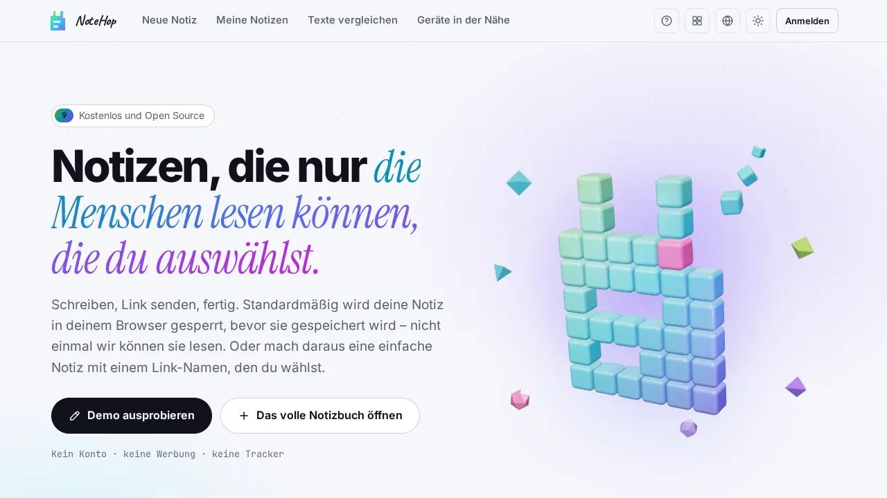

<p align="center">🌐 <a href="README.md">English</a> · <a href="README.zh-CN.md">简体中文</a> · <b>Deutsch</b> · <a href="README.id.md">Bahasa Indonesia</a> · <a href="README.ja.md">日本語</a> · <a href="README.pt-BR.md">Português (Brasil)</a> · <a href="README.es.md">Español</a> · <a href="README.fr.md">Français</a> · <a href="README.ru.md">Русский</a></p>

<p align="center"><picture><source media="(prefers-color-scheme: dark)" srcset="docs/readme/hero-de-dark.webp"></picture></p>

<p align="center"><b>Notiz schreiben, Link senden, fertig.</b><br>Standardmäßig wird die Notiz schon im Browser verschlüsselt, bevor sie gespeichert wird. Der Server speichert also Text, den er nicht lesen kann.</p>

<p align="center">
  <a href="https://note.hel.ink"><b>Online ausprobieren</b></a> ·
  <a href="https://navi-crwn.github.io/NoteHop/">Website</a> ·
  <a href="#run-your-own">Selbst betreiben</a> ·
  <a href="#encrypted-and-basic-notes">Verschlüsselte und einfache Notizen</a> ·
  <a href="#faq">FAQ</a> ·
  <a href="docs/SELF-HOSTING.md">Anleitung zum Selbst-Hosting</a> ·
  <a href="docs/REFERENCE.md">Referenz</a> ·
  <a href="CHANGELOG.md">Änderungsprotokoll</a>
</p>

<p align="center"><sub>Ein Go-Programm und eine SQLite-Datei · 9 Sprachen · keine Werbung, keine Tracker · kostenlos und Open Source (MIT)</sub></p>

> [!IMPORTANT]
> Eine verschlüsselte Notiz trägt ihren Schlüssel im Link. Wer den Link hat, kann die Notiz lesen, und wenn jede Kopie des Links verloren geht, kann niemand sie mehr öffnen, auch nicht der Server und nicht die Menschen, die ihn betreiben. Bei einer einfachen Notiz ist es anders: Der Server speichert ihren Text als Klartext und kann ihn lesen. Nutze einfache Notizen nur für Dinge, die der Betreiber des Servers ruhig lesen darf.

NoteHop ist eine Notiz-Freigabe-App, die du selbst betreiben kannst. Du schreibst eine Notiz, bekommst einen Link und sendest ihn weiter. Jeder Link hat eigene Rechte (nur lesen, schreiben, nur antworten, nur abhaken), eine Notiz kann sich nach dem Lesen selbst löschen, und mehrere Personen können gleichzeitig darin schreiben.

Sie ist für Menschen, die

- Passwörter, Adressen oder private Notizen per Chat schicken und nicht wollen, dass sie im Verlauf stehen bleiben,
- eine Einkaufsliste, eine Besprechungsnotiz oder eine Anmeldeliste teilen, ohne dass alle ein Konto anlegen müssen,
- ein Pastebin oder einen Notizblock auf dem eigenen Server betreiben möchten, als eine einzige Datei.

Installiere sie mit einem Befehl. Das Skript prüft deinen Rechner, stellt ein paar Fragen und kann auch den HOP-ID-Konto-Hub für dich einrichten:

```bash
curl -fsSL https://raw.githubusercontent.com/navi-crwn/NoteHop/main/install.sh | bash
```

Aus einem Klon: `./install.sh`. Aktualisieren mit `./update.sh`, entfernen mit `./uninstall.sh`. Mit `--yes` gelten alle Standardwerte; `--help` zeigt die Optionen.

<p align="center"><picture><source media="(prefers-color-scheme: dark)" srcset="docs/readme/demo-dark.webp"></picture></p>

<details>
<summary>Weitere Screenshots</summary>

<p align="center"><picture><source media="(prefers-color-scheme: dark)" srcset="docs/readme/new-dark.webp"></picture></p>
<p align="center"><picture><source media="(prefers-color-scheme: dark)" srcset="docs/readme/note-dark.webp"></picture></p>
<p align="center"><picture><source media="(prefers-color-scheme: dark)" srcset="docs/readme/share-dark.webp"></picture></p>
<p align="center"><picture><source media="(prefers-color-scheme: dark)" srcset="docs/readme/basic-dark.webp"></picture></p>
<p align="center"><picture><source media="(prefers-color-scheme: dark)" srcset="docs/readme/web-dark.webp"></picture></p>
<p align="center"><picture><source media="(prefers-color-scheme: dark)" srcset="docs/readme/dashboard-dark.webp"></picture></p>
<p align="center"><picture><source media="(prefers-color-scheme: dark)" srcset="docs/readme/tour-dark.webp"></picture></p>
<p align="center"><picture><source media="(prefers-color-scheme: dark)" srcset="docs/readme/phone-dark.webp"></picture></p>

</details>

<a id="encrypted-and-basic-notes"></a>

## Verschlüsselte und einfache Notizen

Jede neue Notiz beginnt mit einer Wahl.

| | Verschlüsselt (Standard) | Einfach |
|---|---|---|
| Wer den Text lesen kann | Wer den vollständigen Link hat, der den Schlüssel enthält | Wer den Link hat, und der Server |
| Wie sie gespeichert wird | Als Geheimtext (AES-256-GCM) | Als Klartext in der Datenbank und in deren Backups |
| Link | Zufällig, mit dem Schlüssel nach `#k=` | Ein Name deiner Wahl, etwa `/monday-meeting`, oder ein zufälliger |
| Passwort, Köder-Passwort, sich selbst zerstörende Blöcke | Ja | Nein |
| `/raw`, die Mock-API, SSH, deine öffentliche Seite `/@name` | Nein | Ja |
| Suchmaschinen | Nie indexiert | Nie indexiert |

Der Besitzer kann eine Notiz im Dialog „Teilen“ von einem Typ in den anderen umwandeln. Der Browser verschlüsselt oder entschlüsselt den Text, und der Server tauscht ihn nur aus. Links und Einstellungen bleiben erhalten. Der Versionsverlauf wird gelöscht, und eine Notiz mit angefügten Zeilen, Vorschlägen, einem Köder, sich selbst zerstörenden Blöcken, einem Posteingang oder Unterschriften lässt sich noch nicht umwandeln.

Anhänge und gemeinsames Schreiben in Echtzeit funktionieren in beiden Typen. In einer einfachen Notiz kann der Server auch diese lesen, weil der Schlüssel eines Anhangs im Notiztext steht und Live-Änderungen nicht verschlüsselt sind.

Linkvorschauen, etwa in einer Chat-App, zeigen nur, dass es eine Notiz gibt und von welcher Art sie ist, nie ihren Titel oder Text.

<a id="what-the-server-sees"></a>

## Was der Server sieht

Bei einer verschlüsselten Notiz:

| Erreicht den Server nie | Das sieht der Server |
|---|---|
| Titel und Text der Notiz | Den Geheimtext und seine Größe |
| Den Schlüssel (er steht nach dem `#` im Link, den Browser nicht senden) | Wann die Notiz erstellt, geändert und geöffnet wurde und wie oft |
| Antworten, Vorschläge, Namen bei Unterschriften, Chat-Nachrichten und Live-Änderungen | Welche Art von Link benutzt wurde (nur lesen, schreiben und so weiter) und die Linkadressen |
| Anhänge (die Dateien sind ebenfalls verschlüsselt) | Ablauf, Sperr- und Öffnungszeiten und die erlaubten Netzwerke, wenn du sie festlegst |
| Dein Kontopasswort und die Liste deiner Notizen mit ihren Titeln | Welche Kästchen angekreuzt sind, wie viele Stimmen jede Umfrageoption hat und wie viele Antworten es gibt |
| Text, den du an die Schreibhilfe sendest (er geht von deinem Browser zum gewählten Anbieter) | Deine IP-Adresse, für Ratenbegrenzungen und die Netzwerkbeschränkungen, die du festlegst; deinen Benutzernamen, wenn du ein Konto hast |

Wie weit „der Server kann sie nicht lesen“ reicht:

- Es gilt für verschlüsselte Notizen. Einfache Notizen sind lesbar. Das gilt auch für Funktionen, die mit Klartext arbeiten: `/raw`, die Mock-API, SSH sowie Posteingang und Telegram-Bot, bei denen der Server den Text beim Eintreffen sieht und ihn danach mit dem Schlüssel der Notiz versiegelt speichert.
- Es hängt vom Code ab, den der Server an deinen Browser schickt. Die Verschlüsselung läuft in JavaScript, das der Server ausliefert. Ein Betreiber, der diesen Code ändert, könnte also Schlüssel von Menschen abgreifen, die Notizen öffnen. Eine strenge Content Security Policy hält fremde Skripte fern, ändert daran aber nichts. Wenn dir das wichtig ist, betreibe NoteHop selbst, lies den Code oder nutze das Kommandozeilenprogramm `notehop`, das auf deinem eigenen Rechner verschlüsselt.
- Der Link ist der Schlüssel. Wer ihn besitzt, kann die Notiz lesen, auch jeder Dienst, der einen Link speichert, den du dort eingefügt hast.
- Manche Angaben werden auch bei einer verschlüsselten Notiz lesbar gespeichert: das Label der Inhaltswarnung und ihr optionaler Grund (bis zu 255 Zeichen), die vor dem Öffnen der Notiz angezeigt werden, sowie Grund und Nachricht einer Meldung, die jemand zu einer Notiz abgibt.
- Backups der Datenbank enthalten alles, was die Datenbank enthält: Geheimtext, den Text einfacher Notizen und Kontodaten.

## Funktionen

- Im Browser verschlüsselt. AES-256-GCM mit einem zufälligen 256-Bit-Schlüssel, der nur im Link liegt. Zusätzlich kannst du ein Passwort setzen.
- Viele Links mit unterschiedlichen Rechten: nur lesen, schreiben, nur antworten (wie ein Gästebuch), nur abhaken (für Checklisten) oder Änderungen vorschlagen. Ist ein Link in falsche Hände geraten, schaltest du nur ihn ab, und die anderen funktionieren weiter. Ein eigener Besitzer-Link ändert, teilt, friert ein oder löscht die Notiz.
- Nach dem Lesen löschen: Die Notiz wird zerstört, nachdem sie 1-, 3- oder 10-mal geöffnet wurde. Vorschau-Bots von Chat-Apps verbrauchen keinen Aufruf, weil die lesende Person erst eine Schaltfläche drückt.
- Ablauf und Zeitkapseln: Eine Notiz verschwindet nach 10 Minuten bis zu 30 Tagen oder bleibt bis zu einem Datum deiner Wahl verschlossen.
- Eine eigene Adresse und ein QR-Code für einfache Notizen, zum Beispiel `/monday-meeting`. Der QR-Code entsteht in deinem Browser.
- Fixierte Kopien, die niemand ändern kann, und Freigabe per Unterschrift, bei der Lesende eine Version mit ihrem Namen bestätigen.
- Gemeinsam schreiben: Ihr seht live die Cursor und Namen der anderen, es gibt einen Chat an der Seite, und alle können der Präsentierenden folgen. In einer verschlüsselten Notiz reicht der Server verschlüsselte Daten weiter.
- Blöcke im Text: Checklisten, Umfragen (eine Stimme pro Person), Formulare, ein Rechner, Mermaid-Diagramme, ein Kanban-Board aus deinen Überschriften, Folien sowie geheime Blöcke hinter einer PIN oder solche, die sich selbst zerstören.
- Notiztypen: Einfacher Text (wie Notepad), Dokument (Markdown mit `/`-Menü und Rechtsklick-Formatmenü), Code (Zeilennummern, wird nie ausgeführt, Download als `.txt`) und Web.
- Web-Notizen: HTML-, CSS- und JS-Dateien in einer Notiz, mit Run-Schaltfläche, Ergebnis und Konsole. Der Code läuft in einem isolierten Rahmen in deinem Browser, ohne Internetzugang und ohne Zugriff auf die Notizseite, ihre Cookies oder ihren Schlüssel. Lesende werden gefragt, bevor fremder Code läuft.
- Schreibhilfe, optional: zusammenfassen, umformulieren, übersetzen und Rechtschreibung prüfen. Sie nutzt die eingebaute KI deines Browsers, die auf deinem Gerät bleibt, oder deinen eigenen API-Schlüssel für Claude, ChatGPT, Gemini, OpenRouter oder Ollama. Text und Schlüssel gehen von deinem Browser zum Anbieter und nie über NoteHop.
- Inhaltswarnungen: Markiere eine Notiz als 18+ oder sensibel, mit einem optionalen Grund. Lesende bestätigen, bevor die Notiz sich öffnet, und `/raw` sowie die Mock-API beachten dieselbe Prüfung.
- Anhänge: Zieh Dateien oder Bilder in eine Notiz. Sie werden im Browser verschlüsselt, 24 Stunden aufbewahrt und sind auf 5 MB pro Datei begrenzt, mit einem gemeinsamen Speicherbudget, das der Betreiber festlegt.
- Konten sind optional. Mit einem Konto ist deine Notizliste mit einem Schlüssel verschlüsselt, den nur dein Passwort öffnet. Acht einmalige Wiederherstellungscodes bringen dich zurück, wenn du das Passwort vergisst. Betreiber können außerdem einen Single-Sign-on-Kontoserver wie HOP ID anbinden.
- Zusätzliche Privatsphäre: ein Köder-Passwort, das eine falsche Notiz öffnet, Zugriff nur aus bestimmten Netzwerken, eine Leck-Verfolgung, die zeigt, über welchen Link ein kopierter Text stammt, und ein Versionsverlauf mit Unterschieden.
- In der Nähe: Schicke einen Block oder Dateien direkt von Browser zu Browser an ein Gerät im selben Netzwerk.
- Für Entwickler: `/raw` für curl, das CLI `notehop`, das im Terminal verschlüsselt, eine Mock-API aus JSON in einer einfachen Notiz, Webhooks in beide Richtungen, SSH und ein Telegram-Bot.
- Neun Sprachen: English, 简体中文, Deutsch, Bahasa Indonesia, 日本語, Português (Brasil), Español, Français und Русский. Anonyme Besuchende sehen Englisch. Über das Globus-Menü oder `?lang=xx` wählst du eine andere.
- Keine Werbung, keine Tracker, keine Skripte von Dritten und eine installierbare Offline-App (PWA).
- Meldungen und Moderation: Jede Notiz hat **Diese Notiz melden**. Betreiber prüfen Meldungen mit dem Befehl `notehop takedown` oder über ein Kontrollzentrum per [HOP App Protocol](docs/REFERENCE.md#control-center-hop-app-protocol).

<a id="run-your-own"></a>

## Selbst betreiben

NoteHop ist ein Go-Programm und eine SQLite-Datei. Es braucht weder Node noch einen Build-Schritt noch weitere Dienste.

Der Installer oben auf dieser Seite ist der einfachste Weg auf einem Rechner, den du selbst kontrollierst. Für einen öffentlichen Server nimm eine dieser Möglichkeiten.

Auf einem VPS (systemd, mit Caddy oder nginx für HTTPS und einem täglichen Backup):

```bash
git clone https://github.com/navi-crwn/NoteHop.git && cd NoteHop
sudo DOMAIN=note.example.com ./deploy/install.sh
```

Die [Anleitung zum Selbst-Hosting](docs/SELF-HOSTING.md) behandelt HTTPS, Updates, Backups und Wiederherstellung.

Auf deinem eigenen Rechner zur Entwicklung (braucht Go 1.27 oder neuer):

```bash
go run ./cmd/notehop -addr 127.0.0.1:8090 -db data/dev.db
```

Öffne http://127.0.0.1:8090. Browser erlauben die Verschlüsselung nur über HTTPS oder auf localhost.

Mit Docker:

```bash
docker build -t notehop .
docker run -d -p 127.0.0.1:8090:8080 -v notehop:/data -e NOTEHOP_BASE_URL=https://note.example.com notehop
```

Jede Einstellung ist eine Umgebungsvariable, die mit `NOTEHOP_` beginnt. Sie sind in [docs/REFERENCE.md](docs/REFERENCE.md) aufgelistet, zusammen mit dem Verschlüsselungsmodell und der API.

Backups: `notehop backup -db notehop.db copy.db` erstellt eine Kopie, während der Server läuft, und die Datei ist nur für ihren Besitzer lesbar. Der VPS-Installer richtet außerdem ein tägliches Backup ein, das 14 Tage aufbewahrt wird. Ein Backup enthält einfache Notizen als Klartext, bewahre es also sorgfältig auf.

## Deine erste Notiz

1. Öffne die Startseite, tippe in das Feld und sieh dir den verschlüsselten Text an, den der Server bekäme.
2. Wähle, wer was darf: **Nur lesen**, **Darf schreiben** oder **Darf antworten**. Schalte **Einmal lesen** ein, wenn es ein Geheimnis ist.
3. Drücke **Verschlüsselten Link erstellen** und sende den Link. Ein Konto brauchst du dafür nicht.
4. Für mehr (Zeitsteuerung, zusätzliche Privatsphäre, gemeinsames Schreiben) nutze **Das volle Notizbuch öffnen** oder die Schaltfläche **Teilen** an jeder Notiz, die dir gehört. Für eine einfache Notiz mit Linknamen wähle oben auf der Seite „Neue Notiz“ **Einfach**.

<a id="faq"></a>

## FAQ

**Können die Menschen, die den Server betreiben, meine Notizen lesen?**
Eine verschlüsselte Notiz nicht. Dein Browser verschlüsselt sie, bevor sie gesendet wird, und der Schlüssel steht im Teil des Links nach dem `#`, den Browser nicht an einen Server senden. Der Server hat nur den verschlüsselten Text. Eine einfache Notiz kann der Server lesen. Die Grenzen dieser Aussage stehen unter [Was der Server sieht](#what-the-server-sees).

**Was, wenn ich den Link verliere?**
Bei einer verschlüsselten Notiz kann sie dann niemand mehr öffnen. Mit einem Konto sind deine Notizen unter „Meine Notizen“ aufgelistet, und du kannst sie von dort öffnen. Ohne Konto merkt sich nur dieser Browser die letzten Notizen. Eine einfache Notiz findest du über ihren Linknamen leicht wieder.

**Ist „Nach dem Lesen löschen“ sicher vor Linkvorschauen?**
Ja. Das Öffnen der Seite zeigt den Inhalt nicht an. Die lesende Person drückt zuerst eine Schaltfläche, und die Vorschau-Bots von Chat-Apps bekommen eine Vorschaukarte, keinen Aufruf.

**Liest die KI meine Notizen?**
Die Schreibhilfe ist aus, bis du sie benutzt. Die eingebaute KI deines Browsers arbeitet auf deinem Gerät. Mit deinem eigenen API-Schlüssel geht der Text von deinem Browser direkt zu diesem Anbieter und nie über NoteHop. Betreiber können sie mit `NOTEHOP_AI=off` abschalten.

**Kann Code in einer Notiz die Menschen angreifen, die sie öffnen?**
Code-Notizen werden nie ausgeführt. Sie werden als Text angezeigt und als `.txt` heruntergeladen. Web-Notizen laufen nur in einem isolierten Rahmen ohne Internet, ohne Cookies und ohne Zugriff auf die Notizseite oder ihren Schlüssel, und Lesende werden vorher gefragt.

**Kann ich meinen eigenen Login-Server nutzen?**
Ja. NoteHop hat eigene Konten und kann Menschen auch über einen Kontoserver anmelden, den du betreibst (Single Sign-on). Siehe die Einstellungen `NOTEHOP_SSO_*` in [docs/REFERENCE.md](docs/REFERENCE.md).

**Was passiert, wenn jemand etwas Schädliches teilt?**
Jede Notiz hat im Menü **Diese Notiz melden**. Die Meldung (ein Grund und eine kurze Nachricht, nie der Inhalt der Notiz) geht an die Menschen, die die Seite betreiben. Eine verschlüsselte Notiz können sie nicht lesen, aber sie können sie entfernen, und der Linkname wird danach ein Jahr lang zurückgehalten.

## Unter der Haube

| Ordner | Was darin ist |
|---|---|
| `cmd/notehop/` | Das Programm: der Server, seine Einstellungen und die Befehle `backup`, `new`, `get` und `takedown` |
| `internal/app/` | HTTP-Handler, Notizfunktionen, das Relay für gemeinsames Schreiben, SSH, Telegram, Single Sign-on, das HOP App Protocol |
| `internal/db/` | Das SQLite-Schema und automatische Migrationen |
| `internal/client/` | Die Verschlüsselung des CLI, dieselbe wie im Browser |
| `internal/i18n/` | Das Laden der 9 Sprachen und ein Test, der sie im Gleichschritt hält |
| `web/templates/`, `web/static/` | Seiten, reines JavaScript und CSS, kein Build-Schritt. Bibliotheken von Dritten liegen eingebunden in `web/static/vendor/` |
| `web/i18n/` | Die Texte der Oberfläche in 9 Sprachen, je eine JSON-Datei |
| `web/changelog.json` | Ein Schnappschuss des Commit- und Pull-Request-Verlaufs, angezeigt auf der Seite `/changelog`. Erzeugt von `scripts/build-changelog.py` |
| `deploy/` | Der VPS-Installer, systemd-Units, Backups, Beispiele für Caddy und nginx |
| `docs/` | Die Dokumentationsseite (GitHub Pages), die Referenz, die Anleitung zum Selbst-Hosting und die README-Bilder |
| `scripts/` | Browsertests (Playwright), alle mit `./scripts/e2e-all.sh`, und die Hilfsskripte |

Die Tests laufen mit `go test -race ./...` und `./scripts/e2e-all.sh`.

## Sicherheit, Lizenz und Verlauf

- Eine Sicherheitslücke meldest du nach [SECURITY.md](SECURITY.md). Bitte eröffne dafür kein öffentliches Issue.
- [CHANGELOG.md](CHANGELOG.md) listet die Änderungen auf, die neuesten zuerst.
- NoteHop steht unter der [MIT-Lizenz](LICENSE). Die eingebundenen Bibliotheken und Schriften behalten ihre eigenen Lizenzen, aufgelistet in [docs/REFERENCE.md](docs/REFERENCE.md#third-party-code).

<a id="family"></a>

## Selbst hosten

<!-- self-hosting:start -->
Alles, was NoteHop braucht, liegt in öffentlichen Repositorys: kein privates Repository, kein Token und kein hel.ink-Konto. Details stehen in der Familienanleitung: [docs/self-hosting.md](https://github.com/navi-crwn/HEL.ink/blob/main/docs/self-hosting.md) (Englisch).

| Baustein | Für NoteHop | Wozu |
| --- | --- | --- |
| [HEL.ink](https://github.com/navi-crwn/HEL.ink) (Hub, HOP ID) | Optional: ergänzt „Mit HOP ID anmelden“ | Konten und Anmeldung für alle Apps |
| [Imperium](https://github.com/navi-crwn/Imperium) | Optional | Admin-Panel für die ganze Familie; braucht den Hub |
| Familien-Schriften und -Kacheln | Nichts zu installieren: kommen von `hel.ink/hop-assets` | Ohne hel.ink: Systemschriften, keine schwebenden Kacheln |

- **Reihenfolge**: NoteHop allein mit `./install.sh`. Für die Anmeldung mit HOP ID zuerst der [Hub](https://github.com/navi-crwn/HEL.ink): `./install.sh --hub new` installiert einen daneben.
- **Mindest-Einstellungen**: `NOTEHOP_BASE_URL`; mit Hub: `NOTEHOP_SSO_URL`, `NOTEHOP_SSO_CLIENT=notehop`, `NOTEHOP_SSO_SECRET`.
- **Allein oder in der Familie**: NoteHop läuft allein mit eigenen Konten. Mit einem Hub kann man sich zusätzlich mit HOP ID anmelden und überall zugleich abmelden.
- **Ohne Imperium**: NoteHop läuft weiter; Notizen sperrst du mit `notehop takedown` und `notehop backup` auf dem Server.
<!-- self-hosting:end -->

## Die Hop-Familie

NoteHop gehört zur HOP-Familie datenschutzfreundlicher, selbst betreibbarer Open-Source-Apps.

<!-- hop-family:start -->
<!-- Generated from HEL.ink resources/hop-assets/apps.source.json; edit there, then run scripts/hop_assets.py build. -->
| App | Address | Repository | What it does |
| --- | --- | --- | --- |
| **HOP ID** | [hel.ink](https://hel.ink) · accounts at `hub.hel.ink` | [navi-crwn/HEL.ink](https://github.com/navi-crwn/HEL.ink) | One account for every HOP app. |
| **LinkHop** | [link.hel.ink](https://link.hel.ink) · `hel.ink/l/…` | [navi-crwn/LinkHop](https://github.com/navi-crwn/LinkHop) | Short links, QR codes and click analytics. |
| **BioHop** | [bio.hel.ink](https://bio.hel.ink) · `hel.ink/b/…` | [navi-crwn/BioHop](https://github.com/navi-crwn/BioHop) | One link-in-bio page for everything you do. |
| **PixelHop** | [pixel.hel.ink](https://pixel.hel.ink) · `p.hel.ink/…` | [navi-crwn/PixelHop](https://github.com/navi-crwn/PixelHop) | Image hosting with albums and direct links. |
| **NoteHop** | [note.hel.ink](https://note.hel.ink) · `n.hel.ink/…` | [navi-crwn/NoteHop](https://github.com/navi-crwn/NoteHop) | Encrypted notes you share with a link. |
| **FileHop** | [file.hel.ink](https://file.hel.ink) | [navi-crwn/FileHop](https://github.com/navi-crwn/FileHop) | Convert files in your browser; nothing is uploaded. |
| **Imperium** | not public-facing: optional, for admins | [navi-crwn/Imperium](https://github.com/navi-crwn/Imperium) | The HOP control panel. |
<!-- hop-family:end -->
