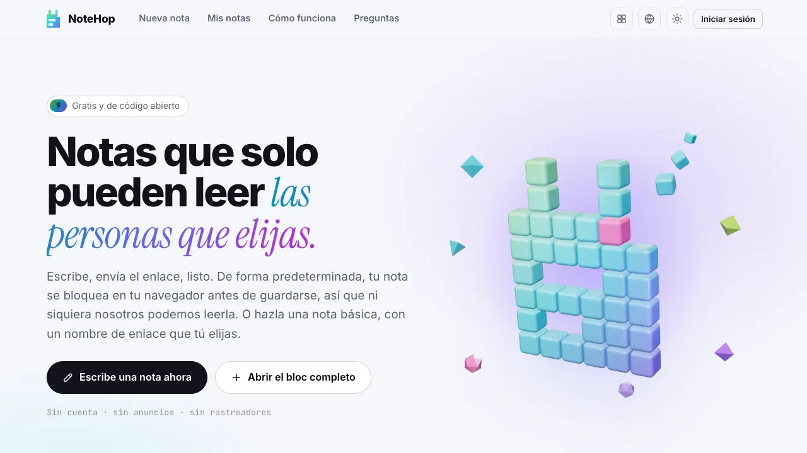

<p align="center">🌐 <a href="README.md">English</a> · <a href="README.zh-CN.md">简体中文</a> · <a href="README.de.md">Deutsch</a> · <a href="README.id.md">Bahasa Indonesia</a> · <a href="README.ja.md">日本語</a> · <a href="README.pt-BR.md">Português (Brasil)</a> · <b>Español</b> · <a href="README.fr.md">Français</a> · <a href="README.ru.md">Русский</a></p>

<p align="center"><picture><source media="(prefers-color-scheme: dark)" srcset="docs/readme/hero-es-dark.webp"></picture></p>

<p align="center"><b>Escribe una nota, envía el enlace y listo.</b><br>Por defecto, la nota se cifra en tu navegador antes de guardarse, así que el servidor almacena un texto que no puede leer.</p>

<p align="center">
  <a href="https://note.hel.ink"><b>Pruébalo en línea</b></a> ·
  <a href="https://navi-crwn.github.io/NoteHop/">Sitio web</a> ·
  <a href="#run-your-own">Alójalo tú mismo</a> ·
  <a href="#encrypted-and-basic-notes">Notas cifradas y básicas</a> ·
  <a href="#faq">Preguntas frecuentes</a> ·
  <a href="docs/SELF-HOSTING.md">Guía de autoalojamiento</a> ·
  <a href="docs/REFERENCE.md">Referencia</a> ·
  <a href="CHANGELOG.md">Registro de cambios</a>
</p>

<p align="center"><sub>Un programa Go y un archivo SQLite · 9 idiomas · sin anuncios ni rastreadores · gratis y de código abierto (MIT)</sub></p>

> [!IMPORTANT]
> Una nota cifrada lleva su clave en el enlace. Quien tenga el enlace puede leer la nota, y si se pierden todas las copias del enlace, nadie puede volver a abrirla, ni el servidor ni las personas que lo gestionan. Una nota básica funciona de otra manera: el servidor guarda su texto como texto plano y puede leerlo. Usa las notas básicas solo para cosas que no te importe que lea quien gestiona el servidor.

NoteHop es una aplicación para compartir notas que puedes alojar tú mismo. Escribes una nota, obtienes un enlace y lo envías. Cada enlace tiene sus propios permisos (solo lectura, puede escribir, solo responder, solo marcar), una nota puede borrarse sola después de leerse, y varias personas pueden escribir en ella a la vez.

Es para quienes:

- envían contraseñas, direcciones o notas privadas por chat y no quieren que se queden en el historial,
- comparten una lista de la compra, una nota de reunión o una hoja de inscripción sin pedir a todos que creen una cuenta,
- quieren un pastebin o un bloc de notas que puedan alojar en su propio servidor, en un solo archivo.

Instálalo con un solo comando. El script revisa tu ordenador, hace unas preguntas y puede configurar también el centro de cuentas HOP ID por ti:

```bash
curl -fsSL https://raw.githubusercontent.com/navi-crwn/NoteHop/main/install.sh | bash
```

Desde un clon: `./install.sh`. Actualiza con `./update.sh` y elimínalo con `./uninstall.sh`. Añade `--yes` para aceptar todos los valores por defecto; `--help` muestra las opciones.

<p align="center"><picture><source media="(prefers-color-scheme: dark)" srcset="docs/readme/demo-dark.webp"></picture></p>

<details>
<summary>Más capturas de pantalla</summary>

<p align="center"><picture><source media="(prefers-color-scheme: dark)" srcset="docs/readme/new-dark.webp"></picture></p>
<p align="center"><picture><source media="(prefers-color-scheme: dark)" srcset="docs/readme/note-dark.webp"></picture></p>
<p align="center"><picture><source media="(prefers-color-scheme: dark)" srcset="docs/readme/share-dark.webp"></picture></p>
<p align="center"><picture><source media="(prefers-color-scheme: dark)" srcset="docs/readme/basic-dark.webp"></picture></p>
<p align="center"><picture><source media="(prefers-color-scheme: dark)" srcset="docs/readme/web-dark.webp"></picture></p>
<p align="center"><picture><source media="(prefers-color-scheme: dark)" srcset="docs/readme/dashboard-dark.webp"></picture></p>
<p align="center"><picture><source media="(prefers-color-scheme: dark)" srcset="docs/readme/tour-dark.webp"></picture></p>
<p align="center"><picture><source media="(prefers-color-scheme: dark)" srcset="docs/readme/phone-dark.webp"></picture></p>

</details>

<a id="encrypted-and-basic-notes"></a>

## Notas cifradas y básicas

Toda nota nueva empieza con una elección.

| | Cifrada (por defecto) | Básica |
|---|---|---|
| Quién puede leer el texto | Quien tenga el enlace completo, que contiene la clave | Quien tenga el enlace, y el servidor |
| Cómo se guarda | Como texto cifrado (AES-256-GCM) | Como texto plano en la base de datos y en sus copias de seguridad |
| Enlace | Aleatorio, con la clave después de `#k=` | Un nombre que eliges, como `/monday-meeting`, o uno aleatorio |
| Contraseña, contraseña señuelo, bloques que se autodestruyen | Sí | No |
| `/raw`, la API de prueba (mock), SSH, tu página pública `/@name` | No | Sí |
| Buscadores | Nunca se indexa | Nunca se indexa |

El propietario puede cambiar una nota de un tipo a otro en el cuadro Compartir. El navegador cifra o descifra el texto y el servidor solo lo sustituye. Los enlaces y los ajustes se mantienen. El historial de versiones se borra, y una nota con líneas añadidas, sugerencias, un señuelo, bloques que se autodestruyen, un buzón o firmas todavía no puede cambiar de tipo.

Los archivos adjuntos y la edición en vivo funcionan en ambos tipos. En una nota básica, el servidor también puede leerlos, porque la clave de un adjunto se guarda en el texto de la nota y las ediciones en vivo no van cifradas.

Las vistas previas de enlaces, por ejemplo en una aplicación de chat, muestran solo que existe una nota y de qué tipo es, nunca su título ni su texto.

<a id="what-the-server-sees"></a>

## Qué ve el servidor

En una nota cifrada:

| Nunca llega al servidor | Lo que sí ve el servidor |
|---|---|
| El título y el texto de la nota | El texto cifrado y su tamaño |
| La clave (va después del `#` del enlace, que los navegadores no envían) | Cuándo se creó, se cambió y se abrió la nota, y cuántas veces |
| Respuestas, sugerencias, nombres de las firmas, mensajes de chat y ediciones en vivo | Qué tipo de enlace se usó (solo lectura, puede escribir y demás) y las direcciones de los enlaces |
| Archivos adjuntos (los archivos también van cifrados) | La caducidad, las horas de bloqueo y de apertura, y las redes permitidas, si los configuras |
| La contraseña de tu cuenta y la lista de tus notas con sus títulos | Qué casillas están marcadas, cuántos votos tiene cada opción de una encuesta y cuántas respuestas hay |
| El texto que envías a la ayuda para escribir (va de tu navegador directamente al proveedor que elijas) | Tu dirección IP, para los límites de uso y los límites de red que configures; tu nombre de usuario, si tienes cuenta |

Hasta dónde llega «el servidor no puede leerla»:

- Se aplica a las notas cifradas. Las notas básicas son legibles. También lo son las funciones que trabajan con texto plano: `/raw`, la API de prueba, SSH, y el buzón y el bot de Telegram, donde el servidor ve el texto al llegar y luego lo guarda sellado con la clave de la nota.
- Depende del código que el servidor envía a tu navegador. El cifrado se ejecuta en JavaScript que entrega el servidor, así que quien lo gestione y modifique ese código podría capturar las claves de quienes abren notas. Una Content Security Policy estricta deja fuera los scripts de terceros, pero no cambia esto. Si te importa, aloja NoteHop tú mismo, lee el código o usa el programa de línea de comandos `notehop`, que cifra en tu propio equipo.
- El enlace es la clave. Quien lo tenga puede leer la nota, incluido cualquier servicio que guarde un enlace que hayas pegado en él.
- Algunos datos se guardan en claro incluso en una nota cifrada: la etiqueta del aviso de contenido y su motivo opcional (hasta 255 caracteres), que se muestran antes de abrir la nota, y el motivo y el mensaje de una denuncia que alguien presente contra una nota.
- Las copias de seguridad de la base de datos contienen todo lo que contiene la base: texto cifrado, el texto de las notas básicas y los registros de las cuentas.

## Funciones

- Cifrada en tu navegador. AES-256-GCM con una clave aleatoria de 256 bits que vive solo en el enlace. Puedes añadir una contraseña encima.
- Muchos enlaces con permisos distintos: solo lectura, puede escribir, solo responder (como un libro de visitas), solo marcar (para listas de tareas) o sugerir cambios. Si se filtra un enlace, desactívalo y los demás siguen funcionando. Un enlace de propietario aparte cambia, comparte, congela o borra la nota.
- Borrar tras leer: la nota se destruye después de abrirse 1, 3 o 10 veces. Los bots de vista previa de las aplicaciones de chat no gastan una apertura, porque quien lee pulsa primero un botón.
- Caducidad y cápsulas del tiempo: la nota desaparece entre 10 minutos y 30 días después, o permanece cerrada hasta la fecha que elijas.
- Tu propia dirección y un código QR para las notas básicas, por ejemplo `/monday-meeting`. El código QR se genera en tu navegador.
- Copias fijas que nadie puede cambiar y aprobación por firma, con la que quienes leen aprueban una versión con su nombre.
- Escribir juntos: ves en directo los cursores y los nombres de los demás, hay un chat al lado y todos pueden seguir a quien presenta. En una nota cifrada, el servidor transmite datos cifrados.
- Bloques en el texto: listas de tareas, encuestas (un voto por persona), formularios, una calculadora, diagramas Mermaid, un tablero Kanban hecho a partir de tus encabezados, diapositivas y bloques secretos tras un PIN o que se autodestruyen.
- Tipos de nota: Simple (como el Bloc de notas), Documento (Markdown con menú `/` y menú de formato con clic derecho), Código (números de línea, nunca se ejecuta, se descarga como `.txt`) y Web.
- Notas web: archivos HTML, CSS y JS en una sola nota, con un botón Ejecutar, el resultado y una consola. El código se ejecuta en un marco aislado de tu navegador, sin acceso a internet ni a la página de la nota, a sus cookies o a su clave. A quien lee se le pregunta antes de ejecutar el código de otra persona.
- Ayuda para escribir, opcional: resumir, reescribir, traducir y corregir la ortografía. Usa la IA integrada de tu navegador, que se queda en tu dispositivo, o tu propia clave de API de Claude, ChatGPT, Gemini, OpenRouter u Ollama. El texto y la clave van de tu navegador al proveedor y nunca pasan por NoteHop.
- Avisos de contenido: marca una nota como 18+ o sensible, con un motivo opcional. Quien lee confirma antes de que se abra la nota, y `/raw` y la API de prueba respetan la misma comprobación.
- Archivos adjuntos: suelta archivos o imágenes en una nota. Se cifran en el navegador, se conservan 24 horas y están limitados a 5 MB por archivo, con un presupuesto de almacenamiento compartido que fija quien gestiona el servidor.
- Las cuentas son opcionales. Con una, tu lista de notas se cifra con una clave que solo abre tu contraseña. Ocho códigos de recuperación de un solo uso te devuelven el acceso si olvidas la contraseña. Quien gestiona el servidor también puede conectar un servidor de cuentas con inicio de sesión único, como HOP ID.
- Privacidad extra: una contraseña señuelo que abre una nota falsa, acceso solo desde ciertas redes, un rastreador de filtraciones que indica por qué enlace salió un texto copiado e historial de versiones con diferencias.
- Cerca: envía un bloc o archivos a un dispositivo de la misma red, directamente de navegador a navegador.
- Para desarrolladores: `/raw` para curl, la CLI `notehop` que cifra en el terminal, una API de prueba a partir de JSON en una nota básica, webhooks de entrada y de salida, SSH y un bot de Telegram.
- Nueve idiomas: English, 简体中文, Deutsch, Bahasa Indonesia, 日本語, Português (Brasil), Español, Français y Русский. Quienes visitan sin sesión ven inglés. Usa el menú del globo o `?lang=xx` para elegir otro.
- Sin anuncios, sin rastreadores, sin scripts de terceros y una aplicación instalable que funciona sin conexión (PWA).
- Denuncias y moderación: cada nota tiene **Denunciar esta nota**. Quienes gestionan el servidor revisan las denuncias con el comando `notehop takedown` o desde un centro de control mediante el [HOP App Protocol](docs/REFERENCE.md#control-center-hop-app-protocol).

<a id="run-your-own"></a>

## Alójalo tú mismo

NoteHop es un programa Go y un archivo SQLite. No necesita Node, ni un paso de compilación, ni otros servicios.

El instalador del principio de esta página es la forma más sencilla en un ordenador que controlas. Para un servidor público, usa una de estas opciones.

En un VPS (systemd, con Caddy o nginx para HTTPS y una copia de seguridad diaria):

```bash
git clone https://github.com/navi-crwn/NoteHop.git && cd NoteHop
sudo DOMAIN=note.example.com ./deploy/install.sh
```

La [guía de autoalojamiento](docs/SELF-HOSTING.md) cubre HTTPS, actualizaciones, copias de seguridad y restauración.

En tu propio ordenador para desarrollar (necesita Go 1.27 o posterior):

```bash
go run ./cmd/notehop -addr 127.0.0.1:8090 -db data/dev.db
```

Abre http://127.0.0.1:8090. Los navegadores solo permiten el cifrado con HTTPS o en localhost.

Con Docker:

```bash
docker build -t notehop .
docker run -d -p 127.0.0.1:8090:8080 -v notehop:/data -e NOTEHOP_BASE_URL=https://note.example.com notehop
```

Cada ajuste es una variable de entorno que empieza por `NOTEHOP_`. Están todas en [docs/REFERENCE.md](docs/REFERENCE.md), junto con el modelo de cifrado y la API.

Copias de seguridad: `notehop backup -db notehop.db copy.db` hace una copia con el servidor en marcha, y solo su propietario puede leer el archivo. El instalador de VPS también configura una copia diaria que se conserva 14 días. Una copia contiene las notas básicas como texto plano, así que guárdala con cuidado.

## Tu primera nota

1. Abre la página de inicio, escribe en el cuadro y mira el texto cifrado que recibiría el servidor.
2. Elige quién puede hacer qué: **Solo lectura**, **Puede escribir** o **Puede responder**. Activa **Lectura única** para un secreto.
3. Pulsa **Crear enlace cifrado** y envía el enlace. No hace falta cuenta.
4. Para más opciones (horarios, privacidad extra, escribir juntos), usa **Abrir el bloc completo** o el botón **Compartir** de cualquier nota tuya. Para una nota básica con nombre de enlace, elige **Básica** en la parte superior de la página Nueva nota.

<a id="faq"></a>

## Preguntas frecuentes

**¿Pueden leer mis notas las personas que gestionan el servidor?**
Una nota cifrada no. Tu navegador la cifra antes de enviarla, y la clave va en la parte del enlace que sigue al `#`, que los navegadores no envían a un servidor. El servidor solo tiene el texto cifrado. Una nota básica sí puede leerla el servidor. Consulta [Qué ve el servidor](#what-the-server-sees) para ver los límites de esta afirmación.

**¿Y si pierdo el enlace?**
En una nota cifrada, nadie podrá volver a abrirla. Si tienes una cuenta, tus notas aparecen en Mis notas y puedes abrirlas desde ahí. Sin cuenta, las notas recientes solo se recuerdan en ese navegador. Una nota básica es fácil de volver a encontrar por el nombre de su enlace.

**¿Es seguro «borrar tras leer» frente a las vistas previas de enlaces?**
Sí. Abrir la página no muestra el contenido. Quien lee pulsa primero un botón, y los bots de vista previa de las aplicaciones de chat reciben una tarjeta de vista previa, no una apertura.

**¿Lee la IA mis notas?**
La ayuda para escribir está desactivada hasta que la uses. La IA integrada de tu navegador funciona en tu dispositivo. Con tu propia clave de API, el texto va de tu navegador directamente a ese proveedor y nunca pasa por NoteHop. Quien gestiona el servidor puede desactivarla con `NOTEHOP_AI=off`.

**¿Puede el código de una nota atacar a quienes la abren?**
Las notas de código nunca se ejecutan. Se muestran como texto y se descargan como `.txt`. Las notas web solo se ejecutan en un marco aislado, sin internet, sin cookies y sin acceso a la página de la nota ni a su clave, y a quien lee se le pregunta antes.

**¿Puedo usar mi propio servidor de inicio de sesión?**
Sí. NoteHop tiene sus propias cuentas y también puede iniciar la sesión mediante un servidor de cuentas que tú gestiones (inicio de sesión único). Consulta los ajustes `NOTEHOP_SSO_*` en [docs/REFERENCE.md](docs/REFERENCE.md).

**¿Qué pasa si alguien comparte algo dañino?**
Cada nota tiene **Denunciar esta nota** en su menú. La denuncia (un motivo y un mensaje breve, nunca el contenido de la nota) llega a quienes gestionan el sitio. No pueden leer una nota cifrada, pero sí retirarla, y el nombre del enlace queda retenido durante un año.

## Bajo el capó

| Carpeta | Qué contiene |
|---|---|
| `cmd/notehop/` | El programa: el servidor, sus ajustes y los comandos `backup`, `new`, `get` y `takedown` |
| `internal/app/` | Manejadores HTTP, funciones de las notas, el relé de escritura conjunta, SSH, Telegram, inicio de sesión único, el HOP App Protocol |
| `internal/db/` | El esquema de SQLite y las migraciones automáticas |
| `internal/client/` | El cifrado de la CLI, el mismo que el del navegador |
| `internal/i18n/` | La carga de los 9 idiomas y una prueba que los mantiene sincronizados |
| `web/templates/`, `web/static/` | Páginas, JavaScript plano y CSS, sin paso de compilación. Las bibliotecas de terceros se incluyen en `web/static/vendor/` |
| `web/i18n/` | Los textos de la interfaz en 9 idiomas, un archivo JSON por idioma |
| `web/changelog.json` | Una instantánea del historial de commits y pull requests, que muestra la página `/changelog`. La genera `scripts/build-changelog.py` |
| `deploy/` | El instalador de VPS, las unidades de systemd, las copias de seguridad y ejemplos de Caddy y nginx |
| `docs/` | El sitio de documentación (GitHub Pages), la referencia, la guía de autoalojamiento y las imágenes del README |
| `scripts/` | Pruebas de navegador (Playwright), todas con `./scripts/e2e-all.sh`, y los scripts auxiliares |

Ejecuta las pruebas con `go test -race ./...` y `./scripts/e2e-all.sh`.

## Seguridad, licencia e historial

- Para informar de una vulnerabilidad, sigue [SECURITY.md](SECURITY.md). Por favor, no abras una incidencia pública para ello.
- [CHANGELOG.md](CHANGELOG.md) enumera los cambios, los más recientes primero.
- NoteHop se publica con la [licencia MIT](LICENSE). Las bibliotecas y fuentes incluidas conservan sus propias licencias, enumeradas en [docs/REFERENCE.md](docs/REFERENCE.md#third-party-code).

<a id="family"></a>

## La familia Hop

NoteHop forma parte de la familia HOP de aplicaciones de código abierto que respetan la privacidad y se pueden alojar uno mismo.

<!-- hop-family:start -->
<!-- Generated from HEL.ink resources/hop-assets/apps.source.json; edit there, then run scripts/hop_assets.py build. -->
| App | Address | Repository | What it does |
| --- | --- | --- | --- |
| **HOP ID** | [hel.ink](https://hel.ink) · accounts at `hub.hel.ink` | [navi-crwn/HEL.ink](https://github.com/navi-crwn/HEL.ink) | One account for every HOP app. |
| **LinkHop** | [link.hel.ink](https://link.hel.ink) · `hel.ink/l/…` | [navi-crwn/LinkHop](https://github.com/navi-crwn/LinkHop) | Short links, QR codes and click analytics. |
| **BioHop** | [bio.hel.ink](https://bio.hel.ink) · `hel.ink/b/…` | [navi-crwn/BioHop](https://github.com/navi-crwn/BioHop) | One link-in-bio page for everything you do. |
| **PixelHop** | [pixel.hel.ink](https://pixel.hel.ink) · `p.hel.ink/…` | [navi-crwn/PixelHop](https://github.com/navi-crwn/PixelHop) | Image hosting with albums and direct links. |
| **NoteHop** | [note.hel.ink](https://note.hel.ink) · `n.hel.ink/…` | [navi-crwn/NoteHop](https://github.com/navi-crwn/NoteHop) | Encrypted notes you share with a link. |
| **FileHop** | [file.hel.ink](https://file.hel.ink) | [navi-crwn/FileHop](https://github.com/navi-crwn/FileHop) | Convert files in your browser; nothing is uploaded. |
| **Imperium** | private (owner only) | private | The HOP control panel. |
<!-- hop-family:end -->
