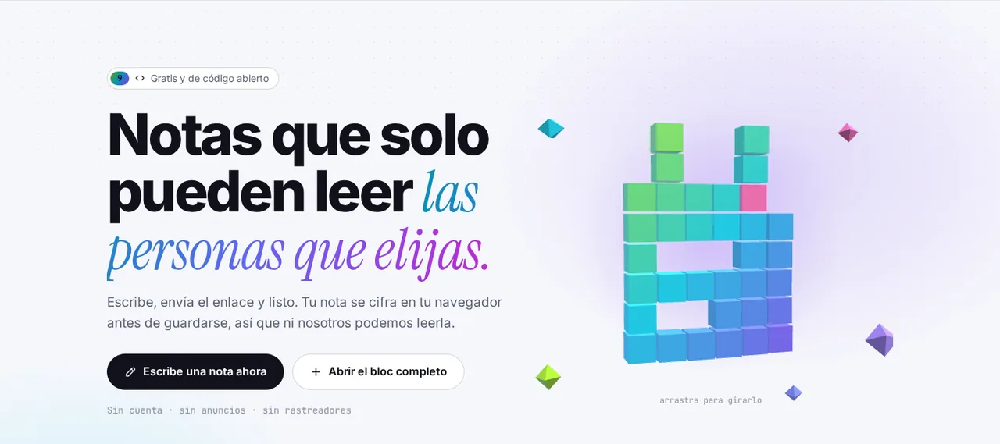

<p align="center">🌐 <a href="README.md">English</a> · <a href="README.zh.md">简体中文</a> · <b>Español</b> · <a href="README.ar.md">العربية</a> · <a href="README.pt.md">Português</a> · <a href="README.fr.md">Français</a> · <a href="README.ja.md">日本語</a> · <a href="README.ru.md">Русский</a> · <a href="README.id.md">Bahasa Indonesia</a></p>

<p align="center"><picture><source media="(prefers-color-scheme: dark)" srcset="docs/readme/hero-es-dark.webp"></picture></p>

<p align="center">
  <b>Escribe una nota, envía el enlace, listo.<br>Se cierra en tu navegador antes de guardarse, así que ni el servidor puede leerla.</b>
</p>

<p align="center">
  <a href="https://note.hel.ink"><b>✍️ Pruébalo en línea</b></a> ·
  <a href="https://navi-crwn.github.io/NoteHop/">Website</a> ·
  <a href="#run-your-own">Instálalo tú</a> ·
  <a href="#features">Funciones</a> ·
  <a href="#faq">Preguntas</a> ·
  <a href="docs/SELF-HOSTING.md">Guía de servidor (EN)</a> ·
  <a href="docs/REFERENCE.md">Referencia (EN)</a> ·
  <a href="CHANGELOG.md">Cambios</a>
</p>

<p align="center"><sub>Un binario Go + un archivo SQLite · 9 idiomas · sin anuncios ni rastreadores · libre y de código abierto (MIT)</sub></p>

> [!IMPORTANT]
> **La clave está en el enlace.** Quien tenga el enlace puede leer la nota, y si pierdes todos los enlaces, nadie podrá abrirla nunca más: ni tú, ni el servidor, ni nosotros. Envía los enlaces a quien corresponda y guarda tu enlace de propietario en un lugar seguro.

---

## ¿Qué es NoteHop?

Piensa en una nota como una carta dentro de una caja con candado. NoteHop cierra la caja **en tu navegador**, pone la llave en el enlace y solo entonces envía la caja al servidor. El servidor guarda una caja que no puede abrir. A quien le des el enlace podrá abrirla ahí mismo, en su propio navegador.

Además, una nota hace mucho más que un bloc de notas: enlaces con permisos distintos (solo lectura, puede escribir, solo responder, solo marcar), borrarse después de leerse, escribir juntos en vivo, listas de tareas, encuestas, formularios, código e incluso pequeñas páginas web que se ejecutan en una caja aislada.

**Es para ti si:**
- envías contraseñas, direcciones o notas privadas por chat y no quieres que se queden en el historial,
- compartes una lista de la compra, unas notas de reunión o una hoja de inscripción sin obligar a todos a crear una cuenta,
- quieres un pastebin o bloc de notas que puedas instalar en tu propio servidor, en un solo archivo.

<p align="center"><picture><source media="(prefers-color-scheme: dark)" srcset="docs/readme/demo-dark.webp"></picture></p>

<details>
<summary><b>Un vistazo más de cerca</b> (interfaz en inglés)</summary>

<p align="center"><picture><source media="(prefers-color-scheme: dark)" srcset="docs/readme/note-dark.webp"></picture></p>
<p align="center"><picture><source media="(prefers-color-scheme: dark)" srcset="docs/readme/share-dark.webp"></picture></p>
<p align="center"><picture><source media="(prefers-color-scheme: dark)" srcset="docs/readme/tour-dark.webp"></picture></p>
<p align="center"><picture><source media="(prefers-color-scheme: dark)" srcset="docs/readme/web-dark.webp"></picture></p>
<p align="center"><picture><source media="(prefers-color-scheme: dark)" srcset="docs/readme/phone-dark.webp"></picture></p>

</details>

## Lo que ve el servidor y lo que nunca ve

| 🙈 Nunca llega al servidor | 👀 Lo que el servidor sí ve |
|---|---|
| El título y el texto de la nota | Texto revuelto (cifrado) y su tamaño |
| La clave (va después del `#` del enlace, que los navegadores nunca envían) | Cuándo se creó, cambió y abrió la nota, y cuántas veces |
| Adjuntos, mensajes de chat y ediciones en vivo (también cerrados) | Qué tipo de enlace se usó (solo lectura, puede escribir…) |
| La contraseña de tu cuenta y tu lista de notas | Qué casillas están marcadas y cuántas respuestas hay |
| El texto que envías a la ayuda de escritura con IA (va de tu navegador directo al proveedor que elijas) | Tu dirección IP, para los límites de uso |

<a id="features"></a>

## Funciones

- **🔒 Cerrada en tu navegador.** AES-256-GCM con una clave aleatoria de 256 bits que solo vive en el enlace. Puedes añadir una contraseña extra.
- **🔗 Muchos enlaces, permisos distintos.** Solo lectura, puede escribir, solo responder (como un libro de visitas) o solo marcar (para listas). ¿Se filtró un enlace? Desactívalo; los demás siguen funcionando.
- **🔑 Enlace de propietario.** Un enlace aparte para cambiar, compartir, congelar o borrar la nota.
- **🔥 Borrar al leer.** Se abre 1, 3 o 10 veces y se destruye. Los bots de vista previa de las apps de chat no gastan lecturas.
- **⏳ Caducidad y cápsulas del tiempo.** Desaparece entre 10 minutos y 30 días después, o queda cerrada hasta la fecha que elijas.
- **🏷️ Dirección propia + QR.** `/reunion-lunes` y un código QR hecho en tu navegador.
- **📌 Copias fijas y firma.** Congela una versión que nadie puede cambiar y deja que los lectores la aprueben con su nombre.
- **🧑‍🤝‍🧑 Escribir juntos.** El cursor y el nombre de cada uno en vivo, un chat al lado y "seguir al presentador". El servidor solo pasa datos cerrados.
- **✅ Bloques inteligentes.** Listas de tareas, encuestas (un voto por persona), formularios, calculadora, diagramas Mermaid, un tablero Kanban desde tus títulos y bloques secretos con PIN o que se destruyen solos.
- **📝 Tipos de nota.** Simple (como el Bloc de notas), Documento (Markdown con menú `/` y menú de formato con clic derecho), Código (números de línea, nunca se ejecuta, se descarga como `.txt`) y Web.
- **🌐 Notas web.** Archivos HTML, CSS y JS en una nota, con botón Ejecutar, el resultado y una consola. El código solo se ejecuta en una caja aislada en tu navegador, sin internet ni acceso a la página, y siempre se pregunta al lector antes de ejecutar código de otra persona.
- **✨ Ayuda para escribir (opcional).** Resumir, reescribir, traducir, corregir ortografía. Usa la IA integrada del navegador (el texto no sale de tu dispositivo) o tu propia clave de API (Claude, ChatGPT, Gemini, OpenRouter u Ollama). NoteHop nunca ve el texto ni la clave.
- **📎 Adjuntos.** Arrastra archivos o imágenes a una nota; también van cerrados y se guardan 24 horas.
- **👤 La cuenta es opcional.** Con una, tu lista de notas se cierra con una clave que solo abre tu contraseña. Los códigos de recuperación te devuelven el acceso si la olvidas.
- **🕵️ Privacidad extra.** Contraseña señuelo (abre una nota falsa), solo desde ciertas redes, un rastreador que te dice qué enlace se filtró e historial con diferencias.
- **📶 Dispositivos cercanos.** Envía una nota o archivos a un dispositivo en la misma Wi-Fi, directo de navegador a navegador.
- **🧑‍💻 Para desarrolladores.** `/raw` para curl, un CLI `notehop` que cifra en la terminal, una API simulada desde el JSON de una nota, webhooks de entrada y salida, SSH y un bot de Telegram.
- **🌍 9 idiomas.** English, 简体中文, Español, العربية (de derecha a izquierda), Português, Français, 日本語, Русский y Bahasa Indonesia, según tu navegador.
- **🛡️ Estricto desde el principio.** Política de seguridad de contenido estricta, sin scripts de terceros, sin anuncios ni rastreadores, `noindex`, límites de uso. Funciona sin conexión como app instalable (PWA).

<a id="run-your-own"></a>

## Instálalo tú

NoteHop es **un binario Go y un archivo SQLite**. Sin Node, sin paso de compilación, sin otros servicios.

**Opción 1: en un VPS** (systemd + Caddy o nginx, copias diarias)

```bash
git clone https://github.com/navi-crwn/NoteHop.git && cd NoteHop
sudo DOMAIN=note.example.com ./deploy/install.sh
```

La guía completa, con HTTPS, actualizaciones, copias de seguridad y restauración, está en **[docs/SELF-HOSTING.md](docs/SELF-HOSTING.md)** (en inglés).

**Opción 2: en tu ordenador** (necesita Go 1.27+)

```bash
go run ./cmd/notehop -addr 127.0.0.1:8090 -db data/dev.db
```

Abre http://127.0.0.1:8090. Los navegadores solo permiten este cifrado en **HTTPS o localhost**.

**Opción 3: Docker**

```bash
docker build -t notehop .
docker run -d -p 127.0.0.1:8090:8080 -v notehop:/data -e NOTEHOP_BASE_URL=https://note.example.com notehop
```

Cada ajuste es una variable de entorno (`NOTEHOP_*`). Están todas en **[docs/REFERENCE.md](docs/REFERENCE.md)**, junto con el modelo de cifrado y la API.

## Tu primera nota

1. Abre la página de inicio, escribe en el cuadro y mira el texto revuelto que recibiría el servidor.
2. Elige quién puede hacer qué: **Solo lectura**, **Puede escribir** o **Puede responder**. Marca **Lectura única** para un secreto.
3. Pulsa **Crear enlace** y envíalo. Eso es todo, sin cuenta.
4. ¿Quieres más (tiempos, privacidad extra, escribir juntos)? Usa **Abrir el bloc completo**, o el botón **Compartir** en cualquier nota tuya.

<a id="faq"></a>

## Preguntas frecuentes

**¿Pueden leer mis notas quienes gestionan el servidor?**
No. La nota se cierra en tu navegador antes de enviarse, y la clave está en la parte del enlace después del `#`, que los navegadores nunca envían a un servidor. El servidor solo tiene texto revuelto.

**¿Y si pierdo el enlace?**
Entonces nadie puede abrir la nota. Si tienes cuenta, tus notas aparecen en **Mis notas** y puedes abrirlas desde ahí. Sin cuenta, las notas recientes solo se recuerdan en este navegador.

**¿"Borrar al leer" es seguro frente a las vistas previas de enlaces?**
Sí. Abrir la página no muestra el contenido; el lector pulsa primero un botón. Los bots de vista previa de las apps de chat reciben una tarjeta, no una lectura.

**¿La IA lee mis notas?**
La ayuda para escribir está apagada hasta que la eliges. La IA integrada del navegador trabaja en tu dispositivo. Con tu propia clave de API, el texto va de tu navegador directamente a ese proveedor, nunca a través de NoteHop. Quien gestiona el servidor puede apagar la IA con `NOTEHOP_AI=off`.

**¿El código de una nota puede atacar a quien la abre?**
Las notas de código nunca se ejecutan: se muestran como texto y se descargan como `.txt`. Las notas web solo se ejecutan en un marco aislado sin internet, sin cookies y sin acceso a la página de la nota ni a su clave, y siempre se pregunta antes al lector.

**¿Puedo usar mi propio servidor de inicio de sesión?**
Sí. NoteHop tiene sus propias cuentas y también puede iniciar sesión a través de un servidor de cuentas tuyo (inicio de sesión único). Mira `NOTEHOP_SSO_*` en [docs/REFERENCE.md](docs/REFERENCE.md).

**¿Qué pasa si alguien comparte algo dañino?**
Cada nota tiene **Denunciar esta nota** en su menú. La denuncia (un motivo y un mensaje corto, nunca el contenido de la nota) llega a quienes gestionan el sitio. No pueden leer una nota cifrada, pero sí retirarla, y el nombre del enlace queda reservado un año. Los operadores revisan las denuncias con el comando `notehop takedown` o desde un centro de control mediante el [HOP App Protocol](docs/REFERENCE.md#control-center-hop-app-protocol).

**¿Cómo hago copias de seguridad?**
`notehop backup -db notehop.db copia.db` funciona con el servidor en marcha. El instalador para VPS también programa una copia diaria. En la copia, las notas siguen cerradas.

## Por dentro

| Carpeta | Qué contiene |
|---|---|
| `cmd/notehop/` | El programa: servidor, ajustes y los comandos `backup`, `new`, `get` y `takedown` |
| `internal/app/` | Manejadores HTTP, funciones de las notas, relé de colaboración en vivo, SSH, Telegram, inicio de sesión único |
| `internal/db/` | Esquema SQLite y migraciones automáticas |
| `internal/client/` | El cifrado del CLI (el mismo que el del navegador) |
| `internal/i18n/` | Carga de los 9 idiomas y una prueba que los mantiene alineados |
| `web/templates/`, `web/static/` | Páginas, JavaScript y CSS sin compilación. Las bibliotecas de terceros están en `web/static/vendor/` |
| `web/i18n/` | Los textos de la interfaz en 9 idiomas |
| `deploy/` | Instalador, unidades systemd, copias de seguridad, ejemplos de Caddy y nginx |
| `scripts/` | Pruebas de navegador (Playwright): `./scripts/e2e-all.sh` ejecuta todas contra un servidor nuevo |

Ejecuta las pruebas con `go test -race ./...` y `./scripts/e2e-all.sh`.

<a id="family"></a>

## La familia Hop

NoteHop forma parte de la familia HOP: apps gratuitas y de código abierto, instalables en tu servidor y sin rastreadores, que comparten una sola cuenta (HOP ID).

<!-- hop-family:start -->
<!-- Generated from HEL.ink resources/hop-assets/apps.source.json; edit there, then run scripts/hop_assets.py build. -->
| App | Address | Repository | What it does |
| --- | --- | --- | --- |
| **HOP ID** | [hel.ink](https://hel.ink) · accounts at `hub.hel.ink` | [navi-crwn/HEL.ink](https://github.com/navi-crwn/HEL.ink) | One account for every HOP app. |
| **LinkHop** | [link.hel.ink](https://link.hel.ink) · `hel.ink/l/…` | [navi-crwn/LinkHop](https://github.com/navi-crwn/LinkHop) | Short links, QR codes and click analytics. |
| **BioHop** | [bio.hel.ink](https://bio.hel.ink) · `hel.ink/b/…` | [navi-crwn/BioHop](https://github.com/navi-crwn/BioHop) | One link-in-bio page for everything you do. |
| **PixelHop** | [pixel.hel.ink](https://pixel.hel.ink) · `p.hel.ink/…` | [navi-crwn/PixelHop](https://github.com/navi-crwn/PixelHop) | Image hosting with albums and direct links. |
| **NoteHop** | [note.hel.ink](https://note.hel.ink) · `n.hel.ink/…` | [navi-crwn/NoteHop](https://github.com/navi-crwn/NoteHop) | Encrypted notes you share with a link. |
| **Imperium** | private (owner only) | private | The HOP control panel. |
<!-- hop-family:end -->

---

<p align="center">Licencia MIT · <a href="docs/REFERENCE.md">Referencia</a> · <a href="docs/SELF-HOSTING.md">Instálalo tú</a> · <a href="CHANGELOG.md">Cambios</a><br><sub>De la familia HEL.ink: <a href="https://github.com/navi-crwn/LinkHop">LinkHop</a> (enlaces cortos) · <a href="https://github.com/navi-crwn/BioHop">BioHop</a> · <a href="https://github.com/navi-crwn/PixelHop">PixelHop</a> (alojamiento de imágenes) · <a href="https://note.hel.ink">NoteHop</a></sub></p>
