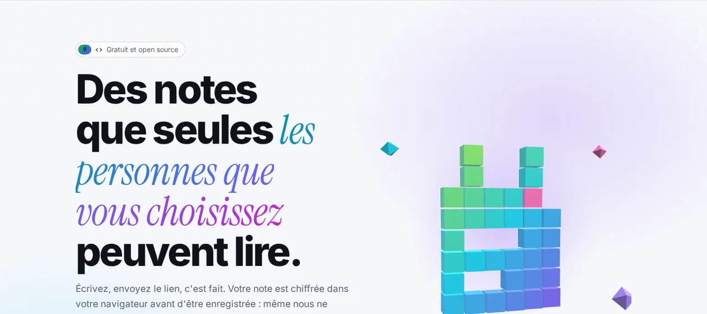
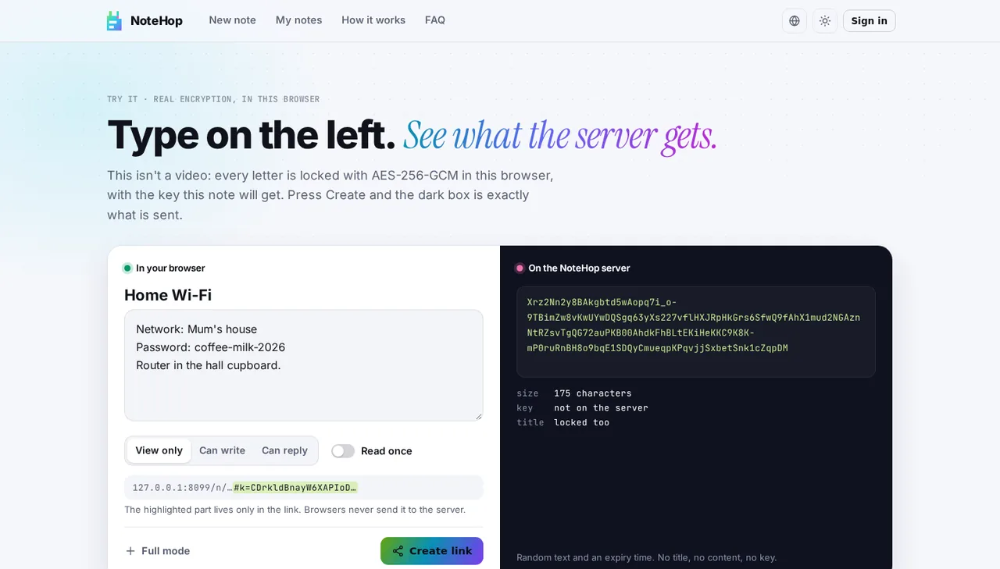
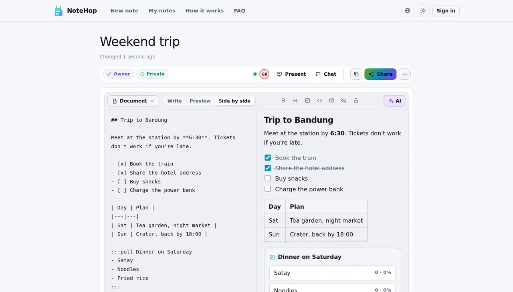
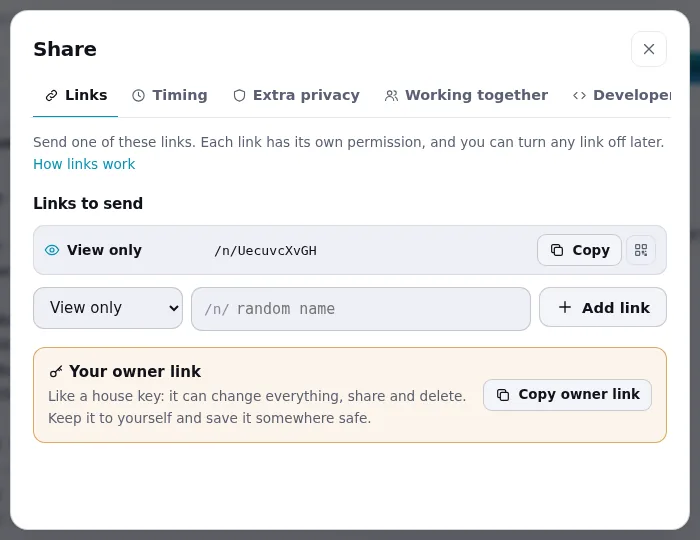
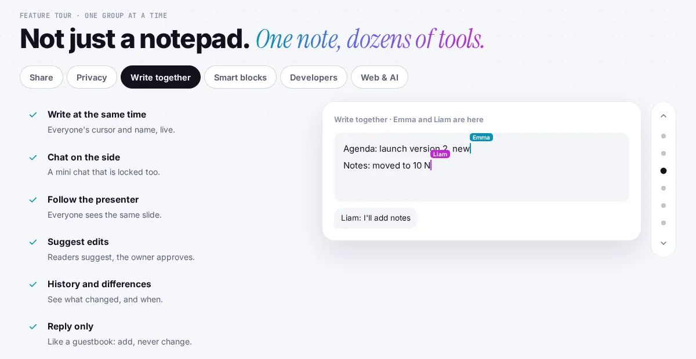
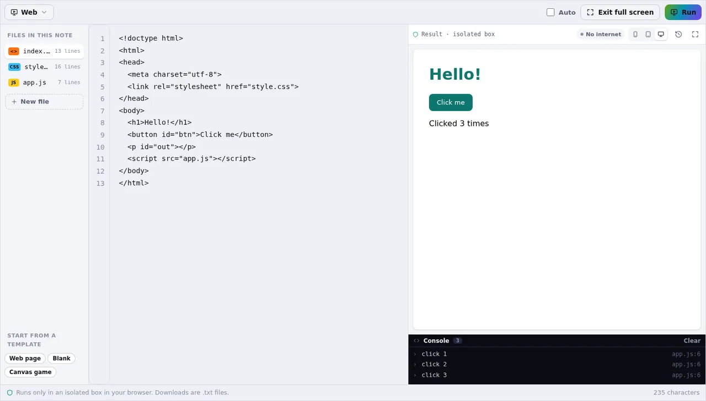
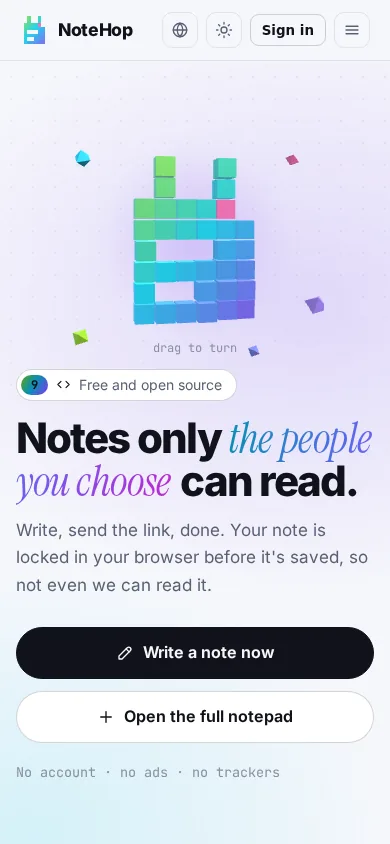

<p align="center">🌐 <a href="README.md">English</a> · <a href="README.zh-CN.md">简体中文</a> · <a href="README.de.md">Deutsch</a> · <a href="README.id.md">Bahasa Indonesia</a> · <a href="README.ja.md">日本語</a> · <a href="README.pt-BR.md">Português (Brasil)</a> · <a href="README.es.md">Español</a> · <b>Français</b> · <a href="README.ru.md">Русский</a></p>

<p align="center"><picture><source media="(prefers-color-scheme: dark)" srcset="docs/readme/hero-fr-dark.webp"></picture></p>

<p align="center">
  <b>Écrivez une note, envoyez le lien, c'est fait.<br>Elle est verrouillée dans votre navigateur avant d'être enregistrée : même le serveur ne peut pas la lire.</b>
</p>

<p align="center">
  <a href="https://note.hel.ink"><b>✍️ Essayer en ligne</b></a> ·
  <a href="https://navi-crwn.github.io/NoteHop/">Website</a> ·
  <a href="#run-your-own">L'héberger soi-même</a> ·
  <a href="#features">Fonctions</a> ·
  <a href="#faq">Questions</a> ·
  <a href="docs/SELF-HOSTING.md">Guide serveur (EN)</a> ·
  <a href="docs/REFERENCE.md">Référence (EN)</a> ·
  <a href="CHANGELOG.md">Nouveautés</a>
</p>

<p align="center"><sub>Un binaire Go + un fichier SQLite · 9 langues · sans pub ni pisteurs · libre et open source (MIT)</sub></p>

> [!IMPORTANT]
> **La clé est dans le lien.** Quiconque a le lien peut lire la note, et si vous perdez tous les liens, plus personne ne pourra l'ouvrir : ni vous, ni le serveur, ni nous. Envoyez les liens aux bonnes personnes et gardez votre lien de propriétaire en lieu sûr.

---

Installez en une commande (il vérifie d’abord votre ordinateur, pose quelques questions et peut aussi installer le hub HOP ID pour vous) :

```bash
curl -fsSL https://raw.githubusercontent.com/navi-crwn/NoteHop/main/install.sh | bash
```

Depuis un clone : `./install.sh` · mise à jour : `./update.sh` · suppression : `./uninstall.sh`. `--yes` prend toutes les valeurs par défaut ; `--help` liste les options.

## NoteHop, c'est quoi ?

Imaginez une note comme une lettre dans une boîte fermée à clé. NoteHop ferme la boîte **dans votre navigateur**, met la clé dans le lien, et seulement ensuite envoie la boîte au serveur. Le serveur garde une boîte qu'il ne peut pas ouvrir. La personne à qui vous donnez le lien l'ouvre sur place, dans son propre navigateur.

En plus, une note fait bien plus qu'un bloc-notes : des liens avec des droits différents (lecture seule, peut écrire, réponse seule, cases seulement), la suppression après lecture, l'écriture à plusieurs en direct, des listes à cocher, des sondages, des formulaires, du code, et même de petites pages web qui tournent dans une boîte isolée.

**C'est pour vous si vous :**
- envoyez des mots de passe, des adresses ou des notes privées par messagerie sans vouloir qu'ils restent dans l'historique,
- partagez une liste de courses, un compte rendu de réunion ou une liste d'inscription sans obliger tout le monde à créer un compte,
- voulez un pastebin ou un bloc-notes à héberger sur votre propre serveur, en un seul fichier.

<p align="center"><picture><source media="(prefers-color-scheme: dark)" srcset="docs/readme/demo-dark.webp"></picture></p>

<details>
<summary><b>De plus près</b> (interface en anglais)</summary>

<p align="center"><picture><source media="(prefers-color-scheme: dark)" srcset="docs/readme/note-dark.webp"></picture></p>
<p align="center"><picture><source media="(prefers-color-scheme: dark)" srcset="docs/readme/share-dark.webp"></picture></p>
<p align="center"><picture><source media="(prefers-color-scheme: dark)" srcset="docs/readme/tour-dark.webp"></picture></p>
<p align="center"><picture><source media="(prefers-color-scheme: dark)" srcset="docs/readme/web-dark.webp"></picture></p>
<p align="center"><picture><source media="(prefers-color-scheme: dark)" srcset="docs/readme/phone-dark.webp"></picture></p>

</details>

## Ce que voit le serveur, et ce qu'il ne voit jamais

| 🙈 N'atteint jamais le serveur | 👀 Ce que le serveur voit |
|---|---|
| Le titre et le texte de la note | Du texte brouillé (chiffré) et sa taille |
| La clé (elle est après le `#` du lien, que les navigateurs n'envoient jamais) | Quand la note a été créée, modifiée et ouverte, et combien de fois |
| Pièces jointes, messages de discussion et modifications en direct (verrouillés aussi) | Le type de lien utilisé (lecture seule, peut écrire…) |
| Le mot de passe de votre compte et votre liste de notes | Les cases cochées, et le nombre de réponses |
| Le texte que vous envoyez à l'aide à l'écriture par IA (il part de votre navigateur directement chez le fournisseur choisi) | Votre adresse IP, pour limiter les abus |

<a id="features"></a>

## Fonctions

- **🔒 Verrouillée dans votre navigateur.** AES-256-GCM avec une clé aléatoire de 256 bits qui n'existe que dans le lien. Vous pouvez ajouter un mot de passe en plus.
- **🔗 Plusieurs liens, des droits différents.** Lecture seule, peut écrire, réponse seule (comme un livre d'or) ou cases seulement (pour les listes). Un lien a fuité ? Coupez-le ; les autres continuent.
- **🔑 Lien de propriétaire.** Un lien à part pour modifier, partager, figer ou supprimer la note.
- **🔥 Supprimer après lecture.** Ouverte 1, 3 ou 10 fois, puis détruite. Les robots d'aperçu des messageries ne consomment pas d'ouverture.
- **⏳ Expiration et capsules temporelles.** Disparaît après 10 minutes à 30 jours, ou reste verrouillée jusqu'à la date choisie.
- **🏷️ Adresse personnalisée + QR.** `/reunion-lundi`, et un QR code créé dans votre navigateur.
- **📌 Copies figées et signature.** Figez une version que personne ne peut modifier, et laissez les lecteurs l'approuver avec leur nom.
- **🧑‍🤝‍🧑 Écrire à plusieurs.** Le curseur et le nom de chacun en direct, une discussion à côté et « suivre le présentateur ». Le serveur ne fait que relayer des données verrouillées.
- **✅ Blocs malins.** Listes à cocher, sondages (un vote par personne), formulaires, calculatrice, diagrammes Mermaid, un tableau Kanban à partir de vos titres, et des blocs secrets sous PIN ou qui s'autodétruisent.
- **📝 Types de note.** Simple (comme le Bloc-notes), Document (Markdown avec un menu `/` et un menu de mise en forme au clic droit), Code (numéros de ligne, jamais exécuté, téléchargé en `.txt`) et Web.
- **🌐 Notes web.** Des fichiers HTML, CSS et JS dans une note, avec un bouton Exécuter, le résultat et une console. Le code ne tourne que dans une boîte isolée de votre navigateur, sans internet ni accès à la page, et on demande toujours au lecteur avant d'exécuter le code de quelqu'un d'autre.
- **✨ Aide à l'écriture (facultative).** Résumer, reformuler, traduire, corriger l'orthographe. Avec l'IA intégrée du navigateur (le texte reste sur votre appareil) ou votre propre clé d'API (Claude, ChatGPT, Gemini, OpenRouter ou Ollama). NoteHop ne voit jamais ni le texte ni la clé.
- **📎 Pièces jointes.** Glissez des fichiers ou des images dans une note ; ils sont verrouillés aussi et gardés 24 heures.
- **👤 Compte facultatif.** Avec un compte, votre liste de notes est verrouillée par une clé que seul votre mot de passe ouvre. Les codes de récupération vous redonnent l'accès si vous l'oubliez.
- **🕵️ Confidentialité en plus.** Mot de passe leurre (ouvre une fausse note), accès depuis certains réseaux seulement, un traceur qui indique quel lien a fuité, et un historique avec les différences.
- **📶 Appareils à proximité.** Envoyez une note ou des fichiers à un appareil sur le même Wi-Fi, directement de navigateur à navigateur.
- **🧑‍💻 Pour les développeurs.** `/raw` pour curl, une CLI `notehop` qui chiffre dans le terminal, une fausse API à partir du JSON d'une note, des webhooks entrants et sortants, SSH et un bot Telegram.
- **🌍 9 langues.** English, 简体中文, Español, العربية (de droite à gauche), Português, Français, 日本語, Русский et Bahasa Indonesia, selon votre navigateur.
- **🛡️ Strict par défaut.** Une politique de sécurité du contenu stricte, aucun script tiers, sans pub ni pisteurs, `noindex`, des limites de débit. Fonctionne hors ligne comme application installable (PWA).

<a id="run-your-own"></a>

## L'héberger soi-même

NoteHop, c'est **un binaire Go et un fichier SQLite**. Pas de Node, pas d'étape de build, pas d'autres services.

**Option 1 : sur un VPS** (systemd + Caddy ou nginx, sauvegardes quotidiennes)

```bash
git clone https://github.com/navi-crwn/NoteHop.git && cd NoteHop
sudo DOMAIN=note.example.com ./deploy/install.sh
```

Le guide complet, avec HTTPS, mises à jour, sauvegardes et restauration, est dans **[docs/SELF-HOSTING.md](docs/SELF-HOSTING.md)** (en anglais).

**Option 2 : sur votre ordinateur** (Go 1.27+ requis)

```bash
go run ./cmd/notehop -addr 127.0.0.1:8090 -db data/dev.db
```

Ouvrez http://127.0.0.1:8090. Les navigateurs n'autorisent ce chiffrement qu'en **HTTPS ou sur localhost**.

**Option 3 : Docker**

```bash
docker build -t notehop .
docker run -d -p 127.0.0.1:8090:8080 -v notehop:/data -e NOTEHOP_BASE_URL=https://note.example.com notehop
```

Chaque réglage est une variable d'environnement (`NOTEHOP_*`). Elles sont toutes dans **[docs/REFERENCE.md](docs/REFERENCE.md)**, avec le modèle de chiffrement et l'API.

## Votre première note

1. Ouvrez la page d'accueil, tapez dans la zone, et regardez le texte brouillé que recevrait le serveur.
2. Choisissez qui peut faire quoi : **Lecture seule**, **Peut écrire** ou **Peut répondre**. Cochez **Lecture unique** pour un secret.
3. Appuyez sur **Créer le lien** et envoyez-le. C'est tout, sans compte.
4. Envie de plus (durées, confidentialité, écrire à plusieurs) ? Utilisez **Ouvrir le bloc-notes complet**, ou le bouton **Partager** sur une note qui vous appartient.

<a id="faq"></a>

## Questions fréquentes

**Les gens qui gèrent le serveur peuvent-ils lire mes notes ?**
Non. La note est verrouillée dans votre navigateur avant d'être envoyée, et la clé se trouve dans la partie du lien après `#`, que les navigateurs n'envoient jamais à un serveur. Le serveur n'a que du texte brouillé.

**Et si je perds le lien ?**
Alors personne ne peut ouvrir la note. Avec un compte, vos notes sont listées dans **Mes notes** et vous pouvez les ouvrir depuis là. Sans compte, les notes récentes ne sont gardées en mémoire que dans ce navigateur.

**« Supprimer après lecture » résiste-t-il aux aperçus de liens ?**
Oui. Ouvrir la page n'affiche pas le contenu : le lecteur appuie d'abord sur un bouton. Les robots d'aperçu des messageries reçoivent une carte d'aperçu, pas une lecture.

**L'IA lit-elle mes notes ?**
L'aide à l'écriture reste désactivée tant que vous ne la choisissez pas. L'IA intégrée au navigateur travaille sur votre appareil. Avec votre propre clé d'API, le texte part de votre navigateur directement chez ce fournisseur, jamais par NoteHop. Les responsables du serveur peuvent couper l'IA avec `NOTEHOP_AI=off`.

**Le code d'une note peut-il attaquer ceux qui l'ouvrent ?**
Les notes de code ne sont jamais exécutées : elles s'affichent en texte et se téléchargent en `.txt`. Les notes web ne tournent que dans un cadre isolé, sans internet, sans cookies et sans accès à la page de la note ni à sa clé, et on demande d'abord au lecteur.

**Puis-je utiliser mon propre serveur de connexion ?**
Oui. NoteHop a ses propres comptes et peut aussi connecter les gens via un serveur de comptes que vous gérez (authentification unique). Voir `NOTEHOP_SSO_*` dans [docs/REFERENCE.md](docs/REFERENCE.md).

**Que se passe-t-il si quelqu'un partage quelque chose de nuisible ?**
Chaque note a **Signaler cette note** dans son menu. Le signalement (un motif et un court message, jamais le contenu de la note) arrive aux responsables du site. Ils ne peuvent pas lire une note chiffrée, mais ils peuvent la retirer, et le nom du lien est alors réservé pendant un an. Les opérateurs traitent les signalements avec la commande `notehop takedown` ou depuis un centre de contrôle via le [HOP App Protocol](docs/REFERENCE.md#control-center-hop-app-protocol).

**Comment faire une sauvegarde ?**
`notehop backup -db notehop.db copie.db` fonctionne pendant que le serveur tourne. L'installateur pour VPS met aussi en place une sauvegarde quotidienne. Les notes restent verrouillées dans la sauvegarde.

## Sous le capot

| Dossier | Contenu |
|---|---|
| `cmd/notehop/` | Le programme : serveur, réglages, et les commandes `backup`, `new`, `get` et `takedown` |
| `internal/app/` | Gestionnaires HTTP, fonctions des notes, relais de la collaboration en direct, SSH, Telegram, authentification unique |
| `internal/db/` | Schéma SQLite et migrations automatiques |
| `internal/client/` | Le chiffrement de la CLI (le même que celui du navigateur) |
| `internal/i18n/` | Le chargement des 9 langues, et un test qui les garde alignées |
| `web/templates/`, `web/static/` | Pages, JavaScript et CSS simples, sans build. Les bibliothèques tierces sont dans `web/static/vendor/` |
| `web/i18n/` | Les textes de l'interface en 9 langues |
| `deploy/` | Installateur, unités systemd, sauvegardes, exemples Caddy et nginx |
| `scripts/` | Tests navigateur (Playwright) : `./scripts/e2e-all.sh` les lance tous sur un serveur neuf |

Lancez les tests avec `go test -race ./...` et `./scripts/e2e-all.sh`.

<a id="family"></a>

## La famille Hop

NoteHop fait partie de la famille HOP : des apps gratuites et open source, auto-hébergeables, sans pisteurs, qui partagent un seul compte (HOP ID).

<!-- hop-family:start -->
<!-- Generated from HEL.ink resources/hop-assets/apps.source.json; edit there, then run scripts/hop_assets.py build. -->
| App | Address | Repository | What it does |
| --- | --- | --- | --- |
| **HOP ID** | [hel.ink](https://hel.ink) · accounts at `hub.hel.ink` | [navi-crwn/HEL.ink](https://github.com/navi-crwn/HEL.ink) | One account for every HOP app. |
| **LinkHop** | [link.hel.ink](https://link.hel.ink) · `hel.ink/l/…` | [navi-crwn/LinkHop](https://github.com/navi-crwn/LinkHop) | Short links, QR codes and click analytics. |
| **BioHop** | [bio.hel.ink](https://bio.hel.ink) · `hel.ink/b/…` | [navi-crwn/BioHop](https://github.com/navi-crwn/BioHop) | One link-in-bio page for everything you do. |
| **PixelHop** | [pixel.hel.ink](https://pixel.hel.ink) · `p.hel.ink/…` | [navi-crwn/PixelHop](https://github.com/navi-crwn/PixelHop) | Image hosting with albums and direct links. |
| **NoteHop** | [note.hel.ink](https://note.hel.ink) · `n.hel.ink/…` | [navi-crwn/NoteHop](https://github.com/navi-crwn/NoteHop) | Encrypted notes you share with a link. |
| **Imperium** | private (owner only) | private | The HOP control panel. |
<!-- hop-family:end -->

---

<p align="center">Licence MIT · <a href="docs/REFERENCE.md">Référence</a> · <a href="docs/SELF-HOSTING.md">L'héberger soi-même</a> · <a href="CHANGELOG.md">Nouveautés</a><br><sub>De la famille HEL.ink : <a href="https://github.com/navi-crwn/LinkHop">LinkHop</a> (liens courts) · <a href="https://github.com/navi-crwn/BioHop">BioHop</a> · <a href="https://github.com/navi-crwn/PixelHop">PixelHop</a> (hébergement d'images) · <a href="https://note.hel.ink">NoteHop</a></sub></p>
