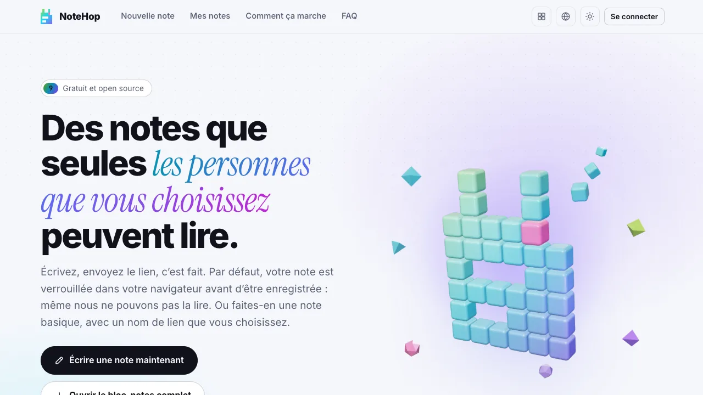

<p align="center">🌐 <a href="README.md">English</a> · <a href="README.zh-CN.md">简体中文</a> · <a href="README.de.md">Deutsch</a> · <a href="README.id.md">Bahasa Indonesia</a> · <a href="README.ja.md">日本語</a> · <a href="README.pt-BR.md">Português (Brasil)</a> · <a href="README.es.md">Español</a> · <b>Français</b> · <a href="README.ru.md">Русский</a></p>

<p align="center"><picture><source media="(prefers-color-scheme: dark)" srcset="docs/readme/hero-fr-dark.webp"></picture></p>

<p align="center"><b>Écrivez une note, envoyez le lien, c'est fini.</b><br>Par défaut, la note est chiffrée dans votre navigateur avant d'être enregistrée : le serveur stocke donc un texte qu'il ne peut pas lire.</p>

<p align="center">
  <a href="https://note.hel.ink"><b>Essayer en ligne</b></a> ·
  <a href="https://navi-crwn.github.io/NoteHop/">Site web</a> ·
  <a href="#run-your-own">L'héberger soi-même</a> ·
  <a href="#encrypted-and-basic-notes">Notes chiffrées et notes basiques</a> ·
  <a href="#faq">FAQ</a> ·
  <a href="docs/SELF-HOSTING.md">Guide d'auto-hébergement</a> ·
  <a href="docs/REFERENCE.md">Référence</a> ·
  <a href="CHANGELOG.md">Journal des modifications</a>
</p>

<p align="center"><sub>Un programme Go et un fichier SQLite · 9 langues · ni publicité ni traceurs · libre et gratuit (MIT)</sub></p>

> [!IMPORTANT]
> Une note chiffrée garde sa clé dans le lien. Quiconque a le lien peut lire la note, et si toutes les copies du lien sont perdues, personne ne peut plus l'ouvrir, ni le serveur ni les personnes qui l'exploitent. Une note basique fonctionne autrement : le serveur stocke son texte en clair et peut le lire. N'utilisez les notes basiques que pour ce que vous acceptez de laisser lire à l'exploitant du serveur.

NoteHop est une application de partage de notes que vous pouvez héberger vous-même. Vous écrivez une note, vous obtenez un lien et vous l'envoyez. Chaque lien a ses propres droits (lecture seule, peut écrire, réponse seule, cocher seulement), une note peut se supprimer après avoir été lue, et plusieurs personnes peuvent y écrire en même temps.

Elle s'adresse aux personnes qui :

- envoient des mots de passe, des adresses ou des notes privées par messagerie et ne veulent pas qu'ils restent dans l'historique,
- partagent une liste de courses, une note de réunion ou une feuille d'inscription sans demander à chacun de créer un compte,
- veulent un pastebin ou un bloc-notes à héberger sur leur propre serveur, dans un seul fichier.

Installez-la avec une seule commande. Le script vérifie votre ordinateur, pose quelques questions et peut aussi mettre en place pour vous le hub de comptes HOP ID :

```bash
curl -fsSL https://raw.githubusercontent.com/navi-crwn/NoteHop/main/install.sh | bash
```

Depuis un clone : `./install.sh`. Mettez à jour avec `./update.sh` et supprimez avec `./uninstall.sh`. Ajoutez `--yes` pour accepter toutes les valeurs par défaut ; `--help` liste les options.

<p align="center"><picture><source media="(prefers-color-scheme: dark)" srcset="docs/readme/demo-dark.webp"></picture></p>

<details>
<summary>Plus de captures d'écran</summary>

<p align="center"><picture><source media="(prefers-color-scheme: dark)" srcset="docs/readme/new-dark.webp"></picture></p>
<p align="center"><picture><source media="(prefers-color-scheme: dark)" srcset="docs/readme/note-dark.webp"></picture></p>
<p align="center"><picture><source media="(prefers-color-scheme: dark)" srcset="docs/readme/share-dark.webp"></picture></p>
<p align="center"><picture><source media="(prefers-color-scheme: dark)" srcset="docs/readme/basic-dark.webp"></picture></p>
<p align="center"><picture><source media="(prefers-color-scheme: dark)" srcset="docs/readme/web-dark.webp"></picture></p>
<p align="center"><picture><source media="(prefers-color-scheme: dark)" srcset="docs/readme/dashboard-dark.webp"></picture></p>
<p align="center"><picture><source media="(prefers-color-scheme: dark)" srcset="docs/readme/tour-dark.webp"></picture></p>
<p align="center"><picture><source media="(prefers-color-scheme: dark)" srcset="docs/readme/phone-dark.webp"></picture></p>

</details>

<a id="encrypted-and-basic-notes"></a>

## Notes chiffrées et notes basiques

Chaque nouvelle note commence par un choix.

| | Chiffrée (par défaut) | Basique |
|---|---|---|
| Qui peut lire le texte | Quiconque a le lien complet, qui contient la clé | Quiconque a le lien, et le serveur |
| Comment elle est stockée | Sous forme de texte chiffré (AES-256-GCM) | En texte clair dans la base de données et dans ses sauvegardes |
| Lien | Aléatoire, avec la clé après `#k=` | Un nom de votre choix, comme `/monday-meeting`, ou un nom aléatoire |
| Mot de passe, mot de passe leurre, blocs qui s'autodétruisent | Oui | Non |
| `/raw`, l'API factice (mock), SSH, votre page publique `/@name` | Non | Oui |
| Moteurs de recherche | Jamais indexée | Jamais indexée |

Le propriétaire peut faire passer une note d'un type à l'autre dans la boîte de dialogue Partager. Le navigateur chiffre ou déchiffre le texte et le serveur ne fait que l'échanger. Les liens et les réglages restent. L'historique des versions est effacé, et une note qui contient des lignes ajoutées, des suggestions, un leurre, des blocs qui s'autodétruisent, une boîte de réception ou des signatures ne peut pas encore changer de type.

Les pièces jointes et l'édition en direct fonctionnent dans les deux types. Dans une note basique, le serveur peut aussi les lire, car la clé d'une pièce jointe est stockée dans le texte de la note et les modifications en direct ne sont pas chiffrées.

Les aperçus de liens, par exemple dans une application de messagerie, montrent seulement qu'une note existe et de quel type elle est, jamais son titre ni son texte.

<a id="what-the-server-sees"></a>

## Ce que voit le serveur

Pour une note chiffrée :

| N'arrive jamais au serveur | Ce que le serveur voit |
|---|---|
| Le titre et le texte de la note | Le texte chiffré et sa taille |
| La clé (elle se trouve après le `#` du lien, que les navigateurs n'envoient pas) | Quand la note a été créée, modifiée et ouverte, et combien de fois |
| Les réponses, les suggestions, les noms des signatures, les messages de discussion et les modifications en direct | Le type de lien utilisé (lecture seule, peut écrire, etc.) et les adresses des liens |
| Les pièces jointes (les fichiers sont chiffrés aussi) | L'expiration, les heures de verrouillage et d'ouverture, et les réseaux autorisés, si vous les définissez |
| Le mot de passe de votre compte et la liste de vos notes avec leurs titres | Les cases cochées, le nombre de votes de chaque option d'un sondage et le nombre de réponses |
| Le texte que vous envoyez à l'aide à la rédaction (il va de votre navigateur directement au fournisseur que vous choisissez) | Votre adresse IP, pour les limites de débit et les limites de réseau que vous définissez ; votre nom d'utilisateur si vous avez un compte |

Jusqu'où va « le serveur ne peut pas la lire » :

- Cela vaut pour les notes chiffrées. Les notes basiques sont lisibles. Les fonctions qui travaillent sur du texte clair le sont aussi : `/raw`, l'API factice, SSH, ainsi que la boîte de réception et le bot Telegram, où le serveur voit le texte à son arrivée puis le stocke scellé avec la clé de la note.
- Cela dépend du code que le serveur envoie à votre navigateur. Le chiffrement s'exécute dans du JavaScript fourni par le serveur : un exploitant qui modifierait ce code pourrait donc capturer les clés des personnes qui ouvrent des notes. Une Content Security Policy stricte tient les scripts tiers à l'écart, mais n'y change rien. Si cela compte pour vous, hébergez NoteHop vous-même, lisez le code ou utilisez le programme en ligne de commande `notehop`, qui chiffre sur votre propre machine.
- Le lien est la clé. Quiconque le détient peut lire la note, y compris tout service qui conserve un lien que vous y avez collé.
- Certains détails sont stockés lisibles même pour une note chiffrée : l'étiquette de l'avertissement de contenu et son motif facultatif (jusqu'à 255 caractères), affichés avant l'ouverture de la note, ainsi que le motif et le message d'un signalement déposé contre une note.
- Les sauvegardes de la base de données contiennent tout ce que contient la base : le texte chiffré, le texte des notes basiques et les données des comptes.

## Fonctions

- Chiffrée dans votre navigateur. AES-256-GCM avec une clé aléatoire de 256 bits qui ne vit que dans le lien. Vous pouvez ajouter un mot de passe en plus.
- Plusieurs liens avec des droits différents : lecture seule, peut écrire, réponse seule (comme un livre d'or), cocher seulement (pour les listes de tâches) ou proposer des modifications. Si un lien fuit, désactivez-le seul et les autres continuent de fonctionner. Un lien de propriétaire distinct modifie, partage, fige ou supprime la note.
- Suppression après lecture : la note est détruite après avoir été ouverte 1, 3 ou 10 fois. Les robots d'aperçu des applications de messagerie ne consomment pas d'ouverture, car la personne qui lit appuie d'abord sur un bouton.
- Expiration et capsules temporelles : la note disparaît après 10 minutes à 30 jours, ou reste fermée jusqu'à une date de votre choix.
- Votre propre adresse et un code QR pour les notes basiques, par exemple `/monday-meeting`. Le code QR est généré dans votre navigateur.
- Des copies figées que personne ne peut modifier, et la validation par signature, avec laquelle les lecteurs approuvent une version en y mettant leur nom.
- Écrire ensemble : vous voyez en direct les curseurs et les noms des autres, il y a une discussion sur le côté et chacun peut suivre la personne qui présente. Dans une note chiffrée, le serveur relaie des données chiffrées.
- Des blocs dans le texte : listes de tâches, sondages (une voix par personne), formulaires, calculatrice, diagrammes Mermaid, tableau Kanban construit à partir de vos titres, diapositives, et blocs secrets derrière un code PIN ou qui s'autodétruisent.
- Types de note : Simple (comme le Bloc-notes), Document (Markdown avec un menu `/` et un menu de mise en forme au clic droit), Code (numéros de ligne, jamais exécuté, téléchargé en `.txt`) et Web.
- Notes web : des fichiers HTML, CSS et JS dans une seule note, avec un bouton Exécuter, le résultat et une console. Le code s'exécute dans un cadre isolé de votre navigateur, sans accès à internet ni à la page de la note, à ses cookies ou à sa clé. On demande d'abord au lecteur avant d'exécuter le code de quelqu'un d'autre.
- Aide à la rédaction, facultative : résumer, reformuler, traduire et corriger l'orthographe. Elle utilise l'IA intégrée à votre navigateur, qui reste sur votre appareil, ou votre propre clé d'API pour Claude, ChatGPT, Gemini, OpenRouter ou Ollama. Le texte et la clé vont de votre navigateur au fournisseur sans jamais passer par NoteHop.
- Avertissements de contenu : marquez une note comme 18+ ou sensible, avec un motif facultatif. Le lecteur confirme avant l'ouverture de la note, et `/raw` et l'API factice respectent la même vérification.
- Pièces jointes : déposez des fichiers ou des images dans une note. Elles sont chiffrées dans le navigateur, conservées 24 heures et limitées à 20 Mo par note (un fichier peut tout utiliser), avec un budget de stockage partagé que l'exploitant peut régler.
- Les comptes sont facultatifs. Avec un compte, la liste de vos notes est chiffrée avec une clé que seul votre mot de passe ouvre. Huit codes de récupération à usage unique vous permettent de revenir si vous oubliez le mot de passe. Les exploitants peuvent aussi brancher un serveur de comptes à authentification unique, comme HOP ID.
- Confidentialité renforcée : un mot de passe leurre qui ouvre une fausse note, un accès limité à certains réseaux, un traceur de fuite qui indique par quel lien un texte copié est sorti, et un historique des versions avec les différences.
- À proximité : envoyez un bloc ou des fichiers à un appareil du même réseau, directement de navigateur à navigateur.
- Pour les développeurs : `/raw` pour curl, la CLI `notehop` qui chiffre dans le terminal, une API factice à partir du JSON d'une note basique, des webhooks entrants et sortants, SSH et un bot Telegram.
- Neuf langues : English, 简体中文, Deutsch, Bahasa Indonesia, 日本語, Português (Brasil), Español, Français et Русский. Les visiteurs anonymes voient l'anglais. Utilisez le menu du globe ou `?lang=xx` pour en choisir une autre.
- Ni publicité, ni traceurs, ni scripts tiers, et une application hors ligne installable (PWA).
- Signalement et modération : chaque note a **Signaler cette note**. Les exploitants examinent les signalements avec la commande `notehop takedown` ou depuis un centre de contrôle via le [HOP App Protocol](docs/REFERENCE.md#control-center-hop-app-protocol).

<a id="run-your-own"></a>

## L'héberger soi-même

NoteHop est un programme Go et un fichier SQLite. Il n'a besoin ni de Node, ni d'étape de compilation, ni d'autres services.

L'installateur au début de cette page est le moyen le plus simple sur un ordinateur que vous contrôlez. Pour un serveur public, utilisez l'une de ces options.

Sur un VPS (systemd, avec Caddy ou nginx pour le HTTPS et une sauvegarde quotidienne) :

```bash
git clone https://github.com/navi-crwn/NoteHop.git && cd NoteHop
sudo DOMAIN=note.example.com ./deploy/install.sh
```

Le [guide d'auto-hébergement](docs/SELF-HOSTING.md) couvre le HTTPS, les mises à jour, les sauvegardes et la restauration.

Sur votre propre ordinateur pour développer (nécessite Go 1.27 ou plus récent) :

```bash
go run ./cmd/notehop -addr 127.0.0.1:8090 -db data/dev.db
```

Ouvrez http://127.0.0.1:8090. Les navigateurs n'autorisent le chiffrement que sur HTTPS ou sur localhost.

Avec Docker :

```bash
docker build -t notehop .
docker run -d -p 127.0.0.1:8090:8080 -v notehop:/data -e NOTEHOP_BASE_URL=https://note.example.com notehop
```

Chaque réglage est une variable d'environnement qui commence par `NOTEHOP_`. Elles sont toutes listées dans [docs/REFERENCE.md](docs/REFERENCE.md), avec le modèle de chiffrement et l'API.

Sauvegardes : `notehop backup -db notehop.db copy.db` fait une copie pendant que le serveur tourne, et seul son propriétaire peut lire le fichier. L'installateur de VPS met aussi en place une sauvegarde quotidienne, conservée 14 jours. Une sauvegarde contient les notes basiques en texte clair, conservez-la donc avec soin.

## Votre première note

1. Ouvrez la page d'accueil, tapez dans la zone et regardez le texte brouillé que le serveur recevrait.
2. Choisissez qui peut faire quoi : **Lecture seule**, **Peut écrire** ou **Peut répondre**. Activez **Lecture unique** pour un secret.
3. Appuyez sur **Créer un lien chiffré** et envoyez le lien. Aucun compte n'est nécessaire.
4. Pour aller plus loin (horaires, confidentialité renforcée, écriture à plusieurs), utilisez **Ouvrir le bloc-notes complet** ou le bouton **Partager** de n'importe quelle note qui vous appartient. Pour une note basique avec un nom de lien, choisissez **Basique** en haut de la page Nouvelle note.

<a id="faq"></a>

## FAQ

**Les personnes qui exploitent le serveur peuvent-elles lire mes notes ?**
Pas une note chiffrée. Votre navigateur la chiffre avant de l'envoyer, et la clé se trouve dans la partie du lien après le `#`, que les navigateurs n'envoient pas à un serveur. Le serveur n'a que le texte brouillé. Une note basique, le serveur peut la lire. Voir [Ce que voit le serveur](#what-the-server-sees) pour les limites de cette affirmation.

**Et si je perds le lien ?**
Pour une note chiffrée, plus personne ne peut l'ouvrir. Si vous avez un compte, vos notes sont listées dans Mes notes et vous pouvez les ouvrir de là. Sans compte, les notes récentes ne sont mémorisées que dans ce navigateur. Une note basique se retrouve facilement grâce au nom de son lien.

**La « suppression après lecture » est-elle à l'abri des aperçus de liens ?**
Oui. Ouvrir la page n'affiche pas le contenu. La personne qui lit appuie d'abord sur un bouton, et les robots d'aperçu des applications de messagerie reçoivent une carte d'aperçu, pas une ouverture.

**L'IA lit-elle mes notes ?**
L'aide à la rédaction est désactivée tant que vous ne l'utilisez pas. L'IA intégrée à votre navigateur fonctionne sur votre appareil. Avec votre propre clé d'API, le texte va de votre navigateur directement à ce fournisseur, sans jamais passer par NoteHop. Les exploitants peuvent la désactiver avec `NOTEHOP_AI=off`.

**Le code d'une note peut-il attaquer les personnes qui l'ouvrent ?**
Les notes de code ne sont jamais exécutées. Elles s'affichent comme du texte et se téléchargent en `.txt`. Les notes web ne s'exécutent que dans un cadre isolé, sans internet, sans cookies et sans accès à la page de la note ni à sa clé, et on demande d'abord au lecteur.

**Puis-je utiliser mon propre serveur de connexion ?**
Oui. NoteHop a ses propres comptes et peut aussi connecter les personnes par un serveur de comptes que vous exploitez (authentification unique). Voir les réglages `NOTEHOP_SSO_*` dans [docs/REFERENCE.md](docs/REFERENCE.md).

**Que se passe-t-il si quelqu'un partage du contenu nuisible ?**
Chaque note a **Signaler cette note** dans son menu. Le signalement (un motif et un court message, jamais le contenu de la note) parvient aux personnes qui exploitent le site. Elles ne peuvent pas lire une note chiffrée, mais elles peuvent la retirer, et le nom du lien est alors retenu pendant un an.

## Sous le capot

| Dossier | Ce qu'il contient |
|---|---|
| `cmd/notehop/` | Le programme : le serveur, ses réglages et les commandes `backup`, `new`, `get` et `takedown` |
| `internal/app/` | Gestionnaires HTTP, fonctions des notes, relais d'écriture à plusieurs, SSH, Telegram, authentification unique, HOP App Protocol |
| `internal/db/` | Le schéma SQLite et les migrations automatiques |
| `internal/client/` | Le chiffrement de la CLI, identique à celui du navigateur |
| `internal/i18n/` | Le chargement des 9 langues et un test qui les garde synchronisées |
| `web/templates/`, `web/static/` | Pages, JavaScript brut et CSS, sans étape de compilation. Les bibliothèques tierces sont incluses dans `web/static/vendor/` |
| `web/i18n/` | Les textes de l'interface en 9 langues, un fichier JSON par langue |
| `web/changelog.json` | Un instantané de l'historique des commits et des pull requests, affiché sur la page `/changelog`. Généré par `scripts/build-changelog.py` |
| `deploy/` | L'installateur de VPS, les unités systemd, les sauvegardes, des exemples Caddy et nginx |
| `docs/` | Le site de documentation (GitHub Pages), la référence, le guide d'auto-hébergement et les images du README |
| `scripts/` | Les tests de navigateur (Playwright), tous avec `./scripts/e2e-all.sh`, et les scripts utilitaires |

Lancez les tests avec `go test -race ./...` et `./scripts/e2e-all.sh`.

## Sécurité, licence et historique

- Pour signaler une vulnérabilité, suivez [SECURITY.md](SECURITY.md). N'ouvrez pas de ticket public pour cela.
- [CHANGELOG.md](CHANGELOG.md) liste les changements, les plus récents d'abord.
- NoteHop est publié sous la [licence MIT](LICENSE). Les bibliothèques et polices incluses gardent leurs propres licences, listées dans [docs/REFERENCE.md](docs/REFERENCE.md#third-party-code).

<a id="family"></a>

## Auto-hébergement

<!-- self-hosting:start -->
Tout ce dont NoteHop a besoin se trouve dans des dépôts publics : aucun dépôt privé, aucun jeton et aucun compte hel.ink. Les détails sont dans le guide de la famille : [docs/self-hosting.md](https://github.com/navi-crwn/HEL.ink/blob/main/docs/self-hosting.md) (en anglais).

| Élément | Pour NoteHop | Rôle |
| --- | --- | --- |
| [HEL.ink](https://github.com/navi-crwn/HEL.ink) (hub, HOP ID) | Facultatif : ajoute « Se connecter avec HOP ID » | Comptes et connexion pour toutes les apps |
| [Imperium](https://github.com/navi-crwn/Imperium) | Facultatif | Panneau d'administration de toute la famille ; nécessite le hub |
| Polices et tuiles de la famille | Rien à installer : chargés depuis `hel.ink/hop-assets` | Sans hel.ink : polices système, pas de tuiles flottantes |

- **Ordre d'installation** : NoteHop seul avec `./install.sh`. Pour la connexion HOP ID, d'abord le [hub](https://github.com/navi-crwn/HEL.ink) : `./install.sh --hub new` en installe un à côté.
- **Réglages minimaux** : `NOTEHOP_BASE_URL`; avec le hub: `NOTEHOP_SSO_URL`, `NOTEHOP_SSO_CLIENT=notehop`, `NOTEHOP_SSO_SECRET`.
- **Seul ou en famille** : NoteHop fonctionne seul avec ses propres comptes. Avec un hub, on peut aussi se connecter avec HOP ID et se déconnecter de toutes les apps d'un coup.
- **Sans Imperium** : NoteHop continue de fonctionner ; retirez une note avec `notehop takedown` et `notehop backup` sur le serveur.
<!-- self-hosting:end -->

## La famille Hop

NoteHop fait partie de la famille HOP, des applications libres qui respectent la vie privée et qu'on peut héberger soi-même.

<!-- hop-family:start -->
<!-- Generated from HEL.ink resources/hop-assets/apps.source.json; edit there, then run scripts/hop_assets.py build. -->
| App | Address | Repository | What it does |
| --- | --- | --- | --- |
| **HOP ID** | [hel.ink](https://hel.ink) · accounts at `hub.hel.ink` | [navi-crwn/HEL.ink](https://github.com/navi-crwn/HEL.ink) | One account for every HOP app. |
| **LinkHop** | [link.hel.ink](https://link.hel.ink) · `hel.ink/l/…` | [navi-crwn/LinkHop](https://github.com/navi-crwn/LinkHop) | Short links, QR codes and click analytics. |
| **BioHop** | [bio.hel.ink](https://bio.hel.ink) · `hel.ink/b/…` | [navi-crwn/BioHop](https://github.com/navi-crwn/BioHop) | One link-in-bio page for everything you do. |
| **PixelHop** | [pixel.hel.ink](https://pixel.hel.ink) · `p.hel.ink/…` | [navi-crwn/PixelHop](https://github.com/navi-crwn/PixelHop) | Image hosting with albums and direct links. |
| **NoteHop** | [note.hel.ink](https://note.hel.ink) · `n.hel.ink/…` | [navi-crwn/NoteHop](https://github.com/navi-crwn/NoteHop) | Encrypted notes you share with a link. |
| **FileHop** | [file.hel.ink](https://file.hel.ink) | [navi-crwn/FileHop](https://github.com/navi-crwn/FileHop) | Convert files in your browser; nothing is uploaded. |
| **PayHop** | [pay.hel.ink](https://pay.hel.ink) | [navi-crwn/PayHop](https://github.com/navi-crwn/PayHop) | Make a payment QR and split a bill; nothing leaves your browser. |
| **Imperium** | not public-facing: optional, for admins | [navi-crwn/Imperium](https://github.com/navi-crwn/Imperium) | The HOP control panel. |
<!-- hop-family:end -->
