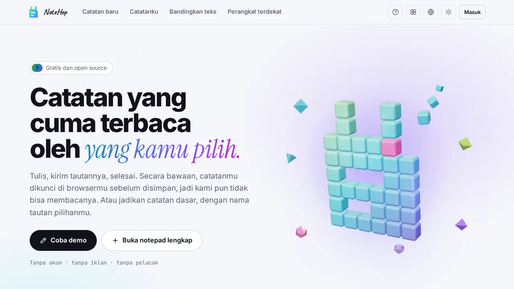
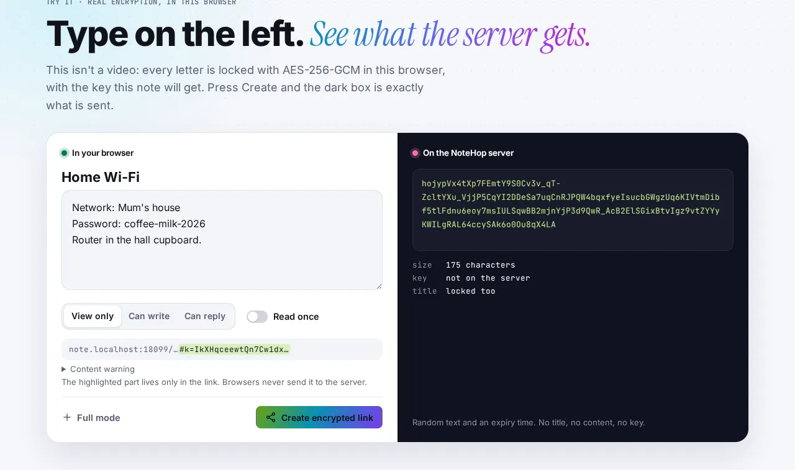
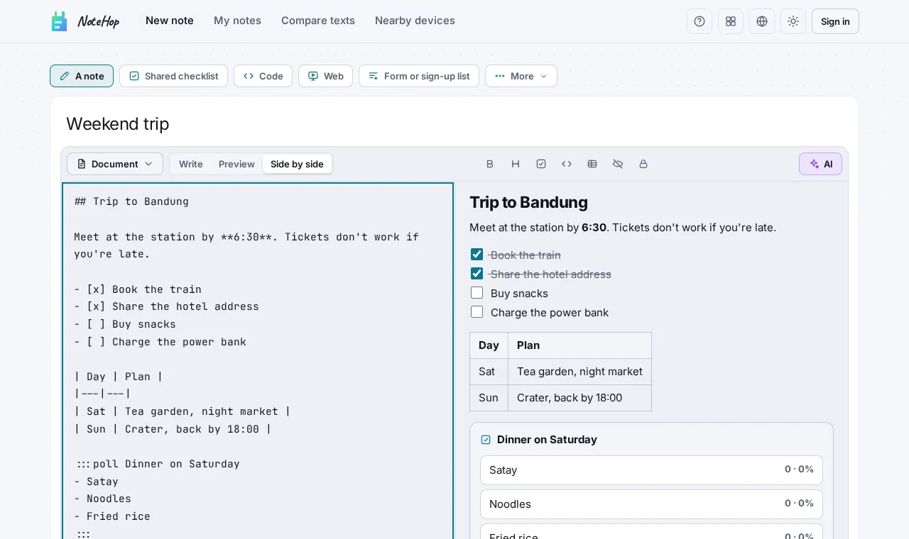
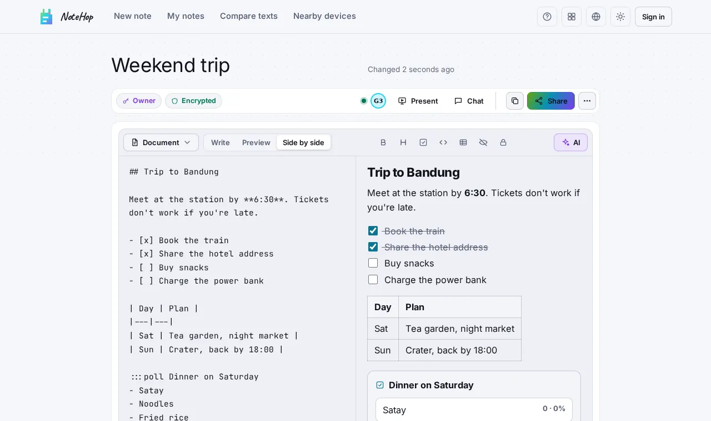
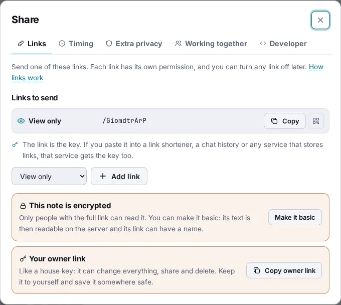
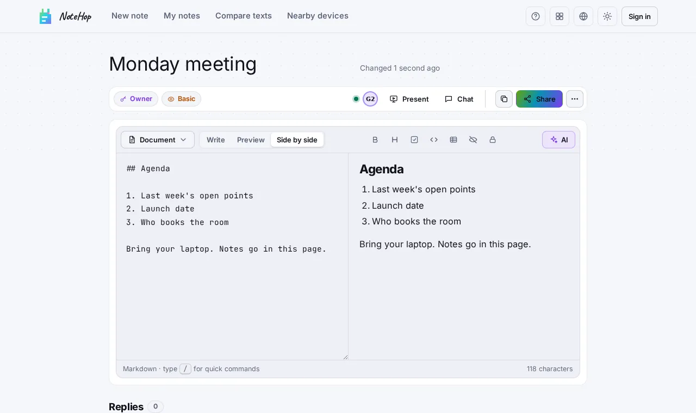
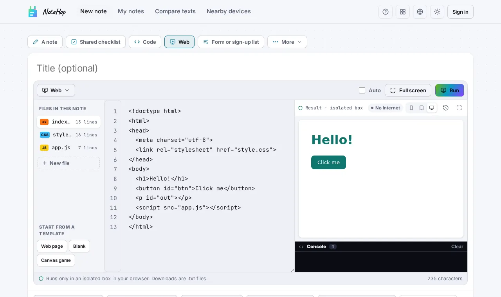
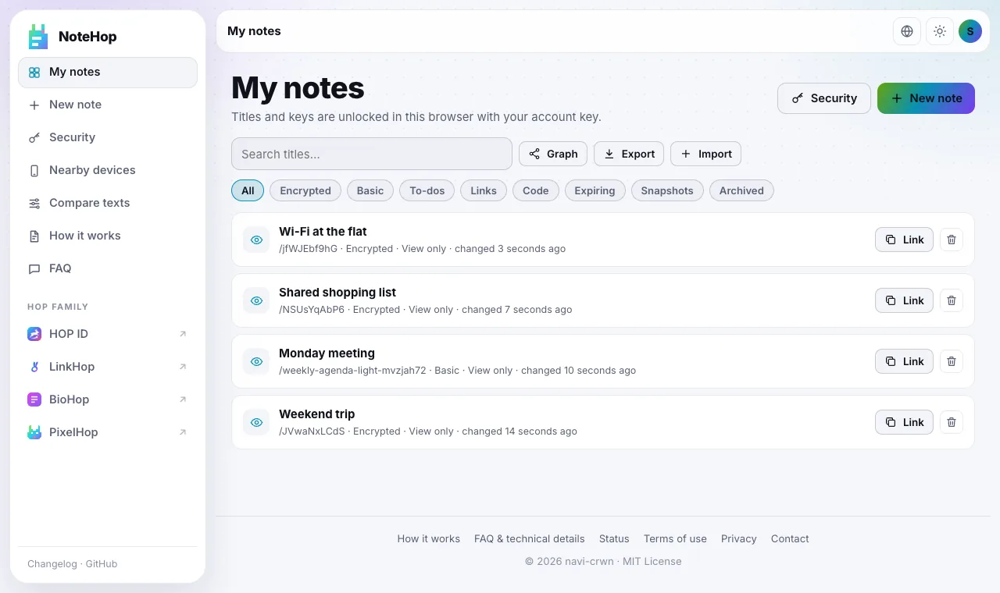
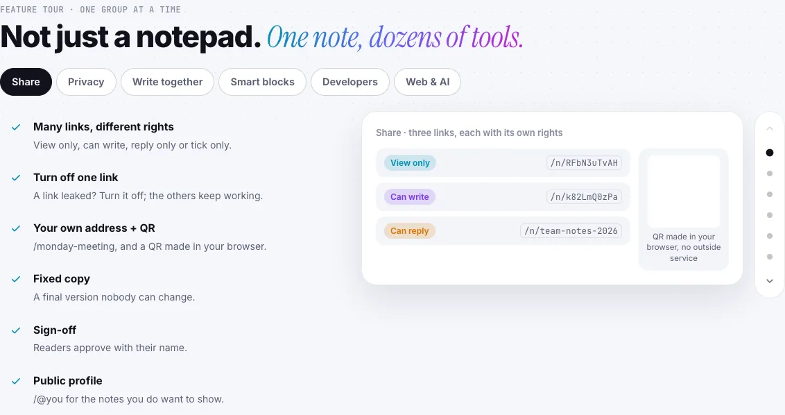
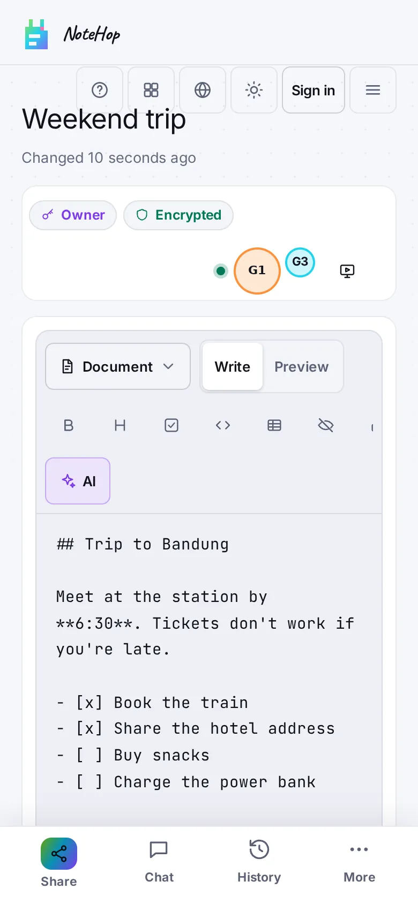

<p align="center">🌐 <a href="README.md">English</a> · <a href="README.zh-CN.md">简体中文</a> · <a href="README.de.md">Deutsch</a> · <b>Bahasa Indonesia</b> · <a href="README.ja.md">日本語</a> · <a href="README.pt-BR.md">Português (Brasil)</a> · <a href="README.es.md">Español</a> · <a href="README.fr.md">Français</a> · <a href="README.ru.md">Русский</a></p>

<p align="center"><picture><source media="(prefers-color-scheme: dark)" srcset="docs/readme/hero-id-dark.webp"></picture></p>

<p align="center"><b>Tulis catatan, kirim tautannya, selesai.</b><br>Secara bawaan, catatan dienkripsi di browser sebelum disimpan, jadi server hanya menyimpan teks yang tidak bisa dibacanya.</p>

<p align="center">
  <a href="https://note.hel.ink"><b>Coba online</b></a> ·
  <a href="https://navi-crwn.github.io/NoteHop/">Situs web</a> ·
  <a href="#run-your-own">Jalankan sendiri</a> ·
  <a href="#encrypted-and-basic-notes">Catatan terenkripsi dan dasar</a> ·
  <a href="#faq">FAQ</a> ·
  <a href="docs/SELF-HOSTING.md">Panduan hosting sendiri</a> ·
  <a href="docs/REFERENCE.md">Referensi</a> ·
  <a href="CHANGELOG.md">Catatan perubahan</a>
</p>

<p align="center"><sub>Satu program Go dan satu file SQLite · 9 bahasa · tanpa iklan, tanpa pelacak · gratis dan sumber terbuka (MIT)</sub></p>

> [!IMPORTANT]
> Catatan terenkripsi menyimpan kuncinya di dalam tautan. Siapa pun yang punya tautannya bisa membaca catatan itu, dan jika semua salinan tautan hilang, tidak ada yang bisa membukanya lagi, termasuk server dan orang yang menjalankannya. Catatan dasar bekerja berbeda: server menyimpan teksnya sebagai teks biasa dan bisa membacanya. Gunakan catatan dasar hanya untuk hal yang tidak masalah jika dibaca operator server.

NoteHop adalah aplikasi berbagi catatan yang bisa Anda jalankan sendiri. Anda menulis catatan, mendapat tautan, lalu mengirimkannya. Setiap tautan punya hak sendiri (hanya baca, bisa menulis, hanya membalas, hanya mencentang), catatan bisa menghapus dirinya setelah dibaca, dan beberapa orang bisa menulis di dalamnya secara bersamaan.

NoteHop cocok untuk orang yang:

- mengirim kata sandi, alamat, atau catatan pribadi lewat chat dan tidak ingin semuanya tertinggal di riwayat,
- membagikan daftar belanja, catatan rapat, atau lembar pendaftaran tanpa meminta semua orang membuat akun,
- ingin pastebin atau notepad yang bisa dijalankan di server sendiri, hanya dalam satu file.

Pasang dengan satu perintah. Skrip memeriksa komputer Anda, mengajukan beberapa pertanyaan, dan bisa sekaligus menyiapkan hub akun HOP ID untuk Anda:

```bash
curl -fsSL https://raw.githubusercontent.com/navi-crwn/NoteHop/main/install.sh | bash
```

Dari hasil clone: `./install.sh`. Perbarui dengan `./update.sh` dan hapus dengan `./uninstall.sh`. Tambahkan `--yes` untuk menerima semua nilai bawaan; `--help` menampilkan opsinya.

<p align="center"><picture><source media="(prefers-color-scheme: dark)" srcset="docs/readme/demo-dark.webp"></picture></p>

<details>
<summary>Tangkapan layar lainnya</summary>

<p align="center"><picture><source media="(prefers-color-scheme: dark)" srcset="docs/readme/new-dark.webp"></picture></p>
<p align="center"><picture><source media="(prefers-color-scheme: dark)" srcset="docs/readme/note-dark.webp"></picture></p>
<p align="center"><picture><source media="(prefers-color-scheme: dark)" srcset="docs/readme/share-dark.webp"></picture></p>
<p align="center"><picture><source media="(prefers-color-scheme: dark)" srcset="docs/readme/basic-dark.webp"></picture></p>
<p align="center"><picture><source media="(prefers-color-scheme: dark)" srcset="docs/readme/web-dark.webp"></picture></p>
<p align="center"><picture><source media="(prefers-color-scheme: dark)" srcset="docs/readme/dashboard-dark.webp"></picture></p>
<p align="center"><picture><source media="(prefers-color-scheme: dark)" srcset="docs/readme/tour-dark.webp"></picture></p>
<p align="center"><picture><source media="(prefers-color-scheme: dark)" srcset="docs/readme/phone-dark.webp"></picture></p>

</details>

<a id="encrypted-and-basic-notes"></a>

## Catatan terenkripsi dan dasar

Setiap catatan baru dimulai dengan satu pilihan.

| | Terenkripsi (bawaan) | Dasar |
|---|---|---|
| Siapa yang bisa membaca teksnya | Siapa pun yang punya tautan lengkap, yang berisi kuncinya | Siapa pun yang punya tautan, dan server |
| Cara penyimpanan | Sebagai teks sandi (AES-256-GCM) | Sebagai teks biasa di database dan di cadangannya |
| Tautan | Acak, dengan kunci setelah `#k=` | Nama pilihan Anda, seperti `/monday-meeting`, atau yang acak |
| Kata sandi, kata sandi umpan, blok yang menghancurkan diri | Ya | Tidak |
| `/raw`, API tiruan (mock), SSH, halaman publik `/@name` Anda | Tidak | Ya |
| Mesin pencari | Tidak pernah diindeks | Tidak pernah diindeks |

Pemilik bisa mengubah catatan dari satu jenis ke jenis lain di dialog Bagikan. Browser mengenkripsi atau mendekripsi teksnya dan server hanya menukarnya. Tautan dan pengaturan tetap. Riwayat versi dihapus, dan catatan yang punya baris tambahan, saran, umpan, blok yang menghancurkan diri, kotak masuk, atau tanda tangan belum bisa diubah jenisnya.

Lampiran dan penulisan langsung bersama berfungsi di kedua jenis. Di catatan dasar, server juga bisa membacanya, karena kunci lampiran disimpan di teks catatan dan suntingan langsung tidak dienkripsi.

Pratinjau tautan, misalnya di aplikasi chat, hanya menunjukkan bahwa ada catatan dan jenisnya, tidak pernah judul atau teksnya.

<a id="what-the-server-sees"></a>

## Apa yang dilihat server

Untuk catatan terenkripsi:

| Tidak pernah sampai ke server | Yang dilihat server |
|---|---|
| Judul dan teks catatan | Teks sandi dan ukurannya |
| Kunci (ada setelah `#` di tautan, yang tidak dikirim browser) | Kapan catatan dibuat, diubah, dan dibuka, serta berapa kali |
| Balasan, saran, nama penanda tangan, pesan obrolan, dan suntingan langsung | Jenis tautan yang dipakai (hanya baca, bisa menulis, dan seterusnya), serta alamat tautan |
| Lampiran (file juga dienkripsi) | Kedaluwarsa, waktu kunci dan waktu buka, serta jaringan yang diizinkan, jika Anda mengaturnya |
| Kata sandi akun Anda dan daftar catatan Anda beserta judulnya | Kotak centang mana yang dicentang, berapa suara tiap pilihan jajak pendapat, dan berapa balasan yang ada |
| Teks yang Anda kirim ke bantuan menulis (langsung dari browser ke penyedia yang Anda pilih) | Alamat IP Anda, untuk pembatasan laju dan batas jaringan yang Anda atur; nama pengguna Anda jika punya akun |

Sejauh mana "server tidak bisa membacanya" berlaku:

- Pernyataan itu berlaku untuk catatan terenkripsi. Catatan dasar bisa dibaca. Begitu pula fitur yang bekerja dengan teks biasa: `/raw`, API tiruan, SSH, serta kotak masuk dan bot Telegram, yang membuat server melihat teksnya saat tiba lalu menyimpannya tersegel dengan kunci catatan.
- Pernyataan itu bergantung pada kode yang dikirim server ke browser Anda. Enkripsi berjalan di JavaScript yang disajikan server, sehingga operator yang mengubah kode itu bisa menangkap kunci dari orang yang membuka catatan. Content Security Policy yang ketat menahan skrip pihak ketiga tetapi tidak mengubah hal ini. Jika ini penting bagi Anda, jalankan NoteHop sendiri, baca kodenya, atau pakai program baris perintah `notehop`, yang mengenkripsi di mesin Anda sendiri.
- Tautan adalah kuncinya. Siapa pun yang memegangnya bisa membaca catatan, termasuk layanan apa pun yang menyimpan tautan yang Anda tempelkan ke dalamnya.
- Beberapa detail disimpan dalam bentuk terbaca bahkan untuk catatan terenkripsi: label peringatan konten dan alasannya yang opsional (hingga 255 karakter), yang ditampilkan sebelum catatan terbuka, serta alasan dan pesan dari laporan yang diajukan seseorang terhadap suatu catatan.
- Cadangan database berisi semua yang ada di database: teks sandi, teks catatan dasar, dan data akun.

## Fitur

- Terenkripsi di browser. AES-256-GCM dengan kunci acak 256-bit yang hanya ada di tautan. Anda bisa menambahkan kata sandi di atasnya.
- Banyak tautan dengan hak berbeda: hanya baca, bisa menulis, hanya membalas (seperti buku tamu), hanya mencentang (untuk daftar centang), atau bisa mengusulkan perubahan. Jika satu tautan bocor, matikan tautan itu saja dan yang lain tetap berfungsi. Tautan pemilik tersendiri mengubah, membagikan, membekukan, atau menghapus catatan.
- Hapus setelah dibaca: catatan dihancurkan setelah dibuka 1, 3, atau 10 kali. Bot pratinjau di aplikasi chat tidak menghabiskan jatah buka, karena pembaca menekan tombol terlebih dahulu.
- Kedaluwarsa dan kapsul waktu: catatan hilang setelah 10 menit hingga 30 hari, atau tetap tertutup sampai tanggal yang Anda pilih.
- Alamat sendiri dan kode QR untuk catatan dasar, misalnya `/monday-meeting`. Kode QR dibuat di browser Anda.
- Salinan tetap yang tidak bisa diubah siapa pun, dan persetujuan tanda tangan, tempat pembaca menyetujui suatu versi dengan nama mereka.
- Menulis bersama: Anda melihat kursor dan nama satu sama lain secara langsung, ada obrolan di samping, dan semua orang bisa mengikuti presenter. Di catatan terenkripsi, server meneruskan data yang terenkripsi.
- Blok di dalam teks: daftar centang, jajak pendapat (satu suara per orang), formulir, kalkulator, diagram Mermaid, papan Kanban dari judul Anda, slide, serta blok rahasia di balik PIN atau yang menghancurkan diri.
- Jenis catatan: Polos (seperti Notepad), Dokumen (Markdown dengan menu `/` dan menu format klik kanan), Kode (nomor baris, tidak pernah dijalankan, diunduh sebagai `.txt`), dan Web.
- Catatan web: file HTML, CSS, dan JS dalam satu catatan, dengan tombol Jalankan, hasil, dan konsol. Kode berjalan di bingkai terisolasi di browser Anda tanpa akses internet dan tanpa akses ke halaman catatan, cookie-nya, atau kuncinya. Pembaca ditanya sebelum kode orang lain dijalankan.
- Bantuan menulis, opsional: meringkas, menulis ulang, menerjemahkan, dan memperbaiki ejaan. Memakai AI bawaan browser, yang tetap di perangkat Anda, atau kunci API Anda sendiri untuk Claude, ChatGPT, Gemini, OpenRouter, atau Ollama. Teks dan kunci dikirim dari browser Anda ke penyedia dan tidak pernah lewat NoteHop.
- Peringatan konten: tandai catatan sebagai 18+ atau sensitif, dengan alasan opsional. Pembaca mengonfirmasi sebelum catatan terbuka, dan `/raw` serta API tiruan menghormati pemeriksaan yang sama.
- Lampiran: seret file atau gambar ke dalam catatan. Lampiran dienkripsi di browser, disimpan 24 jam, dan dibatasi 5 MB per file dengan anggaran penyimpanan bersama yang bisa diatur operator.
- Akun bersifat opsional. Dengan akun, daftar catatan Anda dienkripsi dengan kunci yang hanya bisa dibuka kata sandi Anda. Delapan kode pemulihan sekali pakai membantu Anda masuk lagi jika lupa kata sandi. Operator juga bisa menghubungkan server akun single sign-on, seperti HOP ID.
- Privasi tambahan: kata sandi umpan yang membuka catatan palsu, akses hanya dari jaringan tertentu, pelacak kebocoran yang menunjukkan dari tautan mana teks yang disalin berasal, dan riwayat versi dengan perbedaannya.
- Di sekitar: kirim pad atau file ke perangkat di jaringan yang sama, langsung dari browser ke browser.
- Untuk pengembang: `/raw` untuk curl, CLI `notehop` yang mengenkripsi di terminal, API tiruan dari JSON di catatan dasar, webhook masuk dan keluar, SSH, dan bot Telegram.
- Sembilan bahasa: English, 简体中文, Deutsch, Bahasa Indonesia, 日本語, Português (Brasil), Español, Français, dan Русский. Pengunjung anonim melihat bahasa Inggris. Pakai menu globe atau `?lang=xx` untuk memilih bahasa lain.
- Tanpa iklan, tanpa pelacak, tanpa skrip pihak ketiga, dan aplikasi offline yang bisa dipasang (PWA).
- Laporan dan moderasi: setiap catatan punya **Laporkan catatan ini**. Operator meninjau laporan dengan perintah `notehop takedown` atau dari pusat kendali lewat [HOP App Protocol](docs/REFERENCE.md#control-center-hop-app-protocol).

<a id="run-your-own"></a>

## Jalankan sendiri

NoteHop adalah satu program Go dan satu file SQLite. Tidak perlu Node, tidak ada langkah build, dan tidak ada layanan lain.

Penginstal di bagian atas halaman ini adalah cara termudah di komputer yang Anda kendalikan. Untuk server publik, pakai salah satu cara berikut.

Di VPS (systemd, dengan Caddy atau nginx untuk HTTPS dan cadangan harian):

```bash
git clone https://github.com/navi-crwn/NoteHop.git && cd NoteHop
sudo DOMAIN=note.example.com ./deploy/install.sh
```

[Panduan hosting sendiri](docs/SELF-HOSTING.md) mencakup HTTPS, pembaruan, cadangan, dan pemulihan.

Di komputer Anda sendiri untuk pengembangan (perlu Go 1.27 atau lebih baru):

```bash
go run ./cmd/notehop -addr 127.0.0.1:8090 -db data/dev.db
```

Buka http://127.0.0.1:8090. Browser hanya mengizinkan enkripsi di HTTPS atau di localhost.

Dengan Docker:

```bash
docker build -t notehop .
docker run -d -p 127.0.0.1:8090:8080 -v notehop:/data -e NOTEHOP_BASE_URL=https://note.example.com notehop
```

Setiap pengaturan adalah variabel lingkungan yang diawali `NOTEHOP_`. Semuanya tercantum di [docs/REFERENCE.md](docs/REFERENCE.md), bersama model enkripsi dan API.

Cadangan: `notehop backup -db notehop.db copy.db` membuat salinan saat server berjalan, dan file itu hanya bisa dibaca pemiliknya. Penginstal VPS juga menyiapkan cadangan harian yang disimpan 14 hari. Cadangan berisi catatan dasar sebagai teks biasa, jadi simpan dengan hati-hati.

## Catatan pertama Anda

1. Buka beranda, ketik di kotak, dan lihat teks teracak yang akan diterima server.
2. Pilih siapa boleh melakukan apa: **Hanya baca**, **Bisa menulis**, atau **Bisa membalas**. Nyalakan **Sekali baca** untuk rahasia.
3. Tekan **Buat tautan terenkripsi** dan kirim tautannya. Tidak perlu akun.
4. Untuk lebih banyak (pengaturan waktu, privasi tambahan, menulis bersama), pakai **Buka notepad lengkap**, atau tombol **Bagikan** di catatan mana pun yang Anda miliki. Untuk catatan dasar dengan nama tautan, pilih **Dasar** di bagian atas halaman Catatan baru.

<a id="faq"></a>

## FAQ

**Bisakah orang yang menjalankan server membaca catatan saya?**
Catatan terenkripsi tidak. Browser Anda mengenkripsinya sebelum dikirim, dan kuncinya ada di bagian tautan setelah `#`, yang tidak dikirim browser ke server. Server hanya punya teks teracak. Catatan dasar bisa dibaca server. Batas pernyataan ini ada di [Apa yang dilihat server](#what-the-server-sees).

**Bagaimana jika saya kehilangan tautannya?**
Untuk catatan terenkripsi, tidak ada lagi yang bisa membukanya. Jika Anda punya akun, catatan Anda tercantum di Catatanku dan bisa dibuka dari sana. Tanpa akun, catatan terbaru hanya diingat di browser itu. Catatan dasar mudah ditemukan lagi lewat nama tautannya.

**Apakah "hapus setelah dibaca" aman dari pratinjau tautan?**
Ya. Membuka halaman saja tidak menampilkan isinya. Pembaca menekan tombol dulu, dan bot pratinjau aplikasi chat hanya mendapat kartu pratinjau, bukan satu kali buka.

**Apakah AI membaca catatan saya?**
Bantuan menulis mati sampai Anda memakainya. AI bawaan browser bekerja di perangkat Anda. Dengan kunci API Anda sendiri, teks dikirim dari browser langsung ke penyedia itu dan tidak pernah lewat NoteHop. Operator bisa mematikannya dengan `NOTEHOP_AI=off`.

**Bisakah kode di dalam catatan menyerang orang yang membukanya?**
Catatan kode tidak pernah dijalankan. Catatan itu ditampilkan sebagai teks dan diunduh sebagai `.txt`. Catatan web hanya berjalan di bingkai terisolasi tanpa internet, tanpa cookie, dan tanpa akses ke halaman catatan atau kuncinya, dan pembaca ditanya lebih dulu.

**Bisakah saya memakai server login sendiri?**
Bisa. NoteHop punya akun sendiri dan juga bisa memasukkan orang lewat server akun yang Anda jalankan (single sign-on). Lihat pengaturan `NOTEHOP_SSO_*` di [docs/REFERENCE.md](docs/REFERENCE.md).

**Bagaimana jika seseorang membagikan sesuatu yang berbahaya?**
Setiap catatan punya **Laporkan catatan ini** di menunya. Laporan (alasan dan pesan singkat, tidak pernah isi catatan) dikirim ke orang yang menjalankan situs. Mereka tidak bisa membaca catatan terenkripsi, tetapi bisa menurunkannya, dan nama tautannya lalu ditahan selama setahun.

## Di balik layar

| Folder | Isinya |
|---|---|
| `cmd/notehop/` | Programnya: server, pengaturannya, dan perintah `backup`, `new`, `get`, dan `takedown` |
| `internal/app/` | Penangan HTTP, fitur catatan, relay penulisan bersama, SSH, Telegram, single sign-on, HOP App Protocol |
| `internal/db/` | Skema SQLite dan migrasi otomatis |
| `internal/client/` | Enkripsi CLI, sama dengan yang di browser |
| `internal/i18n/` | Memuat 9 bahasa, dan tes yang menjaganya tetap sinkron |
| `web/templates/`, `web/static/` | Halaman, JavaScript biasa, dan CSS, tanpa langkah build. Pustaka pihak ketiga disertakan di `web/static/vendor/` |
| `web/i18n/` | Teks antarmuka dalam 9 bahasa, masing-masing satu file JSON |
| `web/changelog.json` | Rekam jepret riwayat commit dan pull request, ditampilkan di halaman `/changelog`. Dibuat oleh `scripts/build-changelog.py` |
| `deploy/` | Penginstal VPS, unit systemd, cadangan, contoh Caddy dan nginx |
| `docs/` | Situs dokumentasi (GitHub Pages), referensi, panduan hosting sendiri, dan gambar README |
| `scripts/` | Tes browser (Playwright), jalankan semuanya dengan `./scripts/e2e-all.sh`, dan skrip bantu |

Jalankan tes dengan `go test -race ./...` dan `./scripts/e2e-all.sh`.

## Keamanan, lisensi, dan riwayat

- Untuk melaporkan kerentanan, ikuti [SECURITY.md](SECURITY.md). Mohon jangan membuka issue publik untuk itu.
- [CHANGELOG.md](CHANGELOG.md) mencantumkan perubahan, yang terbaru di atas.
- NoteHop dirilis dengan [Lisensi MIT](LICENSE). Pustaka dan font yang disertakan tetap memakai lisensinya sendiri, tercantum di [docs/REFERENCE.md](docs/REFERENCE.md#third-party-code).

<a id="family"></a>

## Keluarga Hop

NoteHop adalah bagian dari keluarga HOP, aplikasi sumber terbuka yang menghormati privasi dan bisa dijalankan sendiri.

<!-- hop-family:start -->
<!-- Generated from HEL.ink resources/hop-assets/apps.source.json; edit there, then run scripts/hop_assets.py build. -->
| App | Address | Repository | What it does |
| --- | --- | --- | --- |
| **HOP ID** | [hel.ink](https://hel.ink) · accounts at `hub.hel.ink` | [navi-crwn/HEL.ink](https://github.com/navi-crwn/HEL.ink) | One account for every HOP app. |
| **LinkHop** | [link.hel.ink](https://link.hel.ink) · `hel.ink/l/…` | [navi-crwn/LinkHop](https://github.com/navi-crwn/LinkHop) | Short links, QR codes and click analytics. |
| **BioHop** | [bio.hel.ink](https://bio.hel.ink) · `hel.ink/b/…` | [navi-crwn/BioHop](https://github.com/navi-crwn/BioHop) | One link-in-bio page for everything you do. |
| **PixelHop** | [pixel.hel.ink](https://pixel.hel.ink) · `p.hel.ink/…` | [navi-crwn/PixelHop](https://github.com/navi-crwn/PixelHop) | Image hosting with albums and direct links. |
| **NoteHop** | [note.hel.ink](https://note.hel.ink) · `n.hel.ink/…` | [navi-crwn/NoteHop](https://github.com/navi-crwn/NoteHop) | Encrypted notes you share with a link. |
| **Imperium** | private (owner only) | private | The HOP control panel. |
<!-- hop-family:end -->
