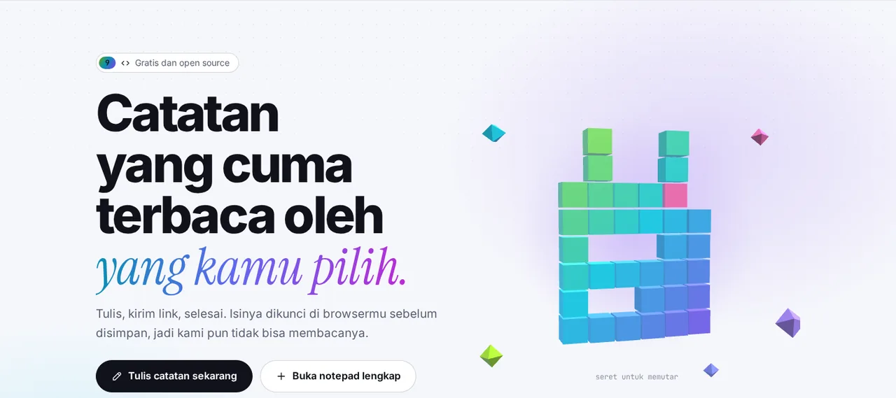

<p align="center">🌐 <a href="README.md">English</a> · <a href="README.zh.md">简体中文</a> · <a href="README.es.md">Español</a> · <a href="README.ar.md">العربية</a> · <a href="README.pt.md">Português</a> · <a href="README.fr.md">Français</a> · <a href="README.ja.md">日本語</a> · <a href="README.ru.md">Русский</a> · <b>Bahasa Indonesia</b></p>

<p align="center"><picture><source media="(prefers-color-scheme: dark)" srcset="docs/readme/hero-id-dark.webp"></picture></p>

<p align="center">
  <b>Tulis catatan, kirim link, selesai.<br>Isinya dikunci di browser sebelum disimpan, jadi server pun tidak bisa membacanya.</b>
</p>

<p align="center">
  <a href="https://note.hel.ink"><b>✍️ Coba online</b></a> ·
  <a href="#run-your-own">Pasang sendiri</a> ·
  <a href="#features">Fitur</a> ·
  <a href="#faq">FAQ</a> ·
  <a href="docs/SELF-HOSTING.md">Panduan server (EN)</a> ·
  <a href="docs/REFERENCE.md">Referensi (EN)</a> ·
  <a href="CHANGELOG.md">Changelog</a>
</p>

<p align="center"><sub>Satu file Go + satu file SQLite · 9 bahasa · tanpa iklan, tanpa pelacak · gratis dan open source (MIT)</sub></p>

> [!IMPORTANT]
> **Kuncinya ada di link.** Siapa pun yang punya link bisa membaca catatannya. Kalau semua link hilang, tidak ada yang bisa membukanya lagi: tidak kamu, tidak server, tidak kami. Kirim link hanya ke orang yang dimaksud, dan simpan link pemilik di tempat aman.

---

## Apa itu NoteHop?

Bayangkan catatan sebagai surat di dalam kotak terkunci. NoteHop mengunci kotak itu **di browsermu**, menaruh kuncinya di link, baru setelah itu kotaknya dikirim ke server. Server menyimpan kotak yang tidak bisa ia buka. Orang yang kamu beri link bisa membukanya, langsung di browsernya sendiri.

Selain itu, satu catatan bisa jauh lebih dari notepad: link dengan izin berbeda (baca saja, bisa menulis, balas saja, centang saja), hapus sendiri setelah dibaca, menulis bareng secara langsung, daftar centang, polling, formulir, kode, bahkan halaman web kecil yang berjalan di kotak tertutup.

**Cocok untukmu kalau kamu:**
- mengirim sandi, alamat, atau catatan pribadi lewat chat dan tidak mau tertinggal di riwayat,
- berbagi daftar belanja, catatan rapat, atau daftar hadir tanpa menyuruh semua orang membuat akun,
- ingin pastebin atau notepad yang bisa dipasang di servermu sendiri, dalam satu file.

<p align="center"><picture><source media="(prefers-color-scheme: dark)" srcset="docs/readme/demo-dark.webp"></picture></p>

<details>
<summary><b>Lihat lebih dekat</b> (tampilan bahasa Inggris)</summary>

<p align="center"><picture><source media="(prefers-color-scheme: dark)" srcset="docs/readme/note-dark.webp"></picture></p>
<p align="center"><picture><source media="(prefers-color-scheme: dark)" srcset="docs/readme/share-dark.webp"></picture></p>
<p align="center"><picture><source media="(prefers-color-scheme: dark)" srcset="docs/readme/tour-dark.webp"></picture></p>
<p align="center"><picture><source media="(prefers-color-scheme: dark)" srcset="docs/readme/web-dark.webp"></picture></p>
<p align="center"><picture><source media="(prefers-color-scheme: dark)" srcset="docs/readme/phone-dark.webp"></picture></p>

</details>

## Apa yang dilihat server, dan apa yang tidak pernah

| 🙈 Tidak pernah sampai ke server | 👀 Yang memang dilihat server |
|---|---|
| Judul dan isi catatan | Teks acak (ciphertext) dan ukurannya |
| Kuncinya (ada setelah tanda `#` di link, yang tidak pernah dikirim browser) | Kapan catatan dibuat, diubah, dibuka, dan berapa kali |
| Lampiran, pesan chat, dan ketikan saat menulis bareng (ikut terkunci) | Jenis link yang dipakai (baca saja, bisa menulis…) |
| Password akunmu dan daftar catatanmu | Kotak centang mana yang dicentang, dan berapa jumlah balasan |
| Teks yang kamu kirim ke bantuan menulis AI (langsung dari browsermu ke penyedia yang kamu pilih) | Alamat IP, untuk pembatasan |

<a id="features"></a>

## Fitur

- **🔒 Dikunci di browser.** AES-256-GCM dengan kunci acak 256-bit yang hanya ada di link. Bisa ditambah password lagi.
- **🔗 Banyak link, izin berbeda.** Baca saja, bisa menulis, balas saja (seperti buku tamu), atau centang saja (untuk daftar). Link bocor? Matikan, link lain tetap jalan.
- **🔑 Link pemilik.** Link terpisah untuk mengubah, membagikan, membekukan, atau menghapus catatan.
- **🔥 Hapus setelah dibaca.** Dibuka 1, 3, atau 10 kali, lalu hancur. Bot pratinjau link di aplikasi chat tidak menghabiskan jatah.
- **⏳ Kedaluwarsa dan kapsul waktu.** Hilang setelah 10 menit sampai 30 hari, atau terkunci sampai tanggal yang kamu pilih.
- **🏷️ Alamat sendiri + QR.** `/rapat-senin`, dan kode QR yang dibuat di browsermu.
- **📌 Salinan tetap dan tanda tangan.** Bekukan versi yang tidak bisa diubah siapa pun, dan biarkan pembaca menyetujuinya dengan nama mereka.
- **🧑‍🤝‍🧑 Tulis bareng.** Kursor dan nama tiap orang secara langsung, obrolan di samping, dan "ikuti presenter". Server hanya meneruskan data terkunci.
- **✅ Blok pintar.** Daftar centang, polling (satu suara per orang), formulir, kalkulator, diagram Mermaid, papan Kanban dari judul, dan blok rahasia ber-PIN atau yang hancur sendiri.
- **📝 Tipe catatan.** Biasa (seperti Notepad), Dokumen (Markdown dengan menu `/` dan menu format klik kanan), Kode (nomor baris, tidak pernah dijalankan, diunduh sebagai `.txt`), dan Web.
- **🌐 Catatan Web.** File HTML, CSS, dan JS dalam satu catatan, dengan tombol Jalankan, hasil, dan konsol. Kodenya hanya berjalan di kotak tertutup di browsermu, tanpa internet dan tanpa akses ke halaman, dan pembaca selalu ditanya dulu sebelum kode orang lain dijalankan.
- **✨ Bantuan menulis (opsional).** Ringkas, tulis ulang, terjemahkan, perbaiki ejaan. Pakai AI bawaan browser (teksnya tetap di perangkatmu) atau kunci API sendiri (Claude, ChatGPT, Gemini, OpenRouter, atau Ollama). NoteHop tidak pernah melihat teks maupun kuncinya.
- **📎 Lampiran.** Seret file atau gambar ke catatan; ikut terkunci dan disimpan 24 jam.
- **👤 Akun tidak wajib.** Kalau punya akun, daftar catatanmu dikunci dengan kunci yang hanya terbuka oleh passwordmu. Kode pemulihan membantumu masuk lagi kalau lupa password.
- **🕵️ Privasi ekstra.** Password umpan (membuka catatan palsu), hanya dari jaringan tertentu, pelacak kebocoran yang memberi tahu link mana yang bocor, dan riwayat beserta perbedaannya.
- **📶 Perangkat terdekat.** Kirim catatan atau file ke perangkat di Wi-Fi yang sama, langsung dari browser ke browser.
- **🧑‍💻 Untuk developer.** `/raw` untuk curl, CLI `notehop` yang mengunci di terminal, mock API dari JSON di catatan, webhook masuk dan keluar, SSH, dan bot Telegram.
- **🌍 9 bahasa.** English, 简体中文, Español, العربية (kanan ke kiri), Português, Français, 日本語, Русский, dan Bahasa Indonesia, dipilih otomatis dari browser.
- **🛡️ Ketat sejak awal.** Content Security Policy ketat, tanpa script pihak ketiga, tanpa iklan, tanpa pelacak, `noindex`, pembatasan permintaan. Bisa dipasang sebagai aplikasi dan dibuka offline (PWA).

<a id="run-your-own"></a>

## Pasang sendiri

NoteHop hanya **satu binary Go dan satu file SQLite**. Tanpa Node, tanpa build step, tanpa layanan lain.

**Cara 1: di VPS** (systemd + Caddy atau nginx, backup harian)

```bash
git clone https://github.com/navi-crwn/NoteHop.git && cd NoteHop
sudo DOMAIN=note.example.com ./deploy/install.sh
```

Panduan lengkapnya, termasuk HTTPS, update, backup, dan restore, ada di **[docs/SELF-HOSTING.md](docs/SELF-HOSTING.md)** (bahasa Inggris).

**Cara 2: di komputer sendiri** (butuh Go 1.27+)

```bash
go run ./cmd/notehop -addr 127.0.0.1:8090 -db data/dev.db
```

Buka http://127.0.0.1:8090. Browser hanya mengizinkan enkripsinya di **HTTPS atau localhost**.

**Cara 3: Docker**

```bash
docker build -t notehop .
docker run -d -p 127.0.0.1:8090:8080 -v notehop:/data -e NOTEHOP_BASE_URL=https://note.example.com notehop
```

Semua pengaturan berupa variabel environment (`NOTEHOP_*`). Daftar lengkapnya ada di **[docs/REFERENCE.md](docs/REFERENCE.md)**, bersama model enkripsi dan API.

## Catatan pertamamu

1. Buka beranda, ketik di kotak, dan lihat teks acak yang akan diterima server.
2. Pilih siapa boleh apa: **Hanya baca**, **Bisa menulis**, atau **Bisa membalas**. Centang **Sekali baca** untuk rahasia.
3. Tekan **Buat link** dan kirim. Selesai, tanpa akun.
4. Mau lebih (waktu, privasi ekstra, tulis bareng)? Pakai **Buka notepad lengkap**, atau tombol **Bagikan** di catatan milikmu.

<a id="faq"></a>

## FAQ

**Apakah pengelola server bisa membaca catatan saya?**
Tidak. Catatan dikunci di browsermu sebelum dikirim, dan kuncinya ada di bagian link setelah `#`, yang tidak pernah dikirim browser ke server. Server hanya punya teks acak.

**Bagaimana kalau link-nya hilang?**
Catatan tidak bisa dibuka, oleh siapa pun. Kalau kamu punya akun, catatanmu tercantum di **Catatanku** dan bisa dibuka dari sana. Tanpa akun, catatan terbaru hanya diingat di browser ini.

**Apakah "hapus setelah dibaca" aman dari pratinjau link?**
Ya. Membuka halaman saja tidak menampilkan isinya; pembaca harus menekan tombol dulu. Bot pratinjau di aplikasi chat hanya mendapat kartu pratinjau, bukan hitungan baca.

**Apakah AI-nya membaca catatan saya?**
Bantuan menulis mati sampai kamu memilihnya. AI bawaan browser bekerja di perangkatmu. Dengan kunci API sendiri, teks dikirim langsung dari browsermu ke penyedia itu, tidak pernah lewat NoteHop. Pemilik server bisa mematikan AI dengan `NOTEHOP_AI=off`.

**Apakah kode di catatan bisa menyerang orang yang membukanya?**
Catatan Kode tidak pernah dijalankan: tampil sebagai teks dan diunduh sebagai `.txt`. Catatan Web hanya berjalan di bingkai tertutup tanpa internet, tanpa cookie, dan tanpa akses ke halaman catatan atau kuncinya, dan pembaca ditanya dulu.

**Bisakah memakai server login sendiri?**
Bisa. NoteHop punya akun sendiri, dan juga bisa memasukkan orang lewat server akun milikmu (single sign-on). Lihat `NOTEHOP_SSO_*` di [docs/REFERENCE.md](docs/REFERENCE.md).

**Bagaimana kalau ada yang membagikan sesuatu yang berbahaya?**
Setiap catatan punya **Laporkan catatan ini** di menunya. Laporan (alasan dan pesan singkat, tidak pernah isi catatannya) sampai ke pengelola situs. Mereka tidak bisa membaca catatan terkunci, tetapi bisa menurunkannya, dan nama link-nya lalu ditahan setahun. Pengelola memeriksa laporan lewat perintah `notehop takedown` atau dari pusat kendali melalui [HOP App Protocol](docs/REFERENCE.md#control-center-hop-app-protocol).

**Bagaimana cara backup?**
`notehop backup -db notehop.db salinan.db` aman dijalankan saat server hidup. Installer VPS juga memasang backup harian. Di backup pun catatan tetap terkunci.

## Di balik layar

| Folder | Isinya |
|---|---|
| `cmd/notehop/` | Programnya: server, pengaturan, dan perintah `backup`, `new`, `get`, `takedown` |
| `internal/app/` | Handler HTTP, fitur catatan, relay kolaborasi langsung, SSH, Telegram, single sign-on |
| `internal/db/` | Skema SQLite dan migrasi otomatis |
| `internal/client/` | Enkripsi CLI (sama dengan browser) |
| `internal/i18n/` | Pemuat 9 bahasa, dan tes yang menjaga semuanya selaras |
| `web/templates/`, `web/static/` | Halaman, JavaScript dan CSS biasa, tanpa build step. Library pihak ketiga ada di `web/static/vendor/` |
| `web/i18n/` | Teks UI dalam 9 bahasa |
| `deploy/` | Installer, unit systemd, backup, contoh Caddy dan nginx |
| `scripts/` | Tes browser (Playwright): `./scripts/e2e-all.sh` menjalankan semua tes ke server baru |

Jalankan tes dengan `go test -race ./...` dan `./scripts/e2e-all.sh`.

<a id="family"></a>

## Keluarga Hop

NoteHop adalah bagian dari keluarga aplikasi open source HOP yang menghargai privasi dan bisa di-host sendiri.

<!-- hop-family:start -->
<!-- Generated from HEL.ink resources/hop-assets/apps.source.json; edit there, then run scripts/hop_assets.py build. -->
| App | Address | Repository | What it does |
| --- | --- | --- | --- |
| **HOP ID** | [hel.ink](https://hel.ink) · accounts at `hub.hel.ink` | [navi-crwn/HEL.ink](https://github.com/navi-crwn/HEL.ink) | One account for every HOP app. |
| **LinkHop** | [link.hel.ink](https://link.hel.ink) · `hel.ink/l/…` | [navi-crwn/LinkHop](https://github.com/navi-crwn/LinkHop) | Short links, QR codes and click analytics. |
| **BioHop** | [bio.hel.ink](https://bio.hel.ink) · `hel.ink/b/…` | [navi-crwn/BioHop](https://github.com/navi-crwn/BioHop) | One link-in-bio page for everything you do. |
| **PixelHop** | [p.hel.ink](https://p.hel.ink) | [navi-crwn/PixelHop](https://github.com/navi-crwn/PixelHop) | Image hosting with albums and direct links. |
| **NoteHop** | [note.hel.ink](https://note.hel.ink) · `n.hel.ink/…` | [navi-crwn/NoteHop](https://github.com/navi-crwn/NoteHop) | Encrypted notes you share with a link. |
| **Imperium** | private (owner only) | private | The HOP control panel. |
<!-- hop-family:end -->

---

<p align="center">Lisensi MIT · <a href="docs/REFERENCE.md">Referensi</a> · <a href="docs/SELF-HOSTING.md">Pasang sendiri</a> · <a href="CHANGELOG.md">Changelog</a><br><sub>Keluarga HEL.ink: <a href="https://github.com/navi-crwn/LinkHop">LinkHop</a> (link pendek) · <a href="https://github.com/navi-crwn/BioHop">BioHop</a> · <a href="https://github.com/navi-crwn/PixelHop">PixelHop</a> (hosting gambar) · <a href="https://note.hel.ink">NoteHop</a></sub></p>
