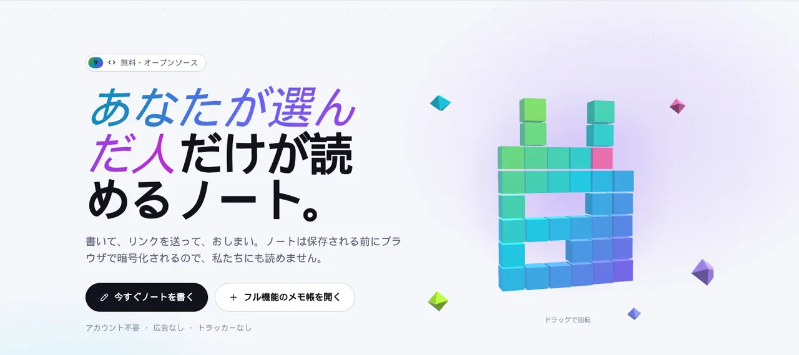

<p align="center">🌐 <a href="README.md">English</a> · <a href="README.zh.md">简体中文</a> · <a href="README.es.md">Español</a> · <a href="README.ar.md">العربية</a> · <a href="README.pt.md">Português</a> · <a href="README.fr.md">Français</a> · <b>日本語</b> · <a href="README.ru.md">Русский</a> · <a href="README.id.md">Bahasa Indonesia</a></p>

<p align="center"><picture><source media="(prefers-color-scheme: dark)" srcset="docs/readme/hero-ja-dark.webp"></picture></p>

<p align="center">
  <b>ノートを書いて、リンクを送って、おしまい。<br>保存される前にブラウザーで鍵がかかるので、サーバーにも読めません。</b>
</p>

<p align="center">
  <a href="https://note.hel.ink"><b>✍️ オンラインで試す</b></a> ·
  <a href="#run-your-own">自分で設置</a> ·
  <a href="#features">機能</a> ·
  <a href="#faq">よくある質問</a> ·
  <a href="docs/SELF-HOSTING.md">サーバーガイド（英語）</a> ·
  <a href="docs/REFERENCE.md">リファレンス（英語）</a> ·
  <a href="CHANGELOG.md">変更履歴</a>
</p>

<p align="center"><sub>Go のバイナリ 1 つ + SQLite ファイル 1 つ · 9 言語 · 広告なし・トラッカーなし · 無料のオープンソース（MIT）</sub></p>

> [!IMPORTANT]
> **鍵はリンクの中にあります。** リンクを持っている人はノートを読めます。すべてのリンクをなくすと、誰にも開けなくなります。あなたにも、サーバーにも、私たちにも。リンクは渡したい相手にだけ送り、オーナーリンクは安全な場所に保管してください。

---

## NoteHop とは？

ノートを、鍵のかかった箱に入れた手紙だと考えてください。NoteHop は**あなたのブラウザーの中で**箱に鍵をかけ、その鍵をリンクに入れ、それから箱をサーバーに送ります。サーバーが持っているのは、自分では開けられない箱です。リンクを渡された人は、自分のブラウザーでその場で開けます。

さらに、1 つのノートでメモ帳以上のことができます。権限の違うリンク（閲覧のみ・編集できる・返信のみ・チェックのみ）、読んだら自動で削除、リアルタイムの共同編集、チェックリスト、投票、フォーム、コード、そして隔離された枠の中で動く小さな Web ページまで。

**こんな人に向いています：**
- パスワードや住所、個人的なメモをチャットで送りたいけれど、履歴に残したくない人
- 買い物リストや会議メモ、参加者リストを、全員にアカウントを作らせずに共有したい人
- 自分のサーバーに置ける pastebin やメモ帳を、ファイル 1 つで動かしたい人

<p align="center"><picture><source media="(prefers-color-scheme: dark)" srcset="docs/readme/demo-dark.webp"></picture></p>

<details>
<summary><b>もっと詳しく</b>（英語の画面）</summary>

<p align="center"><picture><source media="(prefers-color-scheme: dark)" srcset="docs/readme/note-dark.webp"></picture></p>
<p align="center"><picture><source media="(prefers-color-scheme: dark)" srcset="docs/readme/share-dark.webp"></picture></p>
<p align="center"><picture><source media="(prefers-color-scheme: dark)" srcset="docs/readme/tour-dark.webp"></picture></p>
<p align="center"><picture><source media="(prefers-color-scheme: dark)" srcset="docs/readme/web-dark.webp"></picture></p>
<p align="center"><picture><source media="(prefers-color-scheme: dark)" srcset="docs/readme/phone-dark.webp"></picture></p>

</details>

## サーバーに見えるもの、決して見えないもの

| 🙈 サーバーには決して届かない | 👀 サーバーに見えるもの |
|---|---|
| ノートのタイトルと本文 | 暗号文とそのサイズ |
| 鍵（リンクの `#` より後ろにあり、ブラウザーはこの部分を送信しません） | ノートの作成・変更・閲覧の時刻と回数 |
| 添付ファイル、チャット、共同編集の入力（これらも暗号化） | 使われたリンクの種類（閲覧のみ、編集できる…） |
| アカウントのパスワードとノートの一覧 | どのチェックボックスにチェックが入っているか、返信の数 |
| AI の書くお手伝いに送る文章（ブラウザーから選んだプロバイダーへ直接送られます） | IP アドレス（回数制限のため） |

<a id="features"></a>

## 機能

- **🔒 ブラウザーで暗号化。** AES-256-GCM と、リンクの中にしかないランダムな 256 ビットの鍵。追加のパスワードも設定できます。
- **🔗 複数のリンク、別々の権限。** 閲覧のみ、編集できる、返信のみ（ゲストブックのように）、チェックのみ（リスト用）。リンクが漏れた？止めても、ほかのリンクはそのまま使えます。
- **🔑 オーナーリンク。** ノートの変更・共有・固定・削除のための別のリンク。
- **🔥 読んだら削除。** 1・3・10 回開かれたら消滅。チャットアプリのリンクプレビュー用ボットでは回数を消費しません。
- **⏳ 有効期限とタイムカプセル。** 10 分から 30 日で消える、または選んだ日まで開けないように。
- **🏷️ 独自アドレス + QR。** `/n/monday-meeting` と、ブラウザーで作る QR コード。
- **📌 固定コピーと承認サイン。** 誰にも変えられない版を固定し、読み手に名前で承認してもらえます。
- **🧑‍🤝‍🧑 一緒に書く。** 全員のカーソルと名前がリアルタイムで見え、横にチャット、「発表者に追従」も。サーバーは暗号化されたデータを中継するだけです。
- **✅ スマートブロック。** チェックリスト、投票（1 人 1 票）、フォーム、計算機、Mermaid の図、見出しから作るカンバン、PIN 付きや自動で消える秘密ブロック。
- **📝 ノートの種類。** テキスト（メモ帳のように）、ドキュメント（`/` メニューと右クリックの書式メニュー付き Markdown）、コード（行番号付き、実行されない、`.txt` でダウンロード）、Web。
- **🌐 Web ノート。** 1 つのノートに HTML・CSS・JS ファイル。実行ボタン、結果、コンソール付き。コードはブラウザー内の隔離された枠の中だけで動き、インターネットにもページにもアクセスできません。他人のコードを動かす前には必ず読み手に確認します。
- **✨ 書くお手伝い（任意）。** 要約、書き直し、翻訳、スペル修正。ブラウザー内蔵の AI（文章は端末から出ません）か、自分の API キー（Claude、ChatGPT、Gemini、OpenRouter、Ollama）を使えます。NoteHop は文章も鍵も見ません。
- **📎 添付ファイル。** ファイルや画像をノートにドロップ。これも暗号化され、24 時間保存されます。
- **👤 アカウントは任意。** アカウントがあると、ノートの一覧はあなたのパスワードでしか開かない鍵で暗号化されます。パスワードを忘れても、リカバリーコードで戻れます。
- **🕵️ さらなるプライバシー。** おとりパスワード（偽のノートが開く）、特定のネットワークからだけ、どのリンクから漏れたか分かる漏えい追跡、差分付きの履歴。
- **📶 近くの端末。** 同じ Wi-Fi の端末へ、ブラウザーからブラウザーへ直接ノートやファイルを送れます。
- **🧑‍💻 開発者向け。** curl 用の `/raw`、ターミナルで暗号化する `notehop` CLI、ノートの JSON から作るモック API、送受信の Webhook、SSH、Telegram ボット。
- **🌍 9 言語。** English、简体中文、Español、العربية（右から左）、Português、Français、日本語、Русский、Bahasa Indonesia。ブラウザーに合わせて自動で選ばれます。
- **🛡️ 最初から厳格。** 厳しいコンテンツセキュリティポリシー、サードパーティのスクリプトなし、広告・トラッカーなし、`noindex`、回数制限。インストールできるアプリ（PWA）としてオフラインでも使えます。

<a id="run-your-own"></a>

## 自分で設置する

NoteHop は **Go のバイナリ 1 つと SQLite ファイル 1 つ**だけ。Node もビルド手順も、ほかのサービスも要りません。

**方法 1：VPS に**（systemd + Caddy または nginx、毎日のバックアップ）

```bash
git clone https://github.com/navi-crwn/NoteHop.git && cd NoteHop
sudo DOMAIN=note.example.com ./deploy/install.sh
```

HTTPS、更新、バックアップ、復元を含む詳しい手順は **[docs/SELF-HOSTING.md](docs/SELF-HOSTING.md)**（英語）にあります。

**方法 2：自分のパソコンで**（Go 1.27 以上が必要）

```bash
go run ./cmd/notehop -addr 127.0.0.1:8090 -db data/dev.db
```

http://127.0.0.1:8090 を開きます。ブラウザーがこの暗号化を許可するのは **HTTPS か localhost** のときだけです。

**方法 3：Docker**

```bash
docker build -t notehop .
docker run -d -p 127.0.0.1:8090:8080 -v notehop:/data -e NOTEHOP_BASE_URL=https://note.example.com notehop
```

設定はすべて環境変数（`NOTEHOP_*`）です。一覧、暗号化の仕組み、API は **[docs/REFERENCE.md](docs/REFERENCE.md)** にあります。

## 最初のノート

1. ホームページを開き、ボックスに入力して、サーバーが受け取る暗号文を見てみましょう。
2. 誰が何をできるかを選びます：**閲覧のみ**、**編集できる**、**返信できる**。秘密なら **1 回だけ読める** にチェック。
3. **リンクを作成** を押して送ります。これだけ。アカウントは要りません。
4. もっと使いたい（時間設定、追加のプライバシー、一緒に書く）？ **フル機能のメモ帳を開く** か、自分のノートの **共有** ボタンを使ってください。

<a id="faq"></a>

## よくある質問

**サーバーの運営者は私のノートを読めますか？**
読めません。ノートは送信前にあなたのブラウザーで暗号化され、鍵はリンクの `#` より後ろの部分にあります。ブラウザーはこの部分をサーバーに送りません。サーバーにあるのは暗号文だけです。

**リンクをなくしたら？**
そのノートは誰にも開けなくなります。アカウントがあれば、ノートは **マイノート** に一覧され、そこから開けます。アカウントがない場合、最近のノートはこのブラウザーにだけ記憶されます。

**「読んだら削除」はリンクプレビューで消費されませんか？**
されません。ページを開いただけでは中身は表示されず、読み手がまずボタンを押します。チャットアプリのプレビュー用ボットが受け取るのはプレビューカードだけで、閲覧には数えません。

**AI はノートを読みますか？**
書くお手伝いは、あなたが選ぶまでオフです。ブラウザー内蔵の AI は端末の中で動きます。自分の API キーを使う場合、文章はブラウザーからそのプロバイダーへ直接送られ、NoteHop を通ることはありません。サーバーの運営者は `NOTEHOP_AI=off` で AI を止められます。

**ノートのコードが、開いた人を攻撃することはありますか？**
コードノートは実行されません。テキストとして表示され、`.txt` でダウンロードされます。Web ノートはインターネットも Cookie もない隔離された枠の中だけで動き、ノートのページや鍵には触れられません。実行前には読み手に確認します。

**自分のログインサーバーを使えますか？**
使えます。NoteHop には独自のアカウントがあり、あなたが運営するアカウントサーバー経由のログイン（シングルサインオン）もできます。[docs/REFERENCE.md](docs/REFERENCE.md) の `NOTEHOP_SSO_*` を見てください。

**誰かが有害なものを共有したらどうなりますか？**
どのノートにもメニューに **このノートを報告** があります。報告（理由と短いメッセージ。ノートの内容は含みません）はサイトの運営者に届きます。運営者は暗号化されたノートを読めませんが、削除することはでき、そのリンク名は1年間確保されます。運営者は `notehop takedown` コマンド、または [HOP App Protocol](docs/REFERENCE.md#control-center-hop-app-protocol) 経由のコントロールセンターから報告を処理します。

**バックアップは？**
`notehop backup -db notehop.db copy.db` はサーバーの稼働中でも使えます。VPS 用インストーラーは毎日のバックアップも設定します。バックアップの中でもノートは暗号化されたままです。

## 中身の構成

| フォルダー | 内容 |
|---|---|
| `cmd/notehop/` | 本体：サーバー、設定、`backup`・`new`・`get`・`takedown` コマンド |
| `internal/app/` | HTTP ハンドラー、ノートの機能、共同編集の中継、SSH、Telegram、シングルサインオン |
| `internal/db/` | SQLite のスキーマと自動マイグレーション |
| `internal/client/` | CLI の暗号化（ブラウザーと同じ） |
| `internal/i18n/` | 9 言語の読み込みと、それらをそろえておくテスト |
| `web/templates/`、`web/static/` | ページ、素の JavaScript と CSS（ビルド不要）。サードパーティのライブラリは `web/static/vendor/` に |
| `web/i18n/` | 9 言語の UI テキスト |
| `deploy/` | インストーラー、systemd ユニット、バックアップ、Caddy と nginx の例 |
| `scripts/` | ブラウザーテスト（Playwright）：`./scripts/e2e-all.sh` で新しいサーバーに対して全テストを実行 |

テストは `go test -race ./...` と `./scripts/e2e-all.sh` で実行します。

<a id="family"></a>

## Hop ファミリー

NoteHop には、同じ考え方で作られたオープンソースの兄弟プロジェクトが 2 つあります。無料で、自分で設置でき、トラッカーなし。

|  | できること | 試す | コード |
|---|---|---|---|
| 🔗 **LinkHop** | 短縮リンクとリンクインバイオのページ：独自の名前、QR コード、アクセス解析、20 以上のテーマ | [hel.ink](https://hel.ink) | [GitHub](https://github.com/navi-crwn/LinkHop) |
| 🖼️ **PixelHop** | Go のバイナリ 1 つで画像・動画・PDF をホスティング：アップロード時に GPS を削除、アルバム、ShareX、ブラウザーで動くフォトスタジオ | [p.hel.ink](https://p.hel.ink) | [GitHub](https://github.com/navi-crwn/PixelHop) |
| 📝 **NoteHop** | あなたが選んだ人だけが読めるノート | [note.hel.ink](https://note.hel.ink) | ここです |

---

<p align="center">MIT ライセンス · <a href="docs/REFERENCE.md">リファレンス</a> · <a href="docs/SELF-HOSTING.md">自分で設置</a> · <a href="CHANGELOG.md">変更履歴</a><br><sub>HEL.ink ファミリー：<a href="https://github.com/navi-crwn/LinkHop">LinkHop</a>（短縮リンク）· <a href="https://github.com/navi-crwn/PixelHop">PixelHop</a>（画像ホスティング）· <a href="https://note.hel.ink">NoteHop</a></sub></p>
