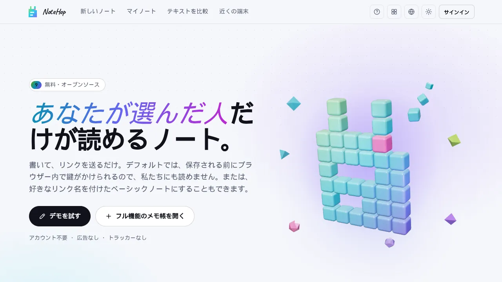

<p align="center">🌐 <a href="README.md">English</a> · <a href="README.zh-CN.md">简体中文</a> · <a href="README.de.md">Deutsch</a> · <a href="README.id.md">Bahasa Indonesia</a> · <b>日本語</b> · <a href="README.pt-BR.md">Português (Brasil)</a> · <a href="README.es.md">Español</a> · <a href="README.fr.md">Français</a> · <a href="README.ru.md">Русский</a></p>

<p align="center"><picture><source media="(prefers-color-scheme: dark)" srcset="docs/readme/hero-ja-dark.webp"></picture></p>

<p align="center"><b>ノートを書いて、リンクを送るだけ。</b><br>ノートは既定で、保存される前にブラウザー内で暗号化されます。そのため、サーバーが保存するのは読めないテキストです。</p>

<p align="center">
  <a href="https://note.hel.ink"><b>オンラインで試す</b></a> ·
  <a href="https://navi-crwn.github.io/NoteHop/">Web サイト</a> ·
  <a href="#run-your-own">自分で運用する</a> ·
  <a href="#encrypted-and-basic-notes">暗号化ノートとベーシックノート</a> ·
  <a href="#faq">FAQ</a> ·
  <a href="docs/SELF-HOSTING.md">セルフホスティングガイド</a> ·
  <a href="docs/REFERENCE.md">リファレンス</a> ·
  <a href="CHANGELOG.md">変更履歴</a>
</p>

<p align="center"><sub>Go のプログラム 1 つと SQLite ファイル 1 つ · 9 言語 · 広告なし、トラッカーなし · 無料のオープンソース（MIT）</sub></p>

> [!IMPORTANT]
> 暗号化ノートは、鍵をリンクの中に持っています。リンクを持つ人はそのノートを読めますし、リンクのコピーがすべて失われると、サーバーや運営者を含めて誰も開けなくなります。ベーシックノートは仕組みが違います。サーバーはそのテキストを平文で保存し、読むことができます。ベーシックノートは、サーバーの運営者に読まれても構わない内容にだけ使ってください。

NoteHop は、自分で運用できるノート共有アプリです。ノートを書いてリンクを受け取り、それを送ります。リンクごとに権限があり（閲覧のみ、編集できる、返信のみ、チェックのみ）、ノートは読まれた後に自分で削除でき、複数人が同時に書き込むこともできます。

次のような人に向いています。

- パスワードや住所、個人的なメモをチャットで送りたいが、履歴に残したくない人、
- 買い物リストや会議メモ、参加者募集シートを、全員にアカウントを作らせずに共有したい人、
- ペーストビンやメモ帳を、1 つのファイルで自分のサーバーに置きたい人です。

コマンド 1 つでインストールできます。スクリプトはコンピューターを確認し、いくつか質問し、必要なら HOP ID のアカウントハブも用意します。

```bash
curl -fsSL https://raw.githubusercontent.com/navi-crwn/NoteHop/main/install.sh | bash
```

クローンから実行する場合は `./install.sh` です。更新は `./update.sh`、削除は `./uninstall.sh` です。`--yes` を付けるとすべて既定値で進み、`--help` でオプションを確認できます。

<p align="center"><picture><source media="(prefers-color-scheme: dark)" srcset="docs/readme/demo-dark.webp"></picture></p>

<details>
<summary>ほかのスクリーンショット</summary>

<p align="center"><picture><source media="(prefers-color-scheme: dark)" srcset="docs/readme/new-dark.webp"></picture></p>
<p align="center"><picture><source media="(prefers-color-scheme: dark)" srcset="docs/readme/note-dark.webp"></picture></p>
<p align="center"><picture><source media="(prefers-color-scheme: dark)" srcset="docs/readme/share-dark.webp"></picture></p>
<p align="center"><picture><source media="(prefers-color-scheme: dark)" srcset="docs/readme/basic-dark.webp"></picture></p>
<p align="center"><picture><source media="(prefers-color-scheme: dark)" srcset="docs/readme/web-dark.webp"></picture></p>
<p align="center"><picture><source media="(prefers-color-scheme: dark)" srcset="docs/readme/dashboard-dark.webp"></picture></p>
<p align="center"><picture><source media="(prefers-color-scheme: dark)" srcset="docs/readme/tour-dark.webp"></picture></p>
<p align="center"><picture><source media="(prefers-color-scheme: dark)" srcset="docs/readme/phone-dark.webp"></picture></p>

</details>

<a id="encrypted-and-basic-notes"></a>

## 暗号化ノートとベーシックノート

新しいノートは、まず 1 つの選択から始まります。

| | 暗号化（既定） | ベーシック |
|---|---|---|
| テキストを読める人 | 鍵を含む完全なリンクを持つ人 | リンクを持つ人と、サーバー |
| 保存のされ方 | 暗号文（AES-256-GCM）として | データベースとそのバックアップに平文で |
| リンク | ランダムで、鍵は `#k=` の後ろ | `/monday-meeting` のように自分で付けた名前、またはランダムなもの |
| パスワード、おとりのパスワード、自己消滅ブロック | 使える | 使えない |
| `/raw`、モック API、SSH、公開ページ `/@name` | 使えない | 使える |
| 検索エンジン | インデックスされない | インデックスされない |

オーナーは「共有」ダイアログで、ノートの種類を相互に切り替えられます。ブラウザーがテキストを暗号化または復号し、サーバーはそれを差し替えるだけです。リンクと設定はそのまま残ります。バージョン履歴は消去され、追記された行、提案、おとり、自己消滅ブロック、受信箱、承認サインのあるノートは、まだ種類を切り替えられません。

添付ファイルとリアルタイム共同編集は、どちらの種類でも使えます。ベーシックノートでは、サーバーはそれらも読めます。添付ファイルの鍵がノートのテキストに保存され、ライブ編集は暗号化されないためです。

チャットアプリなどでのリンクプレビューには、ノートがあることとその種類だけが表示され、タイトルや本文は表示されません。

<a id="what-the-server-sees"></a>

## サーバーに見えるもの

暗号化ノートの場合：

| サーバーに届かないもの | サーバーに見えるもの |
|---|---|
| ノートのタイトルと本文 | 暗号文とそのサイズ |
| 鍵（リンクの `#` の後ろにあり、ブラウザーは送信しません） | ノートが作成、変更、開封された日時と、開かれた回数 |
| 返信、提案、承認サインの名前、チャットメッセージ、ライブ編集 | 使われたリンクの種類（閲覧のみ、編集できる など）と、リンクのアドレス |
| 添付ファイル（ファイルも暗号化されます） | 設定した場合の、有効期限、ロックと開封の時刻、許可したネットワーク |
| アカウントのパスワードと、タイトル付きのノート一覧 | どのチェックボックスがオンか、投票の各選択肢の票数、返信の数 |
| 執筆アシスタントに送るテキスト（ブラウザーから、選んだ提供元に直接送られます） | レート制限と、設定したネットワーク制限のための IP アドレス。アカウントがあればユーザー名 |

「サーバーは読めない」という説明が及ぶ範囲：

- これは暗号化ノートに当てはまります。ベーシックノートは読めます。平文を扱う機能も同様です。`/raw`、モック API、SSH、そして受信箱と Telegram ボットでは、サーバーが到着時にテキストを見て、その後ノートの鍵で封印して保存します。
- これは、サーバーがブラウザーに送るコードに依存します。暗号化はサーバーが配信する JavaScript の中で動くため、運営者がそのコードを書き換えれば、ノートを開く人の鍵を取得できてしまいます。厳格な Content Security Policy はサードパーティのスクリプトを防ぎますが、この点は変わりません。気になる場合は、NoteHop を自分で運用する、コードを読む、または自分のマシン上で暗号化するコマンドラインプログラム `notehop` を使ってください。
- リンクが鍵です。リンクを持つ人は誰でもノートを読めます。リンクを貼り付けて保存するサービスも同じです。
- 暗号化ノートでも、読める形で保存される情報があります。ノートを開く前に表示される内容警告のラベルと任意の理由（最大 255 文字）、そして誰かがノートについて出した報告の理由とメッセージです。
- データベースのバックアップには、データベースにあるものがすべて含まれます。暗号文、ベーシックノートのテキスト、アカウントの記録です。

## 機能

- ブラウザー内で暗号化。リンクの中にだけある、ランダムな 256 ビット鍵による AES-256-GCM です。さらにパスワードを追加できます。
- 権限の異なる複数のリンク：閲覧のみ、編集できる、返信のみ（ゲストブックのように）、チェックのみ（チェックリスト用）、変更を提案できる。リンクが漏れたら、そのリンクだけを無効にでき、ほかのリンクは使い続けられます。別のオーナーリンクで、ノートの変更、共有、凍結、削除ができます。
- 読んだら削除：ノートは 1 回、3 回、10 回開かれた後に破棄されます。読み手がまずボタンを押すので、チャットアプリのプレビュー用ボットが回数を消費することはありません。
- 有効期限とタイムカプセル：ノートは 10 分から 30 日で消えるか、選んだ日付まで閉じたままになります。
- ベーシックノートには、独自のアドレスと QR コードを付けられます。たとえば `/monday-meeting` です。QR コードはブラウザー内で作られます。
- 誰も変更できない固定コピーと、承認サイン。読み手が自分の名前でバージョンを承認できます。
- 共同で書く：互いのカーソルと名前がリアルタイムに見え、横にチャットがあり、全員がプレゼンターに追従できます。暗号化ノートでは、サーバーは暗号化されたデータを中継するだけです。
- テキスト内のブロック：チェックリスト、投票（1 人 1 票）、フォーム、電卓、Mermaid 図、見出しから作るカンバンボード、スライド、PIN で保護されたり自己消滅したりする秘密のブロック。
- ノートの種類：プレーン（メモ帳のように）、ドキュメント（`/` メニューと右クリックの書式メニュー付き Markdown）、コード（行番号付き、実行されず、`.txt` としてダウンロード）、Web。
- Web ノート：1 つのノートに HTML、CSS、JS のファイルを入れ、実行ボタン、結果、コンソールを使えます。コードはブラウザー内の隔離されたフレームで動き、インターネットにも、ノートページ、その Cookie、鍵にもアクセスできません。他の人のコードを実行する前に、読み手に確認します。
- 執筆アシスタント（任意）：要約、書き直し、翻訳、スペル修正。デバイス内にとどまるブラウザー内蔵 AI、または Claude、ChatGPT、Gemini、OpenRouter、Ollama の自分の API キーを使います。テキストとキーはブラウザーから提供元へ直接送られ、NoteHop を経由しません。
- 内容警告：ノートに 18+ またはセンシティブ の印を付け、理由も添えられます。読み手が確認してからノートが開き、`/raw` とモック API も同じチェックに従います。
- 添付ファイル：ファイルや画像をノートにドロップします。ブラウザー内で暗号化され、24 時間保存され、1 ファイル 5 MB までで、運営者が決める共有ストレージの予算があります。
- アカウントは任意です。アカウントがあると、ノート一覧は自分のパスワードでしか開けない鍵で暗号化されます。パスワードを忘れても、1 回限りのリカバリーコード 8 個で戻れます。運営者は、HOP ID のようなシングルサインオンのアカウントサーバーを接続することもできます。
- プライバシーの追加機能：偽のノートを開くおとりのパスワード、特定のネットワークからのみのアクセス、コピーされたテキストがどのリンク経由かを示す漏洩トレーサー、差分付きのバージョン履歴。
- 近くのデバイス：同じネットワーク上のデバイスへ、ブラウザーからブラウザーへ直接、パッドやファイルを送れます。
- 開発者向け：curl 用の `/raw`、ターミナルで暗号化する `notehop` CLI、ベーシックノートの JSON から作るモック API、送受信の Webhook、SSH、Telegram ボット。
- 9 言語：English、简体中文、Deutsch、Bahasa Indonesia、日本語、Português (Brasil)、Español、Français、Русский。匿名の訪問者には英語が表示されます。地球儀メニューまたは `?lang=xx` で別の言語を選べます。
- 広告なし、トラッカーなし、サードパーティのスクリプトなし。インストールできるオフラインアプリ（PWA）です。
- 報告とモデレーション：すべてのノートに **このノートを報告** があります。運営者は `notehop takedown` コマンド、または [HOP App Protocol](docs/REFERENCE.md#control-center-hop-app-protocol) 経由のコントロールセンターで報告を確認します。

<a id="run-your-own"></a>

## 自分で運用する

NoteHop は、Go のプログラム 1 つと SQLite ファイル 1 つです。Node も、ビルド手順も、ほかのサービスも要りません。

このページの冒頭のインストーラーは、自分で管理できるコンピューターでは最も手軽な方法です。公開サーバーでは、次のいずれかを使ってください。

VPS で（systemd、HTTPS 用の Caddy または nginx、毎日のバックアップ付き）：

```bash
git clone https://github.com/navi-crwn/NoteHop.git && cd NoteHop
sudo DOMAIN=note.example.com ./deploy/install.sh
```

[セルフホスティングガイド](docs/SELF-HOSTING.md) では、HTTPS、更新、バックアップ、復元を説明しています。

開発用に自分のコンピューターで（Go 1.27 以降が必要）：

```bash
go run ./cmd/notehop -addr 127.0.0.1:8090 -db data/dev.db
```

http://127.0.0.1:8090 を開きます。ブラウザーは、HTTPS または localhost でのみ暗号化を許可します。

Docker で：

```bash
docker build -t notehop .
docker run -d -p 127.0.0.1:8090:8080 -v notehop:/data -e NOTEHOP_BASE_URL=https://note.example.com notehop
```

すべての設定は `NOTEHOP_` で始まる環境変数です。暗号化モデルや API とともに、[docs/REFERENCE.md](docs/REFERENCE.md) に一覧があります。

バックアップ：`notehop backup -db notehop.db copy.db` は、サーバーが動いている間にコピーを作り、そのファイルは所有者だけが読めます。VPS 用インストーラーは、14 日間保存される毎日のバックアップも設定します。バックアップにはベーシックノートが平文で入っているので、慎重に保管してください。

## 最初のノート

1. ホーム画面を開き、ボックスに入力して、サーバーが受け取る暗号化されたテキストを確かめます。
2. 誰に何を許すかを選びます：**閲覧のみ**、**編集できる**、**返信できる**。秘密にしたい内容なら **1 回だけ読める** をオンにします。
3. **暗号化リンクを作成** を押して、リンクを送ります。アカウントは要りません。
4. さらに詳しく（タイミング、追加のプライバシー、共同編集）設定するには、**フル機能のメモ帳を開く**、または自分のノートの **共有** ボタンを使います。リンク名付きのベーシックノートにするには、「新しいノート」ページの上部で **ベーシック** を選びます。

<a id="faq"></a>

## FAQ

**サーバーを運営している人は、私のノートを読めますか？**
暗号化ノートは読めません。ブラウザーが送信前に暗号化し、鍵はリンクの `#` の後ろの部分にあって、ブラウザーはそこをサーバーに送りません。サーバーが持つのは暗号化されたテキストだけです。ベーシックノートはサーバーが読めます。この説明の範囲は [サーバーに見えるもの](#what-the-server-sees) を参照してください。

**リンクをなくしたらどうなりますか？**
暗号化ノートは、誰にも開けなくなります。アカウントがあれば、ノートは「マイノート」に並び、そこから開けます。アカウントがない場合、最近のノートはそのブラウザーにだけ記憶されます。ベーシックノートは、リンク名から簡単に見つけ直せます。

**「読んだら削除」は、リンクプレビューに対して安全ですか？**
はい。ページを開くだけでは内容は表示されません。読み手がまずボタンを押します。チャットアプリのプレビュー用ボットが受け取るのはプレビューカードで、閲覧回数には数えられません。

**AI は私のノートを読みますか？**
執筆アシスタントは、使うまでオフです。ブラウザー内蔵 AI は、デバイス上で動きます。自分の API キーを使う場合、テキストはブラウザーからその提供元へ直接送られ、NoteHop を経由しません。運営者は `NOTEHOP_AI=off` で無効にできます。

**ノート内のコードは、開いた人を攻撃できますか？**
コードノートは実行されません。テキストとして表示され、`.txt` としてダウンロードされます。Web ノートは、インターネットも Cookie もなく、ノートページやその鍵にもアクセスできない隔離フレームの中でのみ動き、読み手には先に確認が出ます。

**自分のログインサーバーを使えますか？**
はい。NoteHop には独自のアカウントがあり、自分で運用するアカウントサーバー経由のサインイン（シングルサインオン）にも対応します。[docs/REFERENCE.md](docs/REFERENCE.md) の `NOTEHOP_SSO_*` 設定を参照してください。

**誰かが有害なものを共有したらどうなりますか？**
すべてのノートのメニューに **このノートを報告** があります。報告（理由と短いメッセージで、ノートの内容は含まれません）は、サイトの運営者に届きます。運営者は暗号化ノートを読めませんが、削除でき、その後リンク名は 1 年間保留されます。

## 内部構成

| フォルダー | 内容 |
|---|---|
| `cmd/notehop/` | プログラム本体：サーバー、その設定、そして `backup`、`new`、`get`、`takedown` コマンド |
| `internal/app/` | HTTP ハンドラー、ノート機能、共同編集の中継、SSH、Telegram、シングルサインオン、HOP App Protocol |
| `internal/db/` | SQLite のスキーマと自動マイグレーション |
| `internal/client/` | CLI の暗号化。ブラウザーと同じです |
| `internal/i18n/` | 9 言語の読み込みと、それらを揃えておくテスト |
| `web/templates/`, `web/static/` | ページ、素の JavaScript と CSS。ビルド手順はありません。サードパーティのライブラリは `web/static/vendor/` に同梱しています |
| `web/i18n/` | 9 言語のインターフェースの文言。言語ごとに JSON ファイル 1 つ |
| `web/changelog.json` | コミットとプルリクエストの履歴のスナップショット。`/changelog` ページに表示されます。`scripts/build-changelog.py` が生成します |
| `deploy/` | VPS 用インストーラー、systemd ユニット、バックアップ、Caddy と nginx の例 |
| `docs/` | ドキュメントサイト（GitHub Pages）、リファレンス、セルフホスティングガイド、README の画像 |
| `scripts/` | ブラウザーテスト（Playwright）。すべて `./scripts/e2e-all.sh` で実行できます。補助スクリプトも含みます |

テストは `go test -race ./...` と `./scripts/e2e-all.sh` で実行します。

## セキュリティ、ライセンス、履歴

- 脆弱性を報告するには、[SECURITY.md](SECURITY.md) に従ってください。公開の issue は立てないでください。
- [CHANGELOG.md](CHANGELOG.md) に、新しい順で変更点が並んでいます。
- NoteHop は [MIT ライセンス](LICENSE) で公開されています。同梱のライブラリとフォントはそれぞれのライセンスのままで、[docs/REFERENCE.md](docs/REFERENCE.md#third-party-code) に一覧があります。

<a id="family"></a>

## Hop ファミリー

NoteHop は、プライバシーを尊重し、自分で運用できるオープンソースアプリの HOP ファミリーの一員です。

<!-- hop-family:start -->
<!-- Generated from HEL.ink resources/hop-assets/apps.source.json; edit there, then run scripts/hop_assets.py build. -->
| App | Address | Repository | What it does |
| --- | --- | --- | --- |
| **HOP ID** | [hel.ink](https://hel.ink) · accounts at `hub.hel.ink` | [navi-crwn/HEL.ink](https://github.com/navi-crwn/HEL.ink) | One account for every HOP app. |
| **LinkHop** | [link.hel.ink](https://link.hel.ink) · `hel.ink/l/…` | [navi-crwn/LinkHop](https://github.com/navi-crwn/LinkHop) | Short links, QR codes and click analytics. |
| **BioHop** | [bio.hel.ink](https://bio.hel.ink) · `hel.ink/b/…` | [navi-crwn/BioHop](https://github.com/navi-crwn/BioHop) | One link-in-bio page for everything you do. |
| **PixelHop** | [pixel.hel.ink](https://pixel.hel.ink) · `p.hel.ink/…` | [navi-crwn/PixelHop](https://github.com/navi-crwn/PixelHop) | Image hosting with albums and direct links. |
| **NoteHop** | [note.hel.ink](https://note.hel.ink) · `n.hel.ink/…` | [navi-crwn/NoteHop](https://github.com/navi-crwn/NoteHop) | Encrypted notes you share with a link. |
| **Imperium** | private (owner only) | private | The HOP control panel. |
<!-- hop-family:end -->
