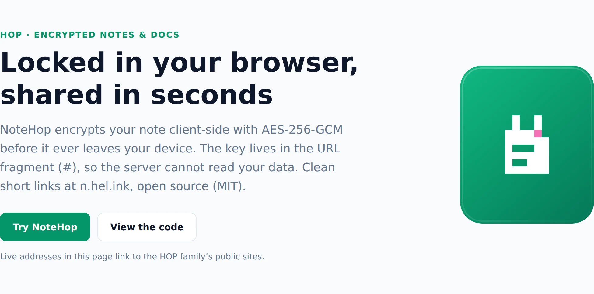

<p align="center">🌐 <b>English</b> · <a href="README.zh.md">简体中文</a> · <a href="README.es.md">Español</a> · <a href="README.ar.md">العربية</a> · <a href="README.pt.md">Português</a> · <a href="README.fr.md">Français</a> · <a href="README.ja.md">日本語</a> · <a href="README.ru.md">Русский</a> · <a href="README.id.md">Bahasa Indonesia</a></p>

<p align="center"><picture><source media="(prefers-color-scheme: dark)" srcset="docs/readme/hero-en-dark.webp"></picture></p>

<p align="center">
  <b>Write a note, send the link, done.<br>It's locked in your browser before it's saved, so not even the server can read it.</b>
</p>

<p align="center">
  <a href="https://note.hel.ink"><b>✍️ Try it online</b></a> ·
  <a href="#run-your-own">Run your own</a> ·
  <a href="#features">Features</a> ·
  <a href="#faq">FAQ</a> ·
  <a href="docs/SELF-HOSTING.md">Self-hosting guide</a> ·
  <a href="docs/REFERENCE.md">Reference</a> ·
  <a href="CHANGELOG.md">Changelog</a>
</p>

<p align="center"><sub>One Go binary + one SQLite file · 9 languages · no ads, no trackers · free and open source (MIT)</sub></p>

> [!IMPORTANT]
> **The key is in the link.** Whoever has the link can read the note, and if you lose every link, nobody can open it again: not you, not the server, not us. Send links to the people you mean, and keep your owner link somewhere safe.

---

## What is NoteHop?

Think of a note as a letter in a locked box. NoteHop locks the box **in your browser**, puts the key in the link, and only then sends the box to the server. The server keeps a box it can't open. Whoever you give the link to can open it, right there in their own browser.

On top of that, a note can do much more than a notepad: links with different rights (read only, can write, reply only, tick only), deleting itself after it's read, writing together live, checklists, polls, forms, code, and even small web pages that run in a sealed box.

**Good for you if you:**
- send passwords, addresses or private notes through chat and don't want them sitting in the history,
- share a shopping list, a meeting note or a sign-up sheet without making everyone create an account,
- want a pastebin or notepad you can run on your own server, in one file.

<p align="center"><picture><source media="(prefers-color-scheme: dark)" srcset="docs/readme/demo-dark.webp"></picture></p>

<details>
<summary><b>A closer look</b></summary>

<p align="center"><picture><source media="(prefers-color-scheme: dark)" srcset="docs/readme/note-dark.webp"></picture></p>
<p align="center"><picture><source media="(prefers-color-scheme: dark)" srcset="docs/readme/share-dark.webp"></picture></p>
<p align="center"><picture><source media="(prefers-color-scheme: dark)" srcset="docs/readme/tour-dark.webp"></picture></p>
<p align="center"><picture><source media="(prefers-color-scheme: dark)" srcset="docs/readme/web-dark.webp"></picture></p>
<p align="center"><picture><source media="(prefers-color-scheme: dark)" srcset="docs/readme/phone-dark.webp"></picture></p>

</details>

## What the server sees, and what it never sees

| 🙈 Never reaches the server | 👀 What the server does see |
|---|---|
| The note's title and text | Scrambled text (ciphertext) and its size |
| The key (it's after the `#` in the link, which browsers never send) | When the note was made, changed and opened, and how many times |
| Attachments, chat messages and live edits (locked too) | Which kind of link was used (read only, can write…) |
| Your account password and your list of notes | Which checkboxes are ticked, and how many replies there are |
| Text you send to AI writing help (it goes from your browser straight to the provider you pick) | Your IP address, for rate limits |

<a id="features"></a>

## Features

- **🔒 Locked in your browser.** AES-256-GCM with a random 256-bit key that lives only in the link. Add an extra password if you like.
- **🔗 Many links, different rights.** Read only, can write, reply only (like a guestbook) or tick only (for checklists). A link leaked? Turn it off; the others keep working.
- **🔑 Owner link.** A separate link to change, share, freeze or delete the note.
- **🔥 Delete after reading.** Opened 1, 3 or 10 times, then destroyed. Chat apps' link preview bots don't use up a view.
- **⏳ Expiry and time capsules.** Gone after 10 minutes to 30 days, or locked until the date you pick.
- **🏷️ Your own address + QR.** `/monday-meeting`, and a QR code made in your browser.
- **📌 Fixed copies and sign-off.** Freeze a version nobody can change, and let readers approve it with their name.
- **🧑‍🤝‍🧑 Write together.** Everyone's cursor and name live, a chat on the side and "follow the presenter". The server only passes locked data along.
- **✅ Smart blocks.** Checklists, polls (one vote each), forms, a calculator, Mermaid diagrams, a Kanban board from your headings, and secret blocks behind a PIN or ones that destroy themselves.
- **📝 Note types.** Plain (like Notepad), Document (Markdown with a `/` menu and a right-click format menu), Code (line numbers, never run, downloads as `.txt`) and Web.
- **🌐 Web notes.** HTML, CSS and JS files in one note, with a Run button, the result and a console. The code runs only in a sealed box in your browser, with no internet and no access to the page, and readers are asked before someone else's code runs.
- **✨ Writing help (optional).** Summarize, rewrite, translate, fix spelling. Use your browser's built-in AI (the text stays on your device) or your own API key (Claude, ChatGPT, Gemini, OpenRouter or Ollama). NoteHop never sees the text or the key.
- **📎 Attachments.** Drop files or images into a note; they're locked too and kept for 24 hours.
- **👤 Accounts are optional.** With one, your list of notes is locked with a key only your password opens. Recovery codes get you back in if you forget the password.
- **🕵️ Extra privacy.** Decoy password (opens a fake note), only from certain networks, a leak tracer that tells you which link leaked, and history with differences.
- **📶 Nearby.** Send a pad or files to a device on the same Wi-Fi, straight from browser to browser.
- **🧑‍💻 For developers.** `/raw` for curl, a `notehop` CLI that encrypts in the terminal, a mock API from JSON in a note, webhooks in and out, SSH and a Telegram bot.
- **🌍 9 languages.** English, 简体中文, Español, العربية (right to left), Português, Français, 日本語, Русский and Bahasa Indonesia. Anonymous visitors see English; use the globe menu or `?lang=xx` to choose another language.
- **🛡️ Strict by default.** A strict Content Security Policy, no third-party scripts, no ads, no trackers, `noindex`, rate limits. Works offline as an installable app (PWA).

<a id="run-your-own"></a>

## Run your own

NoteHop is **one Go binary and one SQLite file**. No Node, no build step, no other services.

**Option 1: on a VPS** (systemd + Caddy or nginx, daily backups)

```bash
git clone https://github.com/navi-crwn/NoteHop.git && cd NoteHop
sudo DOMAIN=note.example.com ./deploy/install.sh
```

The full guide, with HTTPS, updates, backups and restore, is in **[docs/SELF-HOSTING.md](docs/SELF-HOSTING.md)**.

**Option 2: on your own computer** (needs Go 1.27+)

```bash
go run ./cmd/notehop -addr 127.0.0.1:8090 -db data/dev.db
```

Open http://127.0.0.1:8090. Browsers only allow the encryption on **HTTPS or localhost**.

**Option 3: Docker**

```bash
docker build -t notehop .
docker run -d -p 127.0.0.1:8090:8080 -v notehop:/data -e NOTEHOP_BASE_URL=https://note.example.com notehop
```

Every setting is an environment variable (`NOTEHOP_*`). They're all listed in **[docs/REFERENCE.md](docs/REFERENCE.md)**, together with the encryption model and the API.

## Your first note

1. Open the home page, type in the box, and watch the scrambled text the server would get.
2. Pick who can do what: **View only**, **Can write** or **Can reply**. Tick **Read once** for a secret.
3. Press **Create link** and send it. That's it, no account needed.
4. Want more (timing, extra privacy, writing together)? Use **Open the full notepad**, or the **Share** button on any note you own.

<a id="faq"></a>

## FAQ

**Can the people who run the server read my notes?**
No. The note is locked in your browser before it's sent, and the key is in the part of the link after `#`, which browsers never send to a server. The server only has scrambled text.

**What if I lose the link?**
Then the note can't be opened, by anyone. If you have an account, your notes are listed in **My notes** and you can open them from there. Without an account, recent notes are remembered in this browser only.

**Is "delete after reading" safe from link previews?**
Yes. Opening the page alone doesn't show the content; the reader presses a button first. Chat apps' preview bots get a preview card, not a view.

**Does the AI read my notes?**
Writing help is off until you choose it. Your browser's built-in AI works on your device. With your own API key, the text goes from your browser straight to that provider, never through NoteHop. Server owners can switch AI off with `NOTEHOP_AI=off`.

**Can code in a note hack the people who open it?**
Code notes are never run: they're shown as text and download as `.txt`. Web notes run only in a sealed frame with no internet, no cookies and no access to the note page or its key, and readers are asked first.

**Can I use my own login server?**
Yes. NoteHop has its own accounts, and can also sign people in through an account server you run (single sign-on). See `NOTEHOP_SSO_*` in [docs/REFERENCE.md](docs/REFERENCE.md).

**What happens if someone shares something harmful?**
Every note has **Report this note** in its menu. The report (a reason and a short message, never the note's content) goes to the people who run the site. They can't read a locked note, but they can take it down, and the link name is then kept back for a year. Operators review reports from the `notehop takedown` command or from a control center over the [HOP App Protocol](docs/REFERENCE.md#control-center-hop-app-protocol).

**How do I back up?**
`notehop backup -db notehop.db copy.db` works while the server runs. The VPS installer also sets up a daily backup. Notes stay locked in the backup too.

## Under the hood

| Folder | What's in it |
|---|---|
| `cmd/notehop/` | The program: server, settings, and the `backup`, `new`, `get` and `takedown` commands |
| `internal/app/` | HTTP handlers, note features, live collaboration relay, SSH, Telegram, single sign-on |
| `internal/db/` | SQLite schema and automatic migrations |
| `internal/client/` | The CLI's encryption (the same as the browser's) |
| `internal/i18n/` | Loading the 9 languages, and a test that keeps them in step |
| `web/templates/`, `web/static/` | Pages, plain JavaScript and CSS, no build step. Third-party libraries are vendored in `web/static/vendor/` |
| `web/i18n/` | The UI text in 9 languages |
| `deploy/` | Installer, systemd units, backups, Caddy and nginx examples |
| `scripts/` | Browser tests (Playwright): `./scripts/e2e-all.sh` runs every suite against a fresh server |

Run the tests with `go test -race ./...` and `./scripts/e2e-all.sh`.

<a id="family"></a>

## The Hop family

NoteHop is part of the HOP family of privacy-respecting, self-hostable open-source apps.

<!-- hop-family:start -->
<!-- Generated from HEL.ink resources/hop-assets/apps.source.json; edit there, then run scripts/hop_assets.py build. -->
| App | Address | Repository | What it does |
| --- | --- | --- | --- |
| **HOP ID** | [hel.ink](https://hel.ink) · accounts at `hub.hel.ink` | [navi-crwn/HEL.ink](https://github.com/navi-crwn/HEL.ink) | One account for every HOP app. |
| **LinkHop** | [link.hel.ink](https://link.hel.ink) · `hel.ink/l/…` | [navi-crwn/LinkHop](https://github.com/navi-crwn/LinkHop) | Short links, QR codes and click analytics. |
| **BioHop** | [bio.hel.ink](https://bio.hel.ink) · `hel.ink/b/…` | [navi-crwn/BioHop](https://github.com/navi-crwn/BioHop) | One link-in-bio page for everything you do. |
| **PixelHop** | [p.hel.ink](https://p.hel.ink) | [navi-crwn/PixelHop](https://github.com/navi-crwn/PixelHop) | Image hosting with albums and direct links. |
| **NoteHop** | [note.hel.ink](https://note.hel.ink) · `n.hel.ink/…` | [navi-crwn/NoteHop](https://github.com/navi-crwn/NoteHop) | Encrypted notes you share with a link. |
| **Imperium** | private (owner only) | private | The HOP control panel. |
<!-- hop-family:end -->

---

<p align="center">MIT License · <a href="docs/REFERENCE.md">Reference</a> · <a href="docs/SELF-HOSTING.md">Self-hosting</a> · <a href="CHANGELOG.md">Changelog</a><br><sub>HEL.ink family: <a href="https://github.com/navi-crwn/LinkHop">LinkHop</a> (short links) · <a href="https://github.com/navi-crwn/BioHop">BioHop</a> · <a href="https://github.com/navi-crwn/PixelHop">PixelHop</a> (image hosting) · <a href="https://note.hel.ink">NoteHop</a></sub></p>
