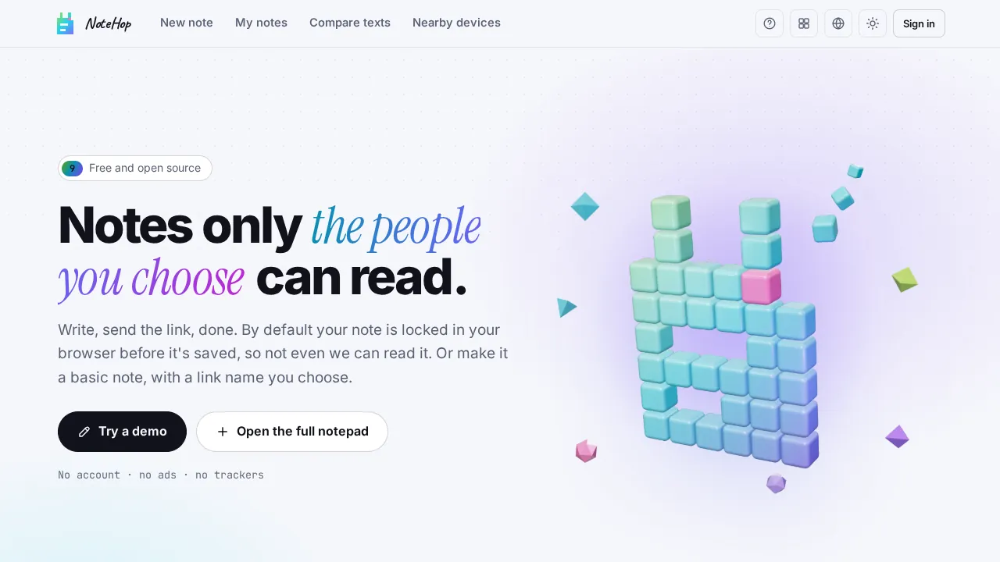

<p align="center">🌐 <b>English</b> · <a href="README.zh-CN.md">简体中文</a> · <a href="README.de.md">Deutsch</a> · <a href="README.id.md">Bahasa Indonesia</a> · <a href="README.ja.md">日本語</a> · <a href="README.pt-BR.md">Português (Brasil)</a> · <a href="README.es.md">Español</a> · <a href="README.fr.md">Français</a> · <a href="README.ru.md">Русский</a></p>

<p align="center"><picture><source media="(prefers-color-scheme: dark)" srcset="docs/readme/hero-en-dark.webp"></picture></p>

<p align="center"><b>Write a note, send the link, done.</b><br>By default the note is encrypted in your browser before it is saved, so the server stores text it cannot read.</p>

<p align="center">
  <a href="https://note.hel.ink"><b>Try it online</b></a> ·
  <a href="https://navi-crwn.github.io/NoteHop/">Website</a> ·
  <a href="#run-your-own">Run your own</a> ·
  <a href="#encrypted-and-basic-notes">Encrypted and basic notes</a> ·
  <a href="#faq">FAQ</a> ·
  <a href="docs/SELF-HOSTING.md">Self-hosting guide</a> ·
  <a href="docs/REFERENCE.md">Reference</a> ·
  <a href="CHANGELOG.md">Changelog</a>
</p>

<p align="center"><sub>One Go binary and one SQLite file · 9 languages · no ads, no trackers · free and open source (MIT)</sub></p>

> [!IMPORTANT]
> An encrypted note keeps its key in the link. Whoever has the link can read the note, and if every copy of the link is lost, nobody can open it again, including the server and the people who run it. A basic note works differently: the server stores its text as plain text and can read it. Use basic notes only for things you are happy for the server's operator to read.

NoteHop is a note-sharing app you can run yourself. You write a note, get a link and send it. Each link carries its own rights (read only, can write, reply only, tick only), a note can delete itself after it has been read, and several people can write in it at the same time.

It is for people who:

- send passwords, addresses or private notes through chat and do not want them to stay in the history,
- share a shopping list, a meeting note or a sign-up sheet without asking everyone to create an account,
- want a pastebin or notepad they can host on their own server, as one file.

Install it with one command. The script checks your computer, asks a few questions, and can set up the HOP ID account hub for you:

```bash
curl -fsSL https://raw.githubusercontent.com/navi-crwn/NoteHop/main/install.sh | bash
```

From a clone: `./install.sh`. Update with `./update.sh` and remove with `./uninstall.sh`. Add `--yes` to accept every default; `--help` lists the options.

<p align="center"><picture><source media="(prefers-color-scheme: dark)" srcset="docs/readme/demo-dark.webp"></picture></p>

<details>
<summary>More screenshots</summary>

<p align="center"><picture><source media="(prefers-color-scheme: dark)" srcset="docs/readme/new-dark.webp"></picture></p>
<p align="center"><picture><source media="(prefers-color-scheme: dark)" srcset="docs/readme/note-dark.webp"></picture></p>
<p align="center"><picture><source media="(prefers-color-scheme: dark)" srcset="docs/readme/share-dark.webp"></picture></p>
<p align="center"><picture><source media="(prefers-color-scheme: dark)" srcset="docs/readme/basic-dark.webp"></picture></p>
<p align="center"><picture><source media="(prefers-color-scheme: dark)" srcset="docs/readme/web-dark.webp"></picture></p>
<p align="center"><picture><source media="(prefers-color-scheme: dark)" srcset="docs/readme/dashboard-dark.webp"></picture></p>
<p align="center"><picture><source media="(prefers-color-scheme: dark)" srcset="docs/readme/tour-dark.webp"></picture></p>
<p align="center"><picture><source media="(prefers-color-scheme: dark)" srcset="docs/readme/phone-dark.webp"></picture></p>

</details>

<a id="encrypted-and-basic-notes"></a>

## Encrypted and basic notes

Every new note starts with one choice.

| | Encrypted (the default) | Basic |
|---|---|---|
| Who can read the text | Whoever has the full link, which contains the key | Whoever has the link, and the server |
| How it is stored | As ciphertext (AES-256-GCM) | As plain text in the database and in its backups |
| Link | Random, with the key after `#k=` | A name you choose, such as `/monday-meeting`, or a random one |
| Password, decoy password, self-destructing blocks | Yes | No |
| `/raw`, the mock API, SSH, your public `/@name` page | No | Yes |
| Search engines | Never indexed | Never indexed |

The owner can change a note from one type to the other in the Share dialog. The browser encrypts or decrypts the text and the server swaps it in. Links and settings stay. Version history is cleared, and a note that has added lines, suggestions, a decoy, self-destructing blocks, an inbox or sign-offs cannot change type yet.

Attachments and live editing work in both types. In a basic note the server can read those as well, because an attachment's key is stored in the note text and live edits are not encrypted.

Link previews, for example in a chat app, show only that a note exists and what kind it is, never its title or text.

<a id="what-the-server-sees"></a>

## What the server sees

For an encrypted note:

| Never reaches the server | What the server does see |
|---|---|
| The note's title and text | The ciphertext and its size |
| The key (it sits after the `#` in the link, which browsers do not send) | When the note was made, changed and opened, and how many times |
| Replies, suggestions, sign-off names, chat messages and live edits | Which kind of link was used (read only, can write, and so on), and the link addresses |
| Attachments (the files are encrypted too) | Expiry, lock and open times, and the networks you allow, if you set them |
| Your account password and the list of your notes with their titles | Which checkboxes are ticked, how many votes each poll option has, and how many replies there are |
| Text you send to the writing help (it goes from your browser to the provider you pick) | Your IP address, for rate limits and the network limits you set; your username if you have an account |

How far "the server cannot read it" goes:

- It applies to encrypted notes. Basic notes are readable. So are features that work on plain text: `/raw`, the mock API, SSH, and the inbox and Telegram bot, where the server sees the text as it arrives and then stores it sealed to the note's key.
- It depends on the code the server sends to your browser. The encryption runs in JavaScript that the server delivers, so an operator who changed that code could capture keys from people who open notes. A strict Content Security Policy keeps third-party scripts out but does not change this. If that matters to you, run NoteHop yourself, read the code, or use the `notehop` command-line program, which encrypts on your own machine.
- The link is the key. Anyone who holds it can read the note, including any service that stores a link you pasted into it.
- Some details are stored readable even for an encrypted note: the content warning label and its optional reason (up to 255 characters), which are shown before the note opens, and the reason and message of a report that someone files against a note.
- Backups of the database hold everything the database holds: ciphertext, the text of basic notes and account records.

## Features

- Encrypted in your browser. AES-256-GCM with a random 256-bit key that lives only in the link. You can add a password on top.
- Many links with different rights: read only, can write, reply only (like a guestbook), tick only (for checklists) or suggest changes. If a link leaks, turn that one off and the others keep working. A separate owner link changes, shares, freezes or deletes the note.
- Delete after reading: the note is destroyed after it has been opened 1, 3 or 10 times. Link preview bots in chat apps do not use up a view, because the reader presses a button first.
- Expiry and time capsules: a note disappears after 10 minutes up to 30 days, or stays closed until a date you pick.
- Your own address and a QR code for basic notes, for example `/monday-meeting`. The QR code is made in your browser.
- Fixed copies that nobody can change, and sign-off, where readers approve a version with their name.
- Writing together: you see each other's cursors and names live, there is a chat on the side, and everyone can follow the presenter. In an encrypted note the server passes along encrypted data.
- Blocks in the text: checklists, polls (one vote each), forms, a calculator, Mermaid diagrams, a Kanban board built from your headings, slides, and secret blocks behind a PIN or ones that destroy themselves.
- Note types: Plain (like Notepad), Document (Markdown with a `/` menu and a right-click format menu), Code (line numbers, never run, downloads as `.txt`) and Web.
- Web notes: HTML, CSS and JS files in one note, with a Run button, the result and a console. The code runs in an isolated frame in your browser with no internet access and no access to the note page, its cookies or its key. Readers are asked before someone else's code runs.
- Writing help, optional: summarize, rewrite, translate and fix spelling. It uses your browser's built-in AI, which stays on your device, or your own API key for Claude, ChatGPT, Gemini, OpenRouter or Ollama. The text and the key go from your browser to the provider and never through NoteHop.
- Content warnings: mark a note 18+ or sensitive, with an optional reason. Readers confirm before the note opens, and `/raw` and the mock API honour the same check.
- Attachments: drop files or images into a note. They are encrypted in the browser, kept for 24 hours by default (`NOTEHOP_FILE_TTL_HOURS`), and limited to 5 MB per file, with a shared storage budget and a per-account limit (`NOTEHOP_FILES_ACCOUNT_MB`, 100 MB by default) that the operator can set.
- Accounts are optional. With one, your list of notes is encrypted with a key that only your password can open. Eight one-time recovery codes get you back in if you forget the password. Operators can also connect a single sign-on account server, such as HOP ID.
- Extra privacy: a decoy password that opens a fake note, access only from certain networks, a leak tracer that shows which link a copied text came from, and version history with differences.
- Nearby: send a pad or files to a device on the same network, directly from browser to browser.
- For developers: `/raw` for curl, the `notehop` CLI that encrypts in the terminal, a mock API from JSON in a basic note, webhooks in and out, SSH and a Telegram bot.
- Nine languages: English, 简体中文, Deutsch, Bahasa Indonesia, 日本語, Português (Brasil), Español, Français and Русский. Anonymous visitors see English. Use the globe menu or `?lang=xx` to pick another.
- No ads, no trackers, no third-party scripts, and an installable offline app (PWA).
- Reports and moderation: every note has **Report this note**. Operators review reports with the `notehop takedown` command or from a control center over the [HOP App Protocol](docs/REFERENCE.md#control-center-hop-app-protocol).

<a id="run-your-own"></a>

## Command line

The `notehop` binary is also a small client. It encrypts and decrypts on your own machine, so the server never sees the text.

```bash
notehop new -server https://note.example.com < note.md                  # prints the share link (the admin link goes to stderr)
notehop new -server https://note.example.com < note.md | notehop get    # the two pipe together
echo "https://note.example.com/TOKEN#k=…" | notehop get                 # link from stdin; "TOKEN KEY" works too, with -server
notehop decrypt -key "https://note.example.com/TOKEN#k=…" payload.txt   # offline: never connects
```

`decrypt` reads the stored payload (the sealed text, or the JSON an open request returns) from a file or stdin and opens it with the key from the link. A note with a password also needs `-password` and the salt of the note (`-salt`). Ready-made binaries for Linux (amd64, arm64), macOS (arm64, amd64) and Windows (amd64), with a `SHA256SUMS` file, are attached to each release.

## Run your own

NoteHop is one Go binary and one SQLite file. It needs no Node, no build step and no other services.

The installer at the top of this page is the easiest way on a computer you control. For a public server, use one of these.

On a VPS (systemd, with Caddy or nginx for HTTPS and a daily backup):

```bash
git clone https://github.com/navi-crwn/NoteHop.git && cd NoteHop
sudo DOMAIN=note.example.com ./deploy/install.sh
```

The [self-hosting guide](docs/SELF-HOSTING.md) covers HTTPS, updates, backups and restoring.

On your own computer for development (needs Go 1.27 or newer):

```bash
go run ./cmd/notehop -addr 127.0.0.1:8090 -db data/dev.db
```

Open http://127.0.0.1:8090. Browsers only allow the encryption on HTTPS or on localhost.

With Docker:

```bash
docker build -t notehop .
docker run -d -p 127.0.0.1:8090:8080 -v notehop:/data -e NOTEHOP_BASE_URL=https://note.example.com notehop
```

Every setting is an environment variable that starts with `NOTEHOP_`. They are listed in [docs/REFERENCE.md](docs/REFERENCE.md) together with the encryption model and the API.

Backups: `notehop backup -db notehop.db copy.db` makes a copy while the server runs, and the file is readable by its owner only. The VPS installer also sets up a daily backup that is kept for 14 days. A backup contains basic notes as plain text, so store it with care.

## Your first note

1. Open the home page, type in the box and watch the scrambled text the server would get.
2. Choose who can do what: **View only**, **Can write** or **Can reply**. Turn on **Read once** for a secret.
3. Press **Create encrypted link** and send the link. No account is needed.
4. For more (timing, extra privacy, writing together), use **Open the full notepad**, or the **Share** button on any note you own. To make a note basic with a link name, pick **Basic** at the top of the New note page.

<a id="faq"></a>

## FAQ

**Can the people who run the server read my notes?**
Not an encrypted note. Your browser encrypts it before it is sent, and the key is in the part of the link after `#`, which browsers do not send to a server. The server has only the scrambled text. A basic note is readable by the server. See [What the server sees](#what-the-server-sees) for the limits of this claim.

**What if I lose the link?**
For an encrypted note, nobody can open it any more. If you have an account, your notes are listed under My notes and you can open them from there. Without an account, recent notes are remembered in that browser only. A basic note is easy to find again by its link name.

**Is "delete after reading" safe from link previews?**
Yes. Opening the page does not show the content. The reader presses a button first, and the preview bots of chat apps get a preview card, not a view.

**Does the AI read my notes?**
Writing help is off until you use it. Your browser's built-in AI works on your device. With your own API key, the text goes from your browser to that provider and never through NoteHop. Operators can switch it off with `NOTEHOP_AI=off`.

**Can code in a note attack the people who open it?**
Code notes are never run. They are shown as text and download as `.txt`. Web notes run only in an isolated frame with no internet, no cookies and no access to the note page or its key, and readers are asked first.

**Can I use my own login server?**
Yes. NoteHop has its own accounts and can also sign people in through an account server you run (single sign-on). See the `NOTEHOP_SSO_*` settings in [docs/REFERENCE.md](docs/REFERENCE.md).

**What happens if someone shares something harmful?**
Every note has **Report this note** in its menu. The report (a reason and a short message, never the note's content) goes to the people who run the site. They cannot read an encrypted note, but they can take it down, and the link name is then held back for a year.

## Under the hood

| Folder | What is in it |
|---|---|
| `cmd/notehop/` | The program: the server, its settings, and the `backup`, `new`, `get` and `takedown` commands |
| `internal/app/` | HTTP handlers, note features, the live collaboration relay, SSH, Telegram, single sign-on, the HOP App Protocol |
| `internal/db/` | The SQLite schema and automatic migrations |
| `internal/client/` | The CLI's encryption, the same as the browser's |
| `internal/i18n/` | Loading the 9 languages, and a test that keeps them in step |
| `web/templates/`, `web/static/` | Pages, plain JavaScript and CSS, no build step. Third-party libraries are vendored in `web/static/vendor/` |
| `web/i18n/` | The interface text in 9 languages, one JSON file each |
| `web/changelog.json` | A snapshot of the commit and pull request history, shown on the `/changelog` page. Generated by `scripts/build-changelog.py` |
| `deploy/` | The VPS installer, systemd units, backups, Caddy and nginx examples |
| `docs/` | The documentation site (GitHub Pages), the reference, the self-hosting guide and the README images |
| `scripts/` | Browser tests (Playwright), run all with `./scripts/e2e-all.sh`, and the helper scripts |

Run the tests with `go test -race ./...` and `./scripts/e2e-all.sh`.

## Security, license and history

- To report a vulnerability, follow [SECURITY.md](SECURITY.md). Please do not open a public issue for it.
- [CHANGELOG.md](CHANGELOG.md) lists what changed, newest first.
- NoteHop is released under the [MIT License](LICENSE). The vendored libraries and fonts keep their own licenses, listed in [docs/REFERENCE.md](docs/REFERENCE.md#third-party-code).

<a id="family"></a>

## Self-hosting

<!-- self-hosting:start -->
Everything NoteHop needs is in public repositories: no private repository, no token and no hel.ink account. The family guide has the details: [docs/self-hosting.md](https://github.com/navi-crwn/HEL.ink/blob/main/docs/self-hosting.md).

| Piece | For NoteHop | What it does |
| --- | --- | --- |
| [HEL.ink](https://github.com/navi-crwn/HEL.ink) (hub, HOP ID) | Optional: adds “Sign in with HOP ID” | Accounts and sign-in for every app |
| [Imperium](https://github.com/navi-crwn/Imperium) | Optional | Admin panel for the whole family; needs the hub |
| Family fonts and tiles | Nothing to install: loaded from `hel.ink/hop-assets` | Without hel.ink: system fonts, no floating tiles |

- **Install order**: NoteHop alone with `./install.sh`. For HOP ID sign-in, the [hub](https://github.com/navi-crwn/HEL.ink) first: `./install.sh --hub new` installs one next to it.
- **Minimum settings**: `NOTEHOP_BASE_URL`; with the hub: `NOTEHOP_SSO_URL`, `NOTEHOP_SSO_CLIENT=notehop`, `NOTEHOP_SSO_SECRET`.
- **Alone or in the family**: NoteHop runs alone with its own accounts. With a hub, people can also sign in with HOP ID and sign out of every app at once.
- **Without Imperium**: NoteHop keeps working; take a note down with `notehop takedown` and `notehop backup` on the server.
<!-- self-hosting:end -->

## The Hop family

NoteHop is part of the HOP family of privacy-respecting, self-hostable open-source apps.

<!-- hop-family:start -->
<!-- Generated from HEL.ink resources/hop-assets/apps.source.json; edit there, then run scripts/hop_assets.py build. -->
| App | Address | Repository | What it does |
| --- | --- | --- | --- |
| **HOP ID** | [hel.ink](https://hel.ink) · accounts at `hub.hel.ink` | [navi-crwn/HEL.ink](https://github.com/navi-crwn/HEL.ink) | One account for every HOP app. |
| **LinkHop** | [link.hel.ink](https://link.hel.ink) · `hel.ink/l/…` | [navi-crwn/LinkHop](https://github.com/navi-crwn/LinkHop) | Short links, QR codes and click analytics. |
| **BioHop** | [bio.hel.ink](https://bio.hel.ink) · `hel.ink/b/…` | [navi-crwn/BioHop](https://github.com/navi-crwn/BioHop) | One link-in-bio page for everything you do. |
| **PixelHop** | [pixel.hel.ink](https://pixel.hel.ink) · `p.hel.ink/…` | [navi-crwn/PixelHop](https://github.com/navi-crwn/PixelHop) | Image hosting with albums and direct links. |
| **NoteHop** | [note.hel.ink](https://note.hel.ink) · `n.hel.ink/…` | [navi-crwn/NoteHop](https://github.com/navi-crwn/NoteHop) | Encrypted notes you share with a link. |
| **FileHop** | [file.hel.ink](https://file.hel.ink) | [navi-crwn/FileHop](https://github.com/navi-crwn/FileHop) | Convert files in your browser; nothing is uploaded. |
| **PayHop** | [pay.hel.ink](https://pay.hel.ink) | [navi-crwn/PayHop](https://github.com/navi-crwn/PayHop) | Make a payment QR and split a bill; nothing leaves your browser. |
| **Imperium** | not public-facing: optional, for admins | [navi-crwn/Imperium](https://github.com/navi-crwn/Imperium) | The HOP control panel. |
<!-- hop-family:end -->
