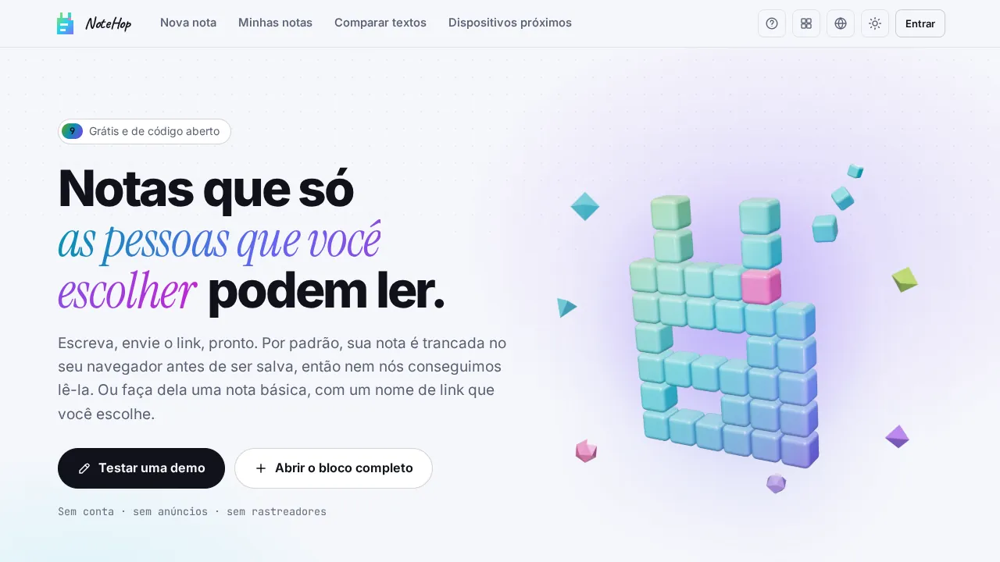

<p align="center">🌐 <a href="README.md">English</a> · <a href="README.zh-CN.md">简体中文</a> · <a href="README.de.md">Deutsch</a> · <a href="README.id.md">Bahasa Indonesia</a> · <a href="README.ja.md">日本語</a> · <b>Português (Brasil)</b> · <a href="README.es.md">Español</a> · <a href="README.fr.md">Français</a> · <a href="README.ru.md">Русский</a></p>

<p align="center"><picture><source media="(prefers-color-scheme: dark)" srcset="docs/readme/hero-pt-dark.webp"></picture></p>

<p align="center"><b>Escreva uma nota, envie o link, pronto.</b><br>Por padrão, a nota é criptografada no seu navegador antes de ser salva, então o servidor guarda um texto que não consegue ler.</p>

<p align="center">
  <a href="https://note.hel.ink"><b>Experimente online</b></a> ·
  <a href="https://navi-crwn.github.io/NoteHop/">Site</a> ·
  <a href="#run-your-own">Hospede você mesmo</a> ·
  <a href="#encrypted-and-basic-notes">Notas criptografadas e básicas</a> ·
  <a href="#faq">FAQ</a> ·
  <a href="docs/SELF-HOSTING.md">Guia de auto-hospedagem</a> ·
  <a href="docs/REFERENCE.md">Referência</a> ·
  <a href="CHANGELOG.md">Histórico de mudanças</a>
</p>

<p align="center"><sub>Um programa Go e um arquivo SQLite · 9 idiomas · sem anúncios, sem rastreadores · gratuito e de código aberto (MIT)</sub></p>

> [!IMPORTANT]
> Uma nota criptografada guarda a chave no link. Quem tem o link pode ler a nota, e se todas as cópias do link se perderem, ninguém consegue abri-la de novo, nem o servidor nem as pessoas que o operam. Uma nota básica funciona de outro jeito: o servidor guarda o texto dela como texto simples e pode lê-lo. Use notas básicas só para coisas que você aceita que o operador do servidor leia.

O NoteHop é um aplicativo de compartilhamento de notas que você pode hospedar por conta própria. Você escreve uma nota, recebe um link e o envia. Cada link tem seus próprios direitos (somente leitura, pode escrever, só responder, só marcar), a nota pode se apagar depois de lida, e várias pessoas podem escrever nela ao mesmo tempo.

Ele serve a quem:

- envia senhas, endereços ou notas privadas por chat e não quer que fiquem no histórico,
- compartilha uma lista de compras, uma ata de reunião ou uma lista de inscrição sem pedir que todos criem uma conta,
- quer um pastebin ou bloco de notas para hospedar no próprio servidor, em um único arquivo.

Instale com um comando. O script verifica o seu computador, faz algumas perguntas e também pode configurar para você o hub de contas HOP ID:

```bash
curl -fsSL https://raw.githubusercontent.com/navi-crwn/NoteHop/main/install.sh | bash
```

A partir de um clone: `./install.sh`. Atualize com `./update.sh` e remova com `./uninstall.sh`. Adicione `--yes` para aceitar todos os padrões; `--help` lista as opções.

<p align="center"><picture><source media="(prefers-color-scheme: dark)" srcset="docs/readme/demo-dark.webp"></picture></p>

<details>
<summary>Mais capturas de tela</summary>

<p align="center"><picture><source media="(prefers-color-scheme: dark)" srcset="docs/readme/new-dark.webp"></picture></p>
<p align="center"><picture><source media="(prefers-color-scheme: dark)" srcset="docs/readme/note-dark.webp"></picture></p>
<p align="center"><picture><source media="(prefers-color-scheme: dark)" srcset="docs/readme/share-dark.webp"></picture></p>
<p align="center"><picture><source media="(prefers-color-scheme: dark)" srcset="docs/readme/basic-dark.webp"></picture></p>
<p align="center"><picture><source media="(prefers-color-scheme: dark)" srcset="docs/readme/web-dark.webp"></picture></p>
<p align="center"><picture><source media="(prefers-color-scheme: dark)" srcset="docs/readme/dashboard-dark.webp"></picture></p>
<p align="center"><picture><source media="(prefers-color-scheme: dark)" srcset="docs/readme/tour-dark.webp"></picture></p>
<p align="center"><picture><source media="(prefers-color-scheme: dark)" srcset="docs/readme/phone-dark.webp"></picture></p>

</details>

<a id="encrypted-and-basic-notes"></a>

## Notas criptografadas e básicas

Toda nota nova começa com uma escolha.

| | Criptografada (padrão) | Básica |
|---|---|---|
| Quem pode ler o texto | Quem tem o link completo, que contém a chave | Quem tem o link, e o servidor |
| Como é guardada | Como texto cifrado (AES-256-GCM) | Como texto simples no banco de dados e nos backups dele |
| Link | Aleatório, com a chave depois de `#k=` | Um nome que você escolhe, como `/monday-meeting`, ou um aleatório |
| Senha, senha-isca, blocos que se autodestroem | Sim | Não |
| `/raw`, a API de simulação (mock), SSH, sua página pública `/@name` | Não | Sim |
| Mecanismos de busca | Nunca indexada | Nunca indexada |

O proprietário pode mudar uma nota de um tipo para o outro na caixa Compartilhar. O navegador criptografa ou descriptografa o texto, e o servidor só o troca. Links e configurações permanecem. O histórico de versões é apagado, e uma nota com linhas adicionadas, sugestões, isca, blocos que se autodestroem, caixa de entrada ou assinaturas ainda não pode mudar de tipo.

Anexos e edição ao vivo funcionam nos dois tipos. Numa nota básica, o servidor também consegue ler esses itens, porque a chave de um anexo fica guardada no texto da nota e as edições ao vivo não são criptografadas.

As pré-visualizações de links, por exemplo num aplicativo de chat, mostram apenas que existe uma nota e de que tipo ela é, nunca o título nem o texto.

<a id="what-the-server-sees"></a>

## O que o servidor vê

Para uma nota criptografada:

| Nunca chega ao servidor | O que o servidor vê |
|---|---|
| O título e o texto da nota | O texto cifrado e o tamanho dele |
| A chave (fica depois do `#` no link, que os navegadores não enviam) | Quando a nota foi criada, alterada e aberta, e quantas vezes |
| Respostas, sugestões, nomes de assinaturas, mensagens de chat e edições ao vivo | Que tipo de link foi usado (somente leitura, pode escrever e assim por diante) e os endereços dos links |
| Anexos (os arquivos também são criptografados) | Expiração, horários de bloqueio e de abertura, e as redes permitidas, se você os definir |
| A senha da sua conta e a lista das suas notas com os títulos | Quais caixas estão marcadas, quantos votos cada opção de enquete tem e quantas respostas existem |
| O texto que você envia à ajuda de escrita (vai do seu navegador direto ao provedor que você escolher) | Seu endereço IP, para limites de uso e para os limites de rede que você definir; seu nome de usuário, se tiver conta |

Até onde vai o "o servidor não consegue ler":

- Vale para notas criptografadas. Notas básicas são legíveis. Também são os recursos que trabalham com texto simples: `/raw`, a API de simulação, o SSH, e a caixa de entrada e o bot do Telegram, em que o servidor vê o texto quando ele chega e depois o guarda selado com a chave da nota.
- Depende do código que o servidor envia ao seu navegador. A criptografia roda em JavaScript entregue pelo servidor, então um operador que alterasse esse código poderia capturar chaves de quem abre notas. Uma Content Security Policy rígida mantém scripts de terceiros de fora, mas não muda isso. Se isso importa para você, hospede o NoteHop por conta própria, leia o código ou use o programa de linha de comando `notehop`, que criptografa na sua própria máquina.
- O link é a chave. Quem o tem pode ler a nota, inclusive qualquer serviço que guarde um link que você colou nele.
- Alguns detalhes ficam guardados de forma legível mesmo numa nota criptografada: o rótulo do aviso de conteúdo e o motivo opcional dele (até 255 caracteres), que são mostrados antes de a nota abrir, e o motivo e a mensagem de uma denúncia feita contra uma nota.
- Os backups do banco de dados contêm tudo o que o banco contém: texto cifrado, o texto das notas básicas e os registros de contas.

## Recursos

- Criptografada no navegador. AES-256-GCM com uma chave aleatória de 256 bits que vive só no link. Você pode acrescentar uma senha.
- Vários links com direitos diferentes: somente leitura, pode escrever, só responder (como um livro de visitas), só marcar (para listas de tarefas) ou sugerir alterações. Se um link vazar, desligue só esse e os outros continuam funcionando. Um link de proprietário à parte altera, compartilha, congela ou apaga a nota.
- Apagar depois de ler: a nota é destruída depois de aberta 1, 3 ou 10 vezes. Os bots de pré-visualização dos aplicativos de chat não gastam uma abertura, porque a pessoa que lê aperta um botão antes.
- Expiração e cápsulas do tempo: a nota some depois de 10 minutos até 30 dias, ou fica fechada até uma data que você escolher.
- Seu próprio endereço e um código QR para notas básicas, por exemplo `/monday-meeting`. O código QR é gerado no seu navegador.
- Cópias fixas que ninguém pode alterar e aprovação por assinatura, em que quem lê aprova uma versão com o próprio nome.
- Escrever junto: vocês veem os cursores e os nomes uns dos outros ao vivo, há um chat ao lado e todos podem acompanhar quem apresenta. Numa nota criptografada, o servidor repassa dados criptografados.
- Blocos no texto: listas de tarefas, enquetes (um voto por pessoa), formulários, uma calculadora, diagramas Mermaid, um quadro Kanban montado a partir dos seus títulos, slides e blocos secretos protegidos por PIN ou que se autodestroem.
- Tipos de nota: Simples (como o Bloco de Notas), Documento (Markdown com menu `/` e menu de formatação no clique direito), Código (números de linha, nunca executado, baixado como `.txt`) e Web.
- Notas web: arquivos HTML, CSS e JS numa só nota, com botão Executar, o resultado e um console. O código roda num quadro isolado no seu navegador, sem acesso à internet e sem acesso à página da nota, aos cookies dela nem à chave. Quem lê é consultado antes de o código de outra pessoa rodar.
- Ajuda de escrita, opcional: resumir, reescrever, traduzir e corrigir a ortografia. Usa a IA embutida do navegador, que fica no seu dispositivo, ou a sua própria chave de API do Claude, ChatGPT, Gemini, OpenRouter ou Ollama. O texto e a chave vão do seu navegador ao provedor e nunca passam pelo NoteHop.
- Avisos de conteúdo: marque uma nota como 18+ ou sensível, com um motivo opcional. Quem lê confirma antes de a nota abrir, e `/raw` e a API de simulação respeitam a mesma verificação.
- Anexos: solte arquivos ou imagens numa nota. Eles são criptografados no navegador, guardados por 24 horas e limitados a 5 MB por arquivo, com um orçamento de armazenamento compartilhado que o operador pode definir.
- As contas são opcionais. Com uma conta, a lista das suas notas é criptografada com uma chave que só a sua senha abre. Oito códigos de recuperação de uso único trazem você de volta se esquecer a senha. Os operadores também podem conectar um servidor de contas com login único, como o HOP ID.
- Privacidade extra: uma senha-isca que abre uma nota falsa, acesso só de certas redes, um rastreador de vazamento que mostra por qual link um texto copiado saiu e histórico de versões com diferenças.
- Por perto: envie um bloco ou arquivos para um dispositivo na mesma rede, direto de navegador para navegador.
- Para desenvolvedores: `/raw` para o curl, a CLI `notehop` que criptografa no terminal, uma API de simulação a partir de JSON numa nota básica, webhooks de entrada e de saída, SSH e um bot do Telegram.
- Nove idiomas: English, 简体中文, Deutsch, Bahasa Indonesia, 日本語, Português (Brasil), Español, Français e Русский. Visitantes anônimos veem inglês. Use o menu do globo ou `?lang=xx` para escolher outro.
- Sem anúncios, sem rastreadores, sem scripts de terceiros, e um aplicativo offline instalável (PWA).
- Denúncias e moderação: toda nota tem **Denunciar esta nota**. Os operadores analisam as denúncias com o comando `notehop takedown` ou a partir de uma central de controle por meio do [HOP App Protocol](docs/REFERENCE.md#control-center-hop-app-protocol).

<a id="run-your-own"></a>

## Hospede você mesmo

O NoteHop é um programa Go e um arquivo SQLite. Não precisa de Node, de etapa de build nem de outros serviços.

O instalador no início desta página é o jeito mais fácil num computador que você controla. Para um servidor público, use uma destas opções.

Num VPS (systemd, com Caddy ou nginx para HTTPS e um backup diário):

```bash
git clone https://github.com/navi-crwn/NoteHop.git && cd NoteHop
sudo DOMAIN=note.example.com ./deploy/install.sh
```

O [guia de auto-hospedagem](docs/SELF-HOSTING.md) cobre HTTPS, atualizações, backups e restauração.

No seu próprio computador, para desenvolvimento (precisa do Go 1.27 ou mais recente):

```bash
go run ./cmd/notehop -addr 127.0.0.1:8090 -db data/dev.db
```

Abra http://127.0.0.1:8090. Os navegadores só permitem a criptografia em HTTPS ou em localhost.

Com Docker:

```bash
docker build -t notehop .
docker run -d -p 127.0.0.1:8090:8080 -v notehop:/data -e NOTEHOP_BASE_URL=https://note.example.com notehop
```

Toda configuração é uma variável de ambiente que começa com `NOTEHOP_`. Elas estão listadas em [docs/REFERENCE.md](docs/REFERENCE.md), junto com o modelo de criptografia e a API.

Backups: `notehop backup -db notehop.db copy.db` faz uma cópia com o servidor em execução, e o arquivo só pode ser lido pelo proprietário. O instalador de VPS também configura um backup diário, mantido por 14 dias. Um backup contém as notas básicas como texto simples, então guarde-o com cuidado.

## Sua primeira nota

1. Abra a página inicial, digite na caixa e veja o texto embaralhado que o servidor receberia.
2. Escolha quem pode fazer o quê: **Somente leitura**, **Pode escrever** ou **Pode responder**. Ative **Leitura única** para um segredo.
3. Aperte **Criar link criptografado** e envie o link. Não é preciso ter conta.
4. Para mais opções (horários, privacidade extra, escrita em conjunto), use **Abrir o bloco completo** ou o botão **Compartilhar** em qualquer nota sua. Para uma nota básica com nome de link, escolha **Básica** no alto da página Nova nota.

<a id="faq"></a>

## FAQ

**As pessoas que operam o servidor podem ler minhas notas?**
Uma nota criptografada, não. Seu navegador a criptografa antes de enviá-la, e a chave fica na parte do link depois do `#`, que os navegadores não enviam a um servidor. O servidor só tem o texto embaralhado. Uma nota básica o servidor consegue ler. Veja [O que o servidor vê](#what-the-server-sees) para os limites dessa afirmação.

**E se eu perder o link?**
Numa nota criptografada, ninguém mais consegue abri-la. Se você tem uma conta, suas notas aparecem em Minhas notas e você pode abri-las de lá. Sem conta, as notas recentes ficam lembradas só naquele navegador. Uma nota básica é fácil de encontrar de novo pelo nome do link.

**"Apagar depois de ler" é seguro contra pré-visualizações de links?**
Sim. Abrir a página não mostra o conteúdo. Quem lê aperta um botão primeiro, e os bots de pré-visualização dos aplicativos de chat recebem um cartão de pré-visualização, não uma abertura.

**A IA lê as minhas notas?**
A ajuda de escrita fica desligada até você usá-la. A IA embutida do navegador funciona no seu dispositivo. Com a sua própria chave de API, o texto vai do seu navegador direto a esse provedor e nunca passa pelo NoteHop. Os operadores podem desligá-la com `NOTEHOP_AI=off`.

**O código numa nota pode atacar quem a abre?**
Notas de código nunca são executadas. Elas aparecem como texto e são baixadas como `.txt`. Notas web só rodam num quadro isolado, sem internet, sem cookies e sem acesso à página da nota ou à chave dela, e quem lê é consultado antes.

**Posso usar o meu próprio servidor de login?**
Sim. O NoteHop tem contas próprias e também pode autenticar pessoas por um servidor de contas que você opera (login único). Veja as configurações `NOTEHOP_SSO_*` em [docs/REFERENCE.md](docs/REFERENCE.md).

**O que acontece se alguém compartilhar algo nocivo?**
Toda nota tem **Denunciar esta nota** no menu. A denúncia (um motivo e uma mensagem curta, nunca o conteúdo da nota) vai para as pessoas que operam o site. Elas não conseguem ler uma nota criptografada, mas podem derrubá-la, e o nome do link fica retido por um ano.

## Por baixo do capô

| Pasta | O que há nela |
|---|---|
| `cmd/notehop/` | O programa: o servidor, as configurações dele e os comandos `backup`, `new`, `get` e `takedown` |
| `internal/app/` | Handlers HTTP, recursos das notas, o relay de escrita em conjunto, SSH, Telegram, login único, o HOP App Protocol |
| `internal/db/` | O esquema SQLite e as migrações automáticas |
| `internal/client/` | A criptografia da CLI, igual à do navegador |
| `internal/i18n/` | O carregamento dos 9 idiomas e um teste que os mantém em sincronia |
| `web/templates/`, `web/static/` | Páginas, JavaScript puro e CSS, sem etapa de build. As bibliotecas de terceiros vêm incluídas em `web/static/vendor/` |
| `web/i18n/` | Os textos da interface em 9 idiomas, um arquivo JSON para cada |
| `web/changelog.json` | Um instantâneo do histórico de commits e pull requests, exibido na página `/changelog`. Gerado por `scripts/build-changelog.py` |
| `deploy/` | O instalador de VPS, units do systemd, backups, exemplos de Caddy e nginx |
| `docs/` | O site de documentação (GitHub Pages), a referência, o guia de auto-hospedagem e as imagens do README |
| `scripts/` | Testes de navegador (Playwright), todos com `./scripts/e2e-all.sh`, e os scripts auxiliares |

Execute os testes com `go test -race ./...` e `./scripts/e2e-all.sh`.

## Segurança, licença e histórico

- Para relatar uma vulnerabilidade, siga o [SECURITY.md](SECURITY.md). Por favor, não abra uma issue pública para isso.
- O [CHANGELOG.md](CHANGELOG.md) lista o que mudou, das mudanças mais recentes às mais antigas.
- O NoteHop é distribuído sob a [Licença MIT](LICENSE). As bibliotecas e fontes incluídas mantêm suas próprias licenças, listadas em [docs/REFERENCE.md](docs/REFERENCE.md#third-party-code).

<a id="family"></a>

## Hospedagem própria

<!-- self-hosting:start -->
Tudo o que o NoteHop precisa está em repositórios públicos: nenhum repositório privado, nenhum token e nenhuma conta no hel.ink. Os detalhes estão no guia da família: [docs/self-hosting.md](https://github.com/navi-crwn/HEL.ink/blob/main/docs/self-hosting.md) (em inglês).

| Peça | Para o NoteHop | O que faz |
| --- | --- | --- |
| [HEL.ink](https://github.com/navi-crwn/HEL.ink) (hub, HOP ID) | Opcional: adiciona “Entrar com HOP ID” | Contas e login para todos os apps |
| [Imperium](https://github.com/navi-crwn/Imperium) | Opcional | Painel de administração de toda a família; precisa do hub |
| Fontes e blocos da família | Nada a instalar: carregados de `hel.ink/hop-assets` | Sem hel.ink: fontes do sistema, sem blocos flutuantes |

- **Ordem de instalação**: o NoteHop sozinho com `./install.sh`. Para login com HOP ID, primeiro o [hub](https://github.com/navi-crwn/HEL.ink): `./install.sh --hub new` instala um ao lado.
- **Configuração mínima**: `NOTEHOP_BASE_URL`; com o hub: `NOTEHOP_SSO_URL`, `NOTEHOP_SSO_CLIENT=notehop`, `NOTEHOP_SSO_SECRET`.
- **Sozinho ou na família**: o NoteHop funciona sozinho, com contas próprias. Com um hub, as pessoas também podem entrar com HOP ID e sair de todos os apps de uma vez.
- **Sem o Imperium**: o NoteHop continua funcionando; retire uma nota com `notehop takedown` e `notehop backup` no servidor.
<!-- self-hosting:end -->

## A família Hop

O NoteHop faz parte da família HOP, de aplicativos de código aberto que respeitam a privacidade e podem ser hospedados por você mesmo.

<!-- hop-family:start -->
<!-- Generated from HEL.ink resources/hop-assets/apps.source.json; edit there, then run scripts/hop_assets.py build. -->
| App | Address | Repository | What it does |
| --- | --- | --- | --- |
| **HOP ID** | [hel.ink](https://hel.ink) · accounts at `hub.hel.ink` | [navi-crwn/HEL.ink](https://github.com/navi-crwn/HEL.ink) | One account for every HOP app. |
| **LinkHop** | [link.hel.ink](https://link.hel.ink) · `hel.ink/l/…` | [navi-crwn/LinkHop](https://github.com/navi-crwn/LinkHop) | Short links, QR codes and click analytics. |
| **BioHop** | [bio.hel.ink](https://bio.hel.ink) · `hel.ink/b/…` | [navi-crwn/BioHop](https://github.com/navi-crwn/BioHop) | One link-in-bio page for everything you do. |
| **PixelHop** | [pixel.hel.ink](https://pixel.hel.ink) · `p.hel.ink/…` | [navi-crwn/PixelHop](https://github.com/navi-crwn/PixelHop) | Image hosting with albums and direct links. |
| **NoteHop** | [note.hel.ink](https://note.hel.ink) · `n.hel.ink/…` | [navi-crwn/NoteHop](https://github.com/navi-crwn/NoteHop) | Encrypted notes you share with a link. |
| **FileHop** | [file.hel.ink](https://file.hel.ink) | [navi-crwn/FileHop](https://github.com/navi-crwn/FileHop) | Convert files in your browser; nothing is uploaded. |
| **PayHop** | [pay.hel.ink](https://pay.hel.ink) | [navi-crwn/PayHop](https://github.com/navi-crwn/PayHop) | Make a payment QR and split a bill; nothing leaves your browser. |
| **Imperium** | not public-facing: optional, for admins | [navi-crwn/Imperium](https://github.com/navi-crwn/Imperium) | The HOP control panel. |
<!-- hop-family:end -->
