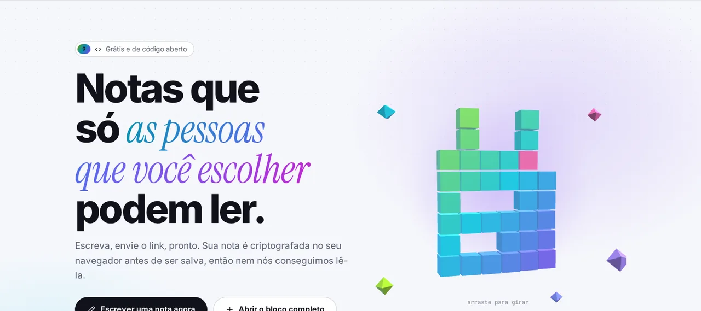

<p align="center">🌐 <a href="README.md">English</a> · <a href="README.zh.md">简体中文</a> · <a href="README.es.md">Español</a> · <a href="README.ar.md">العربية</a> · <b>Português</b> · <a href="README.fr.md">Français</a> · <a href="README.ja.md">日本語</a> · <a href="README.ru.md">Русский</a> · <a href="README.id.md">Bahasa Indonesia</a></p>

<p align="center"><picture><source media="(prefers-color-scheme: dark)" srcset="docs/readme/hero-pt-dark.webp"></picture></p>

<p align="center">
  <b>Escreva uma nota, envie o link, pronto.<br>Ela é trancada no seu navegador antes de ser salva, então nem o servidor consegue ler.</b>
</p>

<p align="center">
  <a href="https://note.hel.ink"><b>✍️ Experimente online</b></a> ·
  <a href="#run-your-own">Hospede você mesmo</a> ·
  <a href="#features">Recursos</a> ·
  <a href="#faq">Perguntas</a> ·
  <a href="docs/SELF-HOSTING.md">Guia de servidor (EN)</a> ·
  <a href="docs/REFERENCE.md">Referência (EN)</a> ·
  <a href="CHANGELOG.md">Mudanças</a>
</p>

<p align="center"><sub>Um binário Go + um arquivo SQLite · 9 idiomas · sem anúncios nem rastreadores · gratuito e de código aberto (MIT)</sub></p>

> [!IMPORTANT]
> **A chave está no link.** Quem tem o link pode ler a nota, e se você perder todos os links, ninguém mais consegue abri-la: nem você, nem o servidor, nem nós. Envie os links só para quem deve recebê-los e guarde seu link de dono em um lugar seguro.

---

## O que é o NoteHop?

Pense numa nota como uma carta dentro de uma caixa trancada. O NoteHop tranca a caixa **no seu navegador**, coloca a chave no link e só então envia a caixa ao servidor. O servidor guarda uma caixa que não consegue abrir. Quem receber o link abre ali mesmo, no próprio navegador.

Além disso, uma nota faz muito mais que um bloco de notas: links com permissões diferentes (somente leitura, pode escrever, só responder, só marcar), apagar-se depois de lida, escrever junto ao vivo, listas de tarefas, enquetes, formulários, código e até pequenas páginas web que rodam numa caixa isolada.

**É para você se:**
- você envia senhas, endereços ou notas pessoais pelo chat e não quer que fiquem no histórico,
- quer compartilhar uma lista de compras, uma ata de reunião ou uma lista de inscrição sem obrigar todo mundo a criar conta,
- quer um pastebin ou bloco de notas que rode no seu próprio servidor, em um só arquivo.

<p align="center"><picture><source media="(prefers-color-scheme: dark)" srcset="docs/readme/demo-dark.webp"></picture></p>

<details>
<summary><b>Um olhar mais de perto</b> (interface em inglês)</summary>

<p align="center"><picture><source media="(prefers-color-scheme: dark)" srcset="docs/readme/note-dark.webp"></picture></p>
<p align="center"><picture><source media="(prefers-color-scheme: dark)" srcset="docs/readme/share-dark.webp"></picture></p>
<p align="center"><picture><source media="(prefers-color-scheme: dark)" srcset="docs/readme/tour-dark.webp"></picture></p>
<p align="center"><picture><source media="(prefers-color-scheme: dark)" srcset="docs/readme/web-dark.webp"></picture></p>
<p align="center"><picture><source media="(prefers-color-scheme: dark)" srcset="docs/readme/phone-dark.webp"></picture></p>

</details>

## O que o servidor vê, e o que ele nunca vê

| 🙈 Nunca chega ao servidor | 👀 O que o servidor vê |
|---|---|
| O título e o texto da nota | Texto embaralhado (cifrado) e o tamanho dele |
| A chave (fica depois do `#` no link, que os navegadores nunca enviam) | Quando a nota foi criada, alterada e aberta, e quantas vezes |
| Anexos, mensagens de chat e edições ao vivo (também trancados) | Que tipo de link foi usado (somente leitura, pode escrever…) |
| A senha da sua conta e a sua lista de notas | Quais caixas estão marcadas e quantas respostas existem |
| O texto que você envia à ajuda de escrita com IA (vai do seu navegador direto ao provedor que você escolher) | Seu endereço IP, para limites de uso |

<a id="features"></a>

## Recursos

- **🔒 Trancada no seu navegador.** AES-256-GCM com uma chave aleatória de 256 bits que só existe no link. Dá para somar uma senha extra.
- **🔗 Vários links, permissões diferentes.** Somente leitura, pode escrever, só responder (como um livro de visitas) ou só marcar (para listas). Um link vazou? Desligue; os outros continuam funcionando.
- **🔑 Link de dono.** Um link separado para mudar, compartilhar, congelar ou apagar a nota.
- **🔥 Apagar depois de ler.** Aberta 1, 3 ou 10 vezes e destruída. Os robôs de pré-visualização dos apps de chat não gastam aberturas.
- **⏳ Validade e cápsulas do tempo.** Some depois de 10 minutos a 30 dias, ou fica trancada até a data que você escolher.
- **🏷️ Endereço próprio + QR.** `/n/reuniao-segunda` e um QR code feito no seu navegador.
- **📌 Cópias fixas e assinatura.** Congele uma versão que ninguém pode mudar e deixe os leitores aprovarem com o nome deles.
- **🧑‍🤝‍🧑 Escrever junto.** O cursor e o nome de cada um ao vivo, um chat ao lado e "seguir o apresentador". O servidor só repassa dados trancados.
- **✅ Blocos inteligentes.** Listas de tarefas, enquetes (um voto por pessoa), formulários, calculadora, diagramas Mermaid, um quadro Kanban a partir dos seus títulos e blocos secretos com PIN ou que se autodestroem.
- **📝 Tipos de nota.** Simples (como o Bloco de Notas), Documento (Markdown com menu `/` e menu de formatação no clique direito), Código (números de linha, nunca é executado, baixa como `.txt`) e Web.
- **🌐 Notas web.** Arquivos HTML, CSS e JS numa nota, com botão Executar, o resultado e um console. O código só roda numa caixa isolada no seu navegador, sem internet e sem acesso à página, e o leitor sempre é perguntado antes de rodar o código de outra pessoa.
- **✨ Ajuda para escrever (opcional).** Resumir, reescrever, traduzir, corrigir ortografia. Use a IA embutida do navegador (o texto fica no seu aparelho) ou sua própria chave de API (Claude, ChatGPT, Gemini, OpenRouter ou Ollama). O NoteHop nunca vê o texto nem a chave.
- **📎 Anexos.** Arraste arquivos ou imagens para a nota; também vão trancados e ficam guardados por 24 horas.
- **👤 Conta opcional.** Com uma conta, sua lista de notas é trancada com uma chave que só a sua senha abre. Os códigos de recuperação devolvem o acesso se você esquecer a senha.
- **🕵️ Privacidade extra.** Senha isca (abre uma nota falsa), só de certas redes, um rastreador que mostra qual link vazou e histórico com diferenças.
- **📶 Aparelhos por perto.** Envie uma nota ou arquivos para um aparelho no mesmo Wi-Fi, direto de navegador para navegador.
- **🧑‍💻 Para desenvolvedores.** `/raw` para curl, uma CLI `notehop` que criptografa no terminal, uma API simulada a partir do JSON de uma nota, webhooks de entrada e saída, SSH e um bot do Telegram.
- **🌍 9 idiomas.** English, 简体中文, Español, العربية (da direita para a esquerda), Português, Français, 日本語, Русский e Bahasa Indonesia, escolhido pelo seu navegador.
- **🛡️ Rigoroso por padrão.** Política de segurança de conteúdo rígida, sem scripts de terceiros, sem anúncios nem rastreadores, `noindex`, limites de uso. Funciona offline como app instalável (PWA).

<a id="run-your-own"></a>

## Hospede você mesmo

O NoteHop é **um binário Go e um arquivo SQLite**. Sem Node, sem etapa de build, sem outros serviços.

**Opção 1: num VPS** (systemd + Caddy ou nginx, backup diário)

```bash
git clone https://github.com/navi-crwn/NoteHop.git && cd NoteHop
sudo DOMAIN=note.example.com ./deploy/install.sh
```

O guia completo, com HTTPS, atualizações, backup e restauração, está em **[docs/SELF-HOSTING.md](docs/SELF-HOSTING.md)** (em inglês).

**Opção 2: no seu computador** (precisa do Go 1.27+)

```bash
go run ./cmd/notehop -addr 127.0.0.1:8090 -db data/dev.db
```

Abra http://127.0.0.1:8090. Os navegadores só permitem essa criptografia em **HTTPS ou localhost**.

**Opção 3: Docker**

```bash
docker build -t notehop .
docker run -d -p 127.0.0.1:8090:8080 -v notehop:/data -e NOTEHOP_BASE_URL=https://note.example.com notehop
```

Cada configuração é uma variável de ambiente (`NOTEHOP_*`). Todas estão em **[docs/REFERENCE.md](docs/REFERENCE.md)**, junto com o modelo de criptografia e a API.

## Sua primeira nota

1. Abra a página inicial, digite na caixa e veja o texto embaralhado que o servidor receberia.
2. Escolha quem pode fazer o quê: **Somente leitura**, **Pode escrever** ou **Pode responder**. Marque **Leitura única** para um segredo.
3. Toque em **Criar link** e envie. Pronto, sem conta.
4. Quer mais (prazos, privacidade extra, escrever junto)? Use **Abrir o bloco completo**, ou o botão **Compartilhar** em qualquer nota sua.

<a id="faq"></a>

## Perguntas frequentes

**Quem administra o servidor consegue ler minhas notas?**
Não. A nota é trancada no seu navegador antes de ser enviada, e a chave fica na parte do link depois do `#`, que os navegadores nunca enviam a um servidor. O servidor só tem texto embaralhado.

**E se eu perder o link?**
Aí ninguém consegue abrir a nota. Se você tem conta, suas notas aparecem em **Minhas notas** e podem ser abertas de lá. Sem conta, as notas recentes ficam lembradas só neste navegador.

**"Apagar depois de ler" é seguro contra pré-visualizações de link?**
Sim. Abrir a página não mostra o conteúdo; o leitor toca num botão primeiro. Os robôs de pré-visualização dos apps de chat recebem um cartão, não uma leitura.

**A IA lê minhas notas?**
A ajuda para escrever fica desligada até você escolher. A IA embutida do navegador trabalha no seu aparelho. Com sua própria chave de API, o texto vai do seu navegador direto para esse provedor, nunca pelo NoteHop. Quem administra o servidor pode desligar a IA com `NOTEHOP_AI=off`.

**O código de uma nota pode atacar quem a abre?**
Notas de código nunca são executadas: aparecem como texto e baixam como `.txt`. Notas web só rodam num quadro isolado, sem internet, sem cookies e sem acesso à página da nota ou à chave dela, e o leitor é perguntado antes.

**Posso usar meu próprio servidor de login?**
Pode. O NoteHop tem contas próprias e também pode fazer login por um servidor de contas seu (login único). Veja `NOTEHOP_SSO_*` em [docs/REFERENCE.md](docs/REFERENCE.md).

**O que acontece se alguém compartilhar algo nocivo?**
Toda nota tem **Denunciar esta nota** no menu. A denúncia (um motivo e uma mensagem curta, nunca o conteúdo da nota) vai para quem administra o site. Eles não conseguem ler uma nota cifrada, mas podem retirá-la, e o nome do link fica reservado por um ano. Os operadores revisam denúncias com o comando `notehop takedown` ou por um centro de controle via [HOP App Protocol](docs/REFERENCE.md#control-center-hop-app-protocol).

**Como faço backup?**
`notehop backup -db notehop.db copia.db` funciona com o servidor rodando. O instalador para VPS também agenda um backup diário. No backup, as notas continuam trancadas.

## Por dentro

| Pasta | O que tem |
|---|---|
| `cmd/notehop/` | O programa: servidor, configurações e os comandos `backup`, `new`, `get` e `takedown` |
| `internal/app/` | Handlers HTTP, recursos das notas, retransmissão da colaboração ao vivo, SSH, Telegram, login único |
| `internal/db/` | Esquema SQLite e migrações automáticas |
| `internal/client/` | A criptografia da CLI (a mesma do navegador) |
| `internal/i18n/` | Carregamento dos 9 idiomas e um teste que os mantém alinhados |
| `web/templates/`, `web/static/` | Páginas, JavaScript e CSS puros, sem build. Bibliotecas de terceiros ficam em `web/static/vendor/` |
| `web/i18n/` | Os textos da interface em 9 idiomas |
| `deploy/` | Instalador, unidades systemd, backups, exemplos de Caddy e nginx |
| `scripts/` | Testes de navegador (Playwright): `./scripts/e2e-all.sh` roda todos contra um servidor novo |

Rode os testes com `go test -race ./...` e `./scripts/e2e-all.sh`.

<a id="family"></a>

## A família Hop

O NoteHop tem dois irmãos de código aberto feitos do mesmo jeito: gratuitos, para hospedar você mesmo e sem rastreadores.

|  | O que faz | Experimente | Código |
|---|---|---|---|
| 🔗 **LinkHop** | Links curtos e páginas de link na bio: nomes próprios, QR codes, estatísticas e mais de 20 temas | [hel.ink](https://hel.ink) | [GitHub](https://github.com/navi-crwn/LinkHop) |
| 🖼️ **PixelHop** | Hospedagem de imagens, vídeos e PDF em um só binário Go: remove o GPS no upload, álbuns, ShareX e um estúdio de fotos no navegador | [p.hel.ink](https://p.hel.ink) | [GitHub](https://github.com/navi-crwn/PixelHop) |
| 📝 **NoteHop** | Notas que só as pessoas que você escolher podem ler | [note.hel.ink](https://note.hel.ink) | você está aqui |

---

<p align="center">Licença MIT · <a href="docs/REFERENCE.md">Referência</a> · <a href="docs/SELF-HOSTING.md">Hospede você mesmo</a> · <a href="CHANGELOG.md">Mudanças</a><br><sub>Da família HEL.ink: <a href="https://github.com/navi-crwn/LinkHop">LinkHop</a> (links curtos) · <a href="https://github.com/navi-crwn/PixelHop">PixelHop</a> (hospedagem de imagens) · <a href="https://note.hel.ink">NoteHop</a></sub></p>
