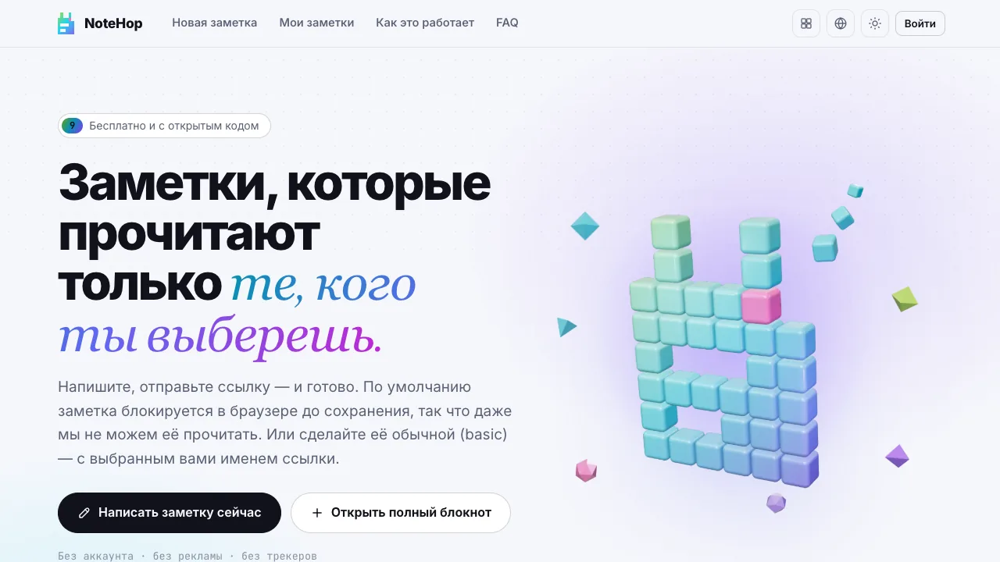

<p align="center">🌐 <a href="README.md">English</a> · <a href="README.zh-CN.md">简体中文</a> · <a href="README.de.md">Deutsch</a> · <a href="README.id.md">Bahasa Indonesia</a> · <a href="README.ja.md">日本語</a> · <a href="README.pt-BR.md">Português (Brasil)</a> · <a href="README.es.md">Español</a> · <a href="README.fr.md">Français</a> · <b>Русский</b></p>

<p align="center"><picture><source media="(prefers-color-scheme: dark)" srcset="docs/readme/hero-ru-dark.webp"></picture></p>

<p align="center"><b>Напишите заметку, отправьте ссылку, и всё.</b><br>По умолчанию заметка шифруется в вашем браузере до сохранения, поэтому сервер хранит текст, который не может прочитать.</p>

<p align="center">
  <a href="https://note.hel.ink"><b>Попробовать онлайн</b></a> ·
  <a href="https://navi-crwn.github.io/NoteHop/">Сайт</a> ·
  <a href="#run-your-own">Развернуть у себя</a> ·
  <a href="#encrypted-and-basic-notes">Зашифрованные и обычные заметки</a> ·
  <a href="#faq">FAQ</a> ·
  <a href="docs/SELF-HOSTING.md">Руководство по самостоятельному размещению</a> ·
  <a href="docs/REFERENCE.md">Справочник</a> ·
  <a href="CHANGELOG.md">Журнал изменений</a>
</p>

<p align="center"><sub>Одна программа на Go и один файл SQLite · 9 языков · без рекламы и трекеров · бесплатно, с открытым кодом (MIT)</sub></p>

> [!IMPORTANT]
> У зашифрованной заметки ключ лежит в ссылке. Любой, у кого есть ссылка, может прочитать заметку, а если потеряны все копии ссылки, открыть её не сможет никто, включая сервер и тех, кто его обслуживает. Обычная заметка устроена иначе: сервер хранит её текст открытым и может его прочитать. Используйте обычные заметки только для того, что вас не смущает показать владельцу сервера.

NoteHop — приложение для обмена заметками, которое можно развернуть самому. Вы пишете заметку, получаете ссылку и отправляете её. У каждой ссылки свои права (только чтение, можно писать, только ответы, только отметки), заметка может удалиться после прочтения, а писать в ней могут сразу несколько человек.

Оно подходит тем, кто:

- отправляет пароли, адреса или личные заметки через мессенджер и не хочет, чтобы они оставались в истории,
- делится списком покупок, заметкой о встрече или листом записи, не заставляя всех заводить аккаунт,
- хочет pastebin или блокнот на собственном сервере, в виде одного файла.

Установите его одной командой. Скрипт проверит ваш компьютер, задаст несколько вопросов и при желании сам настроит хаб учётных записей HOP ID:

```bash
curl -fsSL https://raw.githubusercontent.com/navi-crwn/NoteHop/main/install.sh | bash
```

Из клона репозитория: `./install.sh`. Обновить можно через `./update.sh`, удалить через `./uninstall.sh`. Флаг `--yes` принимает все значения по умолчанию, а `--help` показывает параметры.

<p align="center"><picture><source media="(prefers-color-scheme: dark)" srcset="docs/readme/demo-dark.webp"></picture></p>

<details>
<summary>Другие скриншоты</summary>

<p align="center"><picture><source media="(prefers-color-scheme: dark)" srcset="docs/readme/new-dark.webp"></picture></p>
<p align="center"><picture><source media="(prefers-color-scheme: dark)" srcset="docs/readme/note-dark.webp"></picture></p>
<p align="center"><picture><source media="(prefers-color-scheme: dark)" srcset="docs/readme/share-dark.webp"></picture></p>
<p align="center"><picture><source media="(prefers-color-scheme: dark)" srcset="docs/readme/basic-dark.webp"></picture></p>
<p align="center"><picture><source media="(prefers-color-scheme: dark)" srcset="docs/readme/web-dark.webp"></picture></p>
<p align="center"><picture><source media="(prefers-color-scheme: dark)" srcset="docs/readme/dashboard-dark.webp"></picture></p>
<p align="center"><picture><source media="(prefers-color-scheme: dark)" srcset="docs/readme/tour-dark.webp"></picture></p>
<p align="center"><picture><source media="(prefers-color-scheme: dark)" srcset="docs/readme/phone-dark.webp"></picture></p>

</details>

<a id="encrypted-and-basic-notes"></a>

## Зашифрованные и обычные заметки

Каждая новая заметка начинается с одного выбора.

| | Зашифрованная (по умолчанию) | Обычная |
|---|---|---|
| Кто может прочитать текст | Тот, у кого есть полная ссылка с ключом | Тот, у кого есть ссылка, и сервер |
| Как хранится | В виде шифртекста (AES-256-GCM) | Открытым текстом в базе данных и в её резервных копиях |
| Ссылка | Случайная, ключ идёт после `#k=` | Имя на ваш выбор, например `/monday-meeting`, или случайное |
| Пароль, ложный пароль, самоуничтожающиеся блоки | Да | Нет |
| `/raw`, имитация API (mock), SSH, ваша публичная страница `/@name` | Нет | Да |
| Поисковые системы | Никогда не индексируется | Никогда не индексируется |

Владелец может сменить тип заметки в обе стороны в окне «Поделиться». Браузер шифрует или расшифровывает текст, а сервер лишь подменяет его. Ссылки и настройки сохраняются. История версий очищается, а заметку с добавленными строками, предложениями, ложным текстом, самоуничтожающимися блоками, входящими или подписями пока нельзя перевести в другой тип.

Вложения и совместное редактирование работают в обоих типах. В обычной заметке сервер может прочитать и их, потому что ключ вложения хранится в тексте заметки, а правки в реальном времени не шифруются.

Предпросмотр ссылок, например в мессенджере, показывает только то, что заметка существует и какого она типа, но никогда не заголовок и не текст.

<a id="what-the-server-sees"></a>

## Что видит сервер

Для зашифрованной заметки:

| Никогда не попадает на сервер | Что сервер всё же видит |
|---|---|
| Заголовок и текст заметки | Шифртекст и его размер |
| Ключ (он стоит после `#` в ссылке, которую браузеры не отправляют) | Когда заметка создана, изменена и открыта, и сколько раз |
| Ответы, предложения, имена в подписях, сообщения чата и правки в реальном времени | Какой тип ссылки использован (только чтение, можно писать и так далее), и адреса ссылок |
| Вложения (файлы тоже зашифрованы) | Срок действия, время закрытия и открытия и разрешённые сети, если вы их задали |
| Пароль вашей учётной записи и список ваших заметок с заголовками | Какие флажки отмечены, сколько голосов у каждого варианта опроса и сколько ответов |
| Текст, который вы отправляете помощнику по письму (он идёт из вашего браузера прямо к выбранному вами провайдеру) | Ваш IP-адрес, для ограничения частоты запросов и заданных вами сетевых ограничений; имя пользователя, если у вас есть учётная запись |

До чего доходит утверждение «сервер не может прочитать»:

- Оно относится к зашифрованным заметкам. Обычные заметки читаются. Так же читаются функции, которые работают с открытым текстом: `/raw`, имитация API, SSH, а также входящие и бот Telegram, где сервер видит текст при поступлении, а затем хранит его запечатанным ключом заметки.
- Оно зависит от кода, который сервер отправляет вашему браузеру. Шифрование работает в JavaScript, который выдаёт сервер, поэтому оператор, изменивший этот код, мог бы перехватывать ключи у тех, кто открывает заметки. Строгая Content Security Policy не пускает сторонние скрипты, но этого не меняет. Если это важно, разверните NoteHop сами, прочитайте код или используйте программу командной строки `notehop`, которая шифрует на вашей машине.
- Ссылка и есть ключ. Кто ею владеет, тот может прочитать заметку, включая любой сервис, который сохраняет вставленную в него ссылку.
- Часть данных хранится читаемой даже для зашифрованной заметки: метка предупреждения о содержимом и необязательная причина (до 255 символов), которые показываются до открытия заметки, а также причина и сообщение жалобы, поданной на заметку.
- Резервные копии базы данных содержат всё, что есть в базе: шифртекст, текст обычных заметок и данные учётных записей.

## Возможности

- Шифрование в браузере. AES-256-GCM со случайным 256-битным ключом, который есть только в ссылке. Сверху можно добавить пароль.
- Много ссылок с разными правами: только чтение, можно писать, только ответы (как в гостевой книге), только отметки (для списков задач) или предложения правок. Если ссылка утекла, отключите только её, остальные продолжат работать. Отдельная ссылка владельца меняет, раздаёт, замораживает или удаляет заметку.
- Удаление после прочтения: заметка уничтожается после того, как её откроют 1, 3 или 10 раз. Боты предпросмотра в мессенджерах не тратят открытие, потому что читатель сначала нажимает кнопку.
- Срок действия и капсулы времени: заметка исчезает через срок от 10 минут до 30 дней или остаётся закрытой до выбранной вами даты.
- Собственный адрес и QR-код для обычных заметок, например `/monday-meeting`. QR-код создаётся в вашем браузере.
- Зафиксированные копии, которые никто не может изменить, и согласование подписью: читатели подтверждают версию своим именем.
- Совместная работа: вы видите курсоры и имена друг друга в реальном времени, сбоку есть чат, а все могут следовать за ведущим. В зашифрованной заметке сервер передаёт зашифрованные данные.
- Блоки в тексте: списки задач, опросы (один голос на человека), формы, калькулятор, диаграммы Mermaid, доска Kanban из ваших заголовков, слайды, а также секретные блоки под PIN-кодом или самоуничтожающиеся.
- Типы заметок: простая (как «Блокнот»), документ (Markdown с меню `/` и меню форматирования по правому щелчку), код (номера строк, никогда не запускается, скачивается как `.txt`) и веб.
- Веб-заметки: файлы HTML, CSS и JS в одной заметке, с кнопкой запуска, результатом и консолью. Код выполняется в изолированном фрейме в вашем браузере, без доступа в интернет и без доступа к странице заметки, её cookie и ключу. Перед запуском чужого кода читателя спрашивают.
- Помощник по письму, по желанию: сделать краткое изложение, переписать, перевести и исправить орфографию. Он использует встроенный ИИ браузера, который остаётся на вашем устройстве, или ваш собственный ключ API для Claude, ChatGPT, Gemini, OpenRouter или Ollama. Текст и ключ идут из браузера к провайдеру и никогда не проходят через NoteHop.
- Предупреждения о содержимом: пометьте заметку как 18+ или чувствительную, при желании с причиной. Читатель подтверждает, прежде чем заметка откроется, а `/raw` и имитация API соблюдают ту же проверку.
- Вложения: перетащите файлы или изображения в заметку. Они шифруются в браузере, хранятся 24 часа, ограничены 5 МБ на файл и общим бюджетом хранилища, который задаёт оператор.
- Учётные записи необязательны. С ней список ваших заметок шифруется ключом, который открывает только ваш пароль. Восемь одноразовых кодов восстановления вернут доступ, если вы забудете пароль. Операторы могут также подключить сервер учётных записей с единым входом, например HOP ID.
- Дополнительная приватность: ложный пароль, который открывает поддельную заметку, доступ только из определённых сетей, трассировщик утечек, показывающий, через какую ссылку скопирован текст, и история версий с различиями.
- Рядом: отправляйте блокнот или файлы на устройство в той же сети напрямую, из браузера в браузер.
- Для разработчиков: `/raw` для curl, CLI `notehop`, который шифрует в терминале, имитация API из JSON в обычной заметке, входящие и исходящие вебхуки, SSH и бот Telegram.
- Девять языков: English, 简体中文, Deutsch, Bahasa Indonesia, 日本語, Português (Brasil), Español, Français и Русский. Анонимные посетители видят английский. Другой язык выбирается через меню с глобусом или `?lang=xx`.
- Без рекламы, без трекеров, без сторонних скриптов, с устанавливаемым офлайн-приложением (PWA).
- Жалобы и модерация: у каждой заметки есть **Пожаловаться на заметку**. Операторы разбирают жалобы командой `notehop takedown` или из центра управления через [HOP App Protocol](docs/REFERENCE.md#control-center-hop-app-protocol).

<a id="run-your-own"></a>

## Развернуть у себя

NoteHop — это одна программа на Go и один файл SQLite. Ему не нужны ни Node, ни этап сборки, ни другие сервисы.

Установщик в начале этой страницы — самый простой способ на компьютере, который вы контролируете. Для публичного сервера выберите один из вариантов ниже.

На VPS (systemd, Caddy или nginx для HTTPS и ежедневная резервная копия):

```bash
git clone https://github.com/navi-crwn/NoteHop.git && cd NoteHop
sudo DOMAIN=note.example.com ./deploy/install.sh
```

В [руководстве по самостоятельному размещению](docs/SELF-HOSTING.md) описаны HTTPS, обновления, резервные копии и восстановление.

На собственном компьютере для разработки (нужен Go 1.27 или новее):

```bash
go run ./cmd/notehop -addr 127.0.0.1:8090 -db data/dev.db
```

Откройте http://127.0.0.1:8090. Браузеры разрешают шифрование только по HTTPS или на localhost.

С Docker:

```bash
docker build -t notehop .
docker run -d -p 127.0.0.1:8090:8080 -v notehop:/data -e NOTEHOP_BASE_URL=https://note.example.com notehop
```

Каждая настройка — переменная окружения, начинающаяся с `NOTEHOP_`. Все они перечислены в [docs/REFERENCE.md](docs/REFERENCE.md) вместе с моделью шифрования и API.

Резервные копии: `notehop backup -db notehop.db copy.db` делает копию, пока сервер работает, и файл доступен для чтения только владельцу. Установщик для VPS также настраивает ежедневную копию, которая хранится 14 дней. В копии обычные заметки лежат открытым текстом, поэтому храните её осторожно.

## Ваша первая заметка

1. Откройте главную страницу, наберите текст в поле и посмотрите на искажённый текст, который получил бы сервер.
2. Выберите, кто что может: **Только просмотр**, **Может писать** или **Может отвечать**. Для секрета включите **Одно прочтение**.
3. Нажмите **Создать зашифрованную ссылку** и отправьте ссылку. Аккаунт не нужен.
4. Для большего (время, дополнительная приватность, совместная работа) используйте **Открыть полный блокнот** или кнопку **Поделиться** у любой вашей заметки. Чтобы получить обычную заметку с именем ссылки, выберите **Обычная** вверху страницы «Новая заметка».

<a id="faq"></a>

## FAQ

**Могут ли люди, обслуживающие сервер, читать мои заметки?**
Зашифрованную заметку — нет. Ваш браузер шифрует её до отправки, а ключ находится в части ссылки после `#`, которую браузеры не отправляют серверу. У сервера есть только искажённый текст. Обычную заметку сервер прочитать может. О границах этого утверждения см. [Что видит сервер](#what-the-server-sees).

**Что, если я потеряю ссылку?**
Зашифрованную заметку тогда не сможет открыть никто. Если у вас есть учётная запись, ваши заметки перечислены в «Моих заметках», и вы можете открыть их оттуда. Без учётной записи недавние заметки помнит только этот браузер. Обычную заметку легко найти снова по имени ссылки.

**Защищено ли «удаление после прочтения» от предпросмотра ссылок?**
Да. Открытие страницы не показывает содержимое. Читатель сначала нажимает кнопку, а боты предпросмотра в мессенджерах получают карточку предпросмотра, а не открытие.

**Читает ли ИИ мои заметки?**
Помощник по письму выключен, пока вы им не пользуетесь. Встроенный ИИ браузера работает на вашем устройстве. С вашим собственным ключом API текст идёт из браузера прямо к этому провайдеру и никогда не проходит через NoteHop. Операторы могут отключить его через `NOTEHOP_AI=off`.

**Может ли код в заметке атаковать тех, кто её открывает?**
Заметки с кодом никогда не запускаются. Они показываются как текст и скачиваются как `.txt`. Веб-заметки выполняются только в изолированном фрейме без интернета, без cookie и без доступа к странице заметки и её ключу, а читателя сначала спрашивают.

**Можно ли использовать собственный сервер входа?**
Да. У NoteHop есть собственные учётные записи, а войти можно и через сервер учётных записей, который вы запускаете сами (единый вход). См. настройки `NOTEHOP_SSO_*` в [docs/REFERENCE.md](docs/REFERENCE.md).

**Что будет, если кто-то поделится чем-то вредным?**
В меню каждой заметки есть **Пожаловаться на заметку**. Жалоба (причина и короткое сообщение, но никогда не содержимое заметки) уходит тем, кто обслуживает сайт. Зашифрованную заметку они прочитать не могут, но могут её удалить, и имя ссылки после этого удерживается год.

## Под капотом

| Папка | Что в ней |
|---|---|
| `cmd/notehop/` | Программа: сервер, его настройки и команды `backup`, `new`, `get` и `takedown` |
| `internal/app/` | HTTP-обработчики, функции заметок, ретранслятор совместной работы, SSH, Telegram, единый вход, HOP App Protocol |
| `internal/db/` | Схема SQLite и автоматические миграции |
| `internal/client/` | Шифрование в CLI, то же, что в браузере |
| `internal/i18n/` | Загрузка 9 языков и тест, который держит их в согласии |
| `web/templates/`, `web/static/` | Страницы, обычные JavaScript и CSS, без этапа сборки. Сторонние библиотеки лежат в `web/static/vendor/` |
| `web/i18n/` | Тексты интерфейса на 9 языках, по одному файлу JSON на язык |
| `web/changelog.json` | Снимок истории коммитов и pull request, который показывает страница `/changelog`. Создаётся скриптом `scripts/build-changelog.py` |
| `deploy/` | Установщик для VPS, юниты systemd, резервные копии, примеры для Caddy и nginx |
| `docs/` | Сайт документации (GitHub Pages), справочник, руководство по самостоятельному размещению и изображения для README |
| `scripts/` | Браузерные тесты (Playwright), все запускаются через `./scripts/e2e-all.sh`, и вспомогательные скрипты |

Запустите тесты командами `go test -race ./...` и `./scripts/e2e-all.sh`.

## Безопасность, лицензия и история

- О найденной уязвимости сообщайте по инструкции в [SECURITY.md](SECURITY.md). Пожалуйста, не создавайте для этого публичный issue.
- В [CHANGELOG.md](CHANGELOG.md) перечислены изменения, самые свежие первыми.
- NoteHop распространяется по [лицензии MIT](LICENSE). Встроенные библиотеки и шрифты сохраняют свои лицензии, они перечислены в [docs/REFERENCE.md](docs/REFERENCE.md#third-party-code).

<a id="family"></a>

## Собственный хостинг

<!-- self-hosting:start -->
Всё, что нужно NoteHop, лежит в публичных репозиториях: не нужны ни приватный репозиторий, ни токен, ни учётная запись на hel.ink. Подробности — в руководстве по семейству: [docs/self-hosting.md](https://github.com/navi-crwn/HEL.ink/blob/main/docs/self-hosting.md) (на английском).

| Компонент | Для NoteHop | Зачем |
| --- | --- | --- |
| [HEL.ink](https://github.com/navi-crwn/HEL.ink) (хаб, HOP ID) | Необязательно: добавляет «Войти через HOP ID» | Учётные записи и вход для всех приложений |
| [Imperium](https://github.com/navi-crwn/Imperium) | Необязательно | Панель администратора для всего семейства; нужен хаб |
| Шрифты и плитки семейства | Ничего устанавливать не нужно: загружаются с `hel.ink/hop-assets` | Без hel.ink: системные шрифты, без плавающих плиток |

- **Порядок установки**: NoteHop отдельно через `./install.sh`. Для входа через HOP ID сначала [хаб](https://github.com/navi-crwn/HEL.ink): `./install.sh --hub new` установит его рядом.
- **Минимальные настройки**: `NOTEHOP_BASE_URL`; с хабом: `NOTEHOP_SSO_URL`, `NOTEHOP_SSO_CLIENT=notehop`, `NOTEHOP_SSO_SECRET`.
- **Отдельно или в семействе**: NoteHop работает отдельно со своими учётными записями. С хабом можно также входить через HOP ID и выходить сразу из всех приложений.
- **Без Imperium**: NoteHop продолжает работать; заблокировать заметку можно через `notehop takedown` и `notehop backup` на сервере.
<!-- self-hosting:end -->

## Семья Hop

NoteHop входит в семью HOP: открытые приложения, которые уважают приватность и которые можно развернуть самому.

<!-- hop-family:start -->
<!-- Generated from HEL.ink resources/hop-assets/apps.source.json; edit there, then run scripts/hop_assets.py build. -->
| App | Address | Repository | What it does |
| --- | --- | --- | --- |
| **HOP ID** | [hel.ink](https://hel.ink) · accounts at `hub.hel.ink` | [navi-crwn/HEL.ink](https://github.com/navi-crwn/HEL.ink) | One account for every HOP app. |
| **LinkHop** | [link.hel.ink](https://link.hel.ink) · `hel.ink/l/…` | [navi-crwn/LinkHop](https://github.com/navi-crwn/LinkHop) | Short links, QR codes and click analytics. |
| **BioHop** | [bio.hel.ink](https://bio.hel.ink) · `hel.ink/b/…` | [navi-crwn/BioHop](https://github.com/navi-crwn/BioHop) | One link-in-bio page for everything you do. |
| **PixelHop** | [pixel.hel.ink](https://pixel.hel.ink) · `p.hel.ink/…` | [navi-crwn/PixelHop](https://github.com/navi-crwn/PixelHop) | Image hosting with albums and direct links. |
| **NoteHop** | [note.hel.ink](https://note.hel.ink) · `n.hel.ink/…` | [navi-crwn/NoteHop](https://github.com/navi-crwn/NoteHop) | Encrypted notes you share with a link. |
| **FileHop** | [file.hel.ink](https://file.hel.ink) | [navi-crwn/FileHop](https://github.com/navi-crwn/FileHop) | Convert files in your browser; nothing is uploaded. |
| **Imperium** | not public-facing: optional, for admins | [navi-crwn/Imperium](https://github.com/navi-crwn/Imperium) | The HOP control panel. |
<!-- hop-family:end -->
