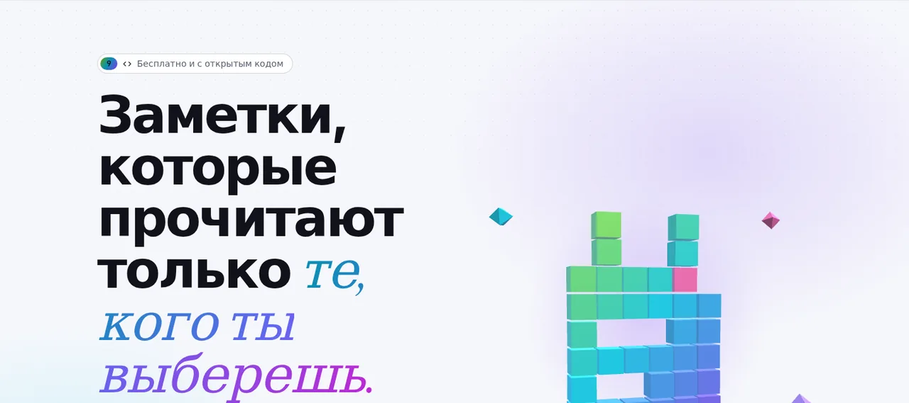

<p align="center">🌐 <a href="README.md">English</a> · <a href="README.zh-CN.md">简体中文</a> · <a href="README.de.md">Deutsch</a> · <a href="README.id.md">Bahasa Indonesia</a> · <a href="README.ja.md">日本語</a> · <a href="README.pt-BR.md">Português (Brasil)</a> · <a href="README.es.md">Español</a> · <a href="README.fr.md">Français</a> · <b>Русский</b></p>

<p align="center"><picture><source media="(prefers-color-scheme: dark)" srcset="docs/readme/hero-ru-dark.webp"></picture></p>

<p align="center">
  <b>Напиши заметку, отправь ссылку, готово.<br>Она запирается в браузере ещё до сохранения, так что даже сервер не может её прочитать.</b>
</p>

<p align="center">
  <a href="https://note.hel.ink"><b>✍️ Попробовать онлайн</b></a> ·
  <a href="https://navi-crwn.github.io/NoteHop/">Website</a> ·
  <a href="#run-your-own">Свой сервер</a> ·
  <a href="#features">Возможности</a> ·
  <a href="#faq">Вопросы</a> ·
  <a href="docs/SELF-HOSTING.md">Руководство по серверу (EN)</a> ·
  <a href="docs/REFERENCE.md">Справочник (EN)</a> ·
  <a href="CHANGELOG.md">Изменения</a>
</p>

<p align="center"><sub>Один бинарник Go + один файл SQLite · 9 языков · без рекламы и трекеров · бесплатно и с открытым кодом (MIT)</sub></p>

> [!IMPORTANT]
> **Ключ находится в ссылке.** Любой, у кого есть ссылка, может прочитать заметку, а если потерять все ссылки, её больше никто не откроет: ни ты, ни сервер, ни мы. Отправляй ссылки только тем, кому они предназначены, и храни ссылку владельца в надёжном месте.

---

Установка одной командой (сначала проверяет ваш компьютер, задаёт несколько вопросов и может сам установить хаб HOP ID):

```bash
curl -fsSL https://raw.githubusercontent.com/navi-crwn/NoteHop/main/install.sh | bash
```

Из клона: `./install.sh` · обновление: `./update.sh` · удаление: `./uninstall.sh`. С `--yes` берутся все значения по умолчанию; `--help` показывает параметры.

## Что такое NoteHop?

Представь заметку как письмо в запертом ящике. NoteHop запирает ящик **в твоём браузере**, кладёт ключ в ссылку и только потом отправляет ящик на сервер. Сервер хранит ящик, который сам открыть не может. Тот, кому ты дашь ссылку, откроет его прямо в своём браузере.

Кроме того, заметка умеет гораздо больше, чем блокнот: ссылки с разными правами (только просмотр, может писать, только ответы, только отметки), удаление после прочтения, совместное письмо вживую, списки дел, опросы, формы, код и даже маленькие веб-страницы, которые работают в изолированном окне.

**Подойдёт тебе, если ты:**
- отправляешь пароли, адреса или личные заметки в чате и не хочешь, чтобы они оставались в истории,
- делишься списком покупок, протоколом встречи или списком участников, не заставляя всех заводить аккаунт,
- хочешь pastebin или блокнот на своём сервере, в одном файле.

<p align="center"><picture><source media="(prefers-color-scheme: dark)" srcset="docs/readme/demo-dark.webp"></picture></p>

<details>
<summary><b>Поближе</b> (интерфейс на английском)</summary>

<p align="center"><picture><source media="(prefers-color-scheme: dark)" srcset="docs/readme/note-dark.webp"></picture></p>
<p align="center"><picture><source media="(prefers-color-scheme: dark)" srcset="docs/readme/share-dark.webp"></picture></p>
<p align="center"><picture><source media="(prefers-color-scheme: dark)" srcset="docs/readme/tour-dark.webp"></picture></p>
<p align="center"><picture><source media="(prefers-color-scheme: dark)" srcset="docs/readme/web-dark.webp"></picture></p>
<p align="center"><picture><source media="(prefers-color-scheme: dark)" srcset="docs/readme/phone-dark.webp"></picture></p>

</details>

## Что видит сервер, а что не видит никогда

| 🙈 Никогда не попадает на сервер | 👀 Что сервер всё-таки видит |
|---|---|
| Заголовок и текст заметки | Зашифрованный текст и его размер |
| Ключ (он после `#` в ссылке, а эту часть браузеры никогда не отправляют) | Когда заметку создали, изменили и открыли, и сколько раз |
| Вложения, сообщения чата и правки при совместной работе (тоже зашифрованы) | Какой тип ссылки использовали (только просмотр, может писать…) |
| Пароль от аккаунта и список твоих заметок | Какие флажки отмечены и сколько ответов |
| Текст, который ты отправляешь помощнику с ИИ (он идёт из браузера прямо к выбранному поставщику) | Твой IP-адрес, для ограничения частоты запросов |

<a id="features"></a>

## Возможности

- **🔒 Заперто в браузере.** AES-256-GCM со случайным 256-битным ключом, который есть только в ссылке. Можно добавить ещё и пароль.
- **🔗 Много ссылок, разные права.** Только просмотр, может писать, только ответы (как гостевая книга) или только отметки (для списков). Ссылка утекла? Отключи её, остальные продолжат работать.
- **🔑 Ссылка владельца.** Отдельная ссылка, чтобы менять, делиться, замораживать или удалять заметку.
- **🔥 Удалить после прочтения.** Открыта 1, 3 или 10 раз и уничтожена. Боты предпросмотра ссылок в мессенджерах не тратят открытия.
- **⏳ Срок жизни и капсулы времени.** Исчезает через 10 минут — 30 дней или остаётся запертой до выбранной даты.
- **🏷️ Свой адрес + QR.** `/monday-meeting` и QR-код, созданный в браузере.
- **📌 Неизменные копии и подпись.** Заморозь версию, которую никто не изменит, и дай читателям одобрить её своим именем.
- **🧑‍🤝‍🧑 Писать вместе.** Курсор и имя каждого вживую, чат сбоку и «следовать за докладчиком». Сервер лишь передаёт зашифрованные данные.
- **✅ Умные блоки.** Списки дел, опросы (один голос на человека), формы, калькулятор, диаграммы Mermaid, Kanban-доска из заголовков и секретные блоки под PIN-кодом или самоуничтожающиеся.
- **📝 Типы заметок.** Простой текст (как Блокнот), документ (Markdown с меню `/` и меню форматирования по правому клику), код (номера строк, никогда не запускается, скачивается как `.txt`) и веб.
- **🌐 Веб-заметки.** Файлы HTML, CSS и JS в одной заметке, с кнопкой запуска, результатом и консолью. Код работает только в изолированном окне в твоём браузере, без интернета и без доступа к странице, а перед запуском чужого кода читателя всегда спрашивают.
- **✨ Помощь в письме (по желанию).** Пересказать, переписать, перевести, исправить ошибки. Встроенный ИИ браузера (текст остаётся на устройстве) или свой ключ API (Claude, ChatGPT, Gemini, OpenRouter или Ollama). NoteHop никогда не видит ни текст, ни ключ.
- **📎 Вложения.** Перетащи файлы или картинки в заметку; они тоже зашифрованы и хранятся 24 часа.
- **👤 Аккаунт не обязателен.** С аккаунтом список заметок запирается ключом, который открывает только твой пароль. Коды восстановления вернут доступ, если пароль забыт.
- **🕵️ Дополнительная приватность.** Пароль-приманка (открывает поддельную заметку), доступ только из определённых сетей, поиск утечки, который покажет, какая ссылка утекла, и история с различиями.
- **📶 Устройства рядом.** Отправь заметку или файлы на устройство в той же сети Wi-Fi, напрямую из браузера в браузер.
- **🧑‍💻 Для разработчиков.** `/raw` для curl, CLI `notehop`, который шифрует в терминале, фальшивый API из JSON в заметке, входящие и исходящие вебхуки, SSH и бот Telegram.
- **🌍 9 языков.** English, 简体中文, Español, العربية (справа налево), Português, Français, 日本語, Русский и Bahasa Indonesia, выбираются по браузеру.
- **🛡️ Строго по умолчанию.** Строгая политика безопасности контента, без сторонних скриптов, без рекламы и трекеров, `noindex`, ограничения частоты. Работает офлайн как устанавливаемое приложение (PWA).

<a id="run-your-own"></a>

## Свой сервер

NoteHop — это **один бинарник Go и один файл SQLite**. Без Node, без сборки, без других сервисов.

**Вариант 1: на VPS** (systemd + Caddy или nginx, ежедневные резервные копии)

```bash
git clone https://github.com/navi-crwn/NoteHop.git && cd NoteHop
sudo DOMAIN=note.example.com ./deploy/install.sh
```

Полное руководство с HTTPS, обновлениями, резервными копиями и восстановлением — в **[docs/SELF-HOSTING.md](docs/SELF-HOSTING.md)** (на английском).

**Вариант 2: на своём компьютере** (нужен Go 1.27+)

```bash
go run ./cmd/notehop -addr 127.0.0.1:8090 -db data/dev.db
```

Открой http://127.0.0.1:8090. Браузеры разрешают такое шифрование только по **HTTPS или на localhost**.

**Вариант 3: Docker**

```bash
docker build -t notehop .
docker run -d -p 127.0.0.1:8090:8080 -v notehop:/data -e NOTEHOP_BASE_URL=https://note.example.com notehop
```

Каждая настройка — переменная окружения (`NOTEHOP_*`). Полный список, модель шифрования и API — в **[docs/REFERENCE.md](docs/REFERENCE.md)**.

## Первая заметка

1. Открой главную страницу, напечатай что-нибудь в поле и посмотри, какой зашифрованный текст получил бы сервер.
2. Выбери, кто что может: **Только просмотр**, **Может писать** или **Может отвечать**. Для секрета отметь **Одно прочтение**.
3. Нажми **Создать ссылку** и отправь её. Всё, без аккаунта.
4. Хочешь больше (сроки, приватность, совместная работа)? Нажми **Открыть полный блокнот** или кнопку **Поделиться** в своей заметке.

<a id="faq"></a>

## Вопросы

**Могут ли владельцы сервера читать мои заметки?**
Нет. Заметка запирается в твоём браузере ещё до отправки, а ключ находится в части ссылки после `#`, которую браузеры никогда не отправляют на сервер. У сервера есть только зашифрованный текст.

**А если я потеряю ссылку?**
Тогда заметку не откроет никто. Если у тебя есть аккаунт, заметки есть в разделе **Мои заметки**, и их можно открыть оттуда. Без аккаунта недавние заметки запоминаются только в этом браузере.

**«Удалить после прочтения» не сработает от предпросмотра ссылки?**
Нет. Само открытие страницы не показывает содержимое: читатель сначала нажимает кнопку. Боты предпросмотра в мессенджерах получают карточку, а не прочтение.

**ИИ читает мои заметки?**
Помощь в письме выключена, пока ты её не выберешь. Встроенный ИИ браузера работает на твоём устройстве. Со своим ключом API текст идёт из браузера прямо к этому поставщику, а не через NoteHop. Владельцы сервера могут выключить ИИ через `NOTEHOP_AI=off`.

**Может ли код в заметке навредить тому, кто её открыл?**
Заметки с кодом никогда не запускаются: они показываются как текст и скачиваются как `.txt`. Веб-заметки работают только в изолированном окне без интернета, без cookie и без доступа к странице заметки и её ключу, а читателя сначала спрашивают.

**Можно использовать свой сервер входа?**
Да. У NoteHop есть свои аккаунты, а ещё можно входить через твой сервер аккаунтов (единый вход). См. `NOTEHOP_SSO_*` в [docs/REFERENCE.md](docs/REFERENCE.md).

**Что будет, если кто-то поделится чем-то вредным?**
В меню каждой заметки есть **Пожаловаться на заметку**. Жалоба (причина и короткое сообщение, но никогда не содержимое заметки) попадает к администраторам сайта. Они не могут прочитать зашифрованную заметку, но могут её убрать, и имя ссылки затем удерживается год. Операторы разбирают жалобы командой `notehop takedown` или из центра управления по [HOP App Protocol](docs/REFERENCE.md#control-center-hop-app-protocol).

**Как сделать резервную копию?**
`notehop backup -db notehop.db copy.db` работает, пока сервер запущен. Установщик для VPS также настраивает ежедневное копирование. В копии заметки тоже остаются зашифрованными.

## Как устроено

| Папка | Что внутри |
|---|---|
| `cmd/notehop/` | Сама программа: сервер, настройки и команды `backup`, `new`, `get` и `takedown` |
| `internal/app/` | HTTP-обработчики, функции заметок, ретранслятор совместной работы, SSH, Telegram, единый вход |
| `internal/db/` | Схема SQLite и автоматические миграции |
| `internal/client/` | Шифрование в CLI (такое же, как в браузере) |
| `internal/i18n/` | Загрузка 9 языков и тест, который держит их в согласии |
| `web/templates/`, `web/static/` | Страницы, обычный JavaScript и CSS без сборки. Сторонние библиотеки — в `web/static/vendor/` |
| `web/i18n/` | Тексты интерфейса на 9 языках |
| `deploy/` | Установщик, юниты systemd, резервные копии, примеры для Caddy и nginx |
| `scripts/` | Браузерные тесты (Playwright): `./scripts/e2e-all.sh` запускает все на свежем сервере |

Тесты: `go test -race ./...` и `./scripts/e2e-all.sh`.

<a id="family"></a>

## Семейство Hop

NoteHop входит в семейство HOP: бесплатные приложения с открытым кодом, которые можно поставить на свой сервер, без трекеров и с одним общим аккаунтом (HOP ID).

<!-- hop-family:start -->
<!-- Generated from HEL.ink resources/hop-assets/apps.source.json; edit there, then run scripts/hop_assets.py build. -->
| App | Address | Repository | What it does |
| --- | --- | --- | --- |
| **HOP ID** | [hel.ink](https://hel.ink) · accounts at `hub.hel.ink` | [navi-crwn/HEL.ink](https://github.com/navi-crwn/HEL.ink) | One account for every HOP app. |
| **LinkHop** | [link.hel.ink](https://link.hel.ink) · `hel.ink/l/…` | [navi-crwn/LinkHop](https://github.com/navi-crwn/LinkHop) | Short links, QR codes and click analytics. |
| **BioHop** | [bio.hel.ink](https://bio.hel.ink) · `hel.ink/b/…` | [navi-crwn/BioHop](https://github.com/navi-crwn/BioHop) | One link-in-bio page for everything you do. |
| **PixelHop** | [pixel.hel.ink](https://pixel.hel.ink) · `p.hel.ink/…` | [navi-crwn/PixelHop](https://github.com/navi-crwn/PixelHop) | Image hosting with albums and direct links. |
| **NoteHop** | [note.hel.ink](https://note.hel.ink) · `n.hel.ink/…` | [navi-crwn/NoteHop](https://github.com/navi-crwn/NoteHop) | Encrypted notes you share with a link. |
| **Imperium** | private (owner only) | private | The HOP control panel. |
<!-- hop-family:end -->

---

<p align="center">Лицензия MIT · <a href="docs/REFERENCE.md">Справочник</a> · <a href="docs/SELF-HOSTING.md">Свой сервер</a> · <a href="CHANGELOG.md">Изменения</a><br><sub>Из семейства HEL.ink: <a href="https://github.com/navi-crwn/LinkHop">LinkHop</a> (короткие ссылки) · <a href="https://github.com/navi-crwn/BioHop">BioHop</a> · <a href="https://github.com/navi-crwn/PixelHop">PixelHop</a> (хостинг изображений) · <a href="https://note.hel.ink">NoteHop</a></sub></p>
