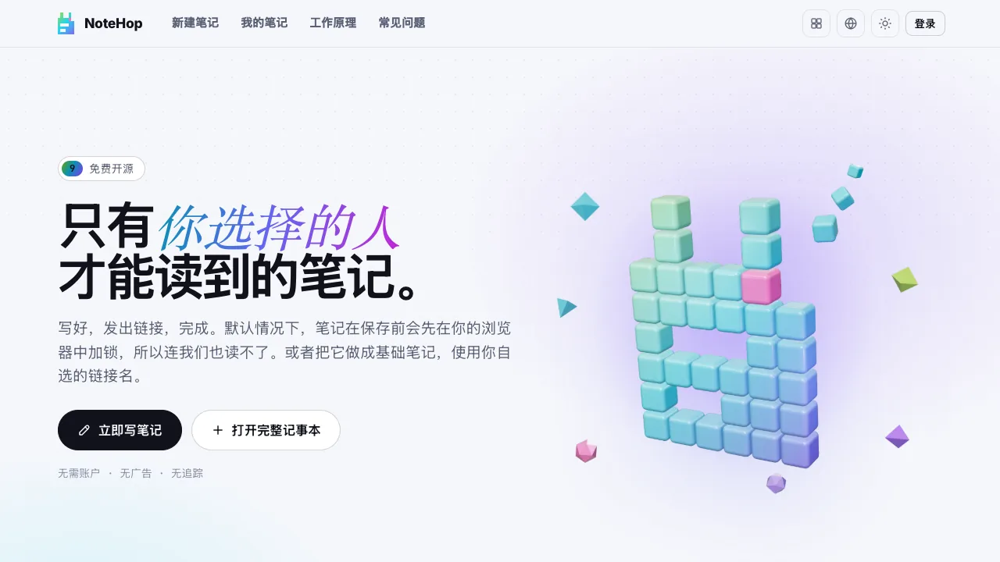

<p align="center">🌐 <a href="README.md">English</a> · <b>简体中文</b> · <a href="README.de.md">Deutsch</a> · <a href="README.id.md">Bahasa Indonesia</a> · <a href="README.ja.md">日本語</a> · <a href="README.pt-BR.md">Português (Brasil)</a> · <a href="README.es.md">Español</a> · <a href="README.fr.md">Français</a> · <a href="README.ru.md">Русский</a></p>

<p align="center"><picture><source media="(prefers-color-scheme: dark)" srcset="docs/readme/hero-zh-dark.webp"></picture></p>

<p align="center"><b>写一条笔记，发出链接，就这么简单。</b><br>笔记默认在保存之前就已在浏览器中加密，所以服务器保存的是它读不懂的文本。</p>

<p align="center">
  <a href="https://note.hel.ink"><b>在线试用</b></a> ·
  <a href="https://navi-crwn.github.io/NoteHop/">网站</a> ·
  <a href="#run-your-own">自己部署</a> ·
  <a href="#encrypted-and-basic-notes">加密笔记与基础笔记</a> ·
  <a href="#faq">常见问题</a> ·
  <a href="docs/SELF-HOSTING.md">自托管指南</a> ·
  <a href="docs/REFERENCE.md">参考文档</a> ·
  <a href="CHANGELOG.md">更新日志</a>
</p>

<p align="center"><sub>一个 Go 程序加一个 SQLite 文件 · 9 种语言 · 无广告、无追踪 · 免费开源（MIT）</sub></p>

> [!IMPORTANT]
> 加密笔记把密钥放在链接里。拿到链接的人都能读这条笔记；如果所有链接都丢了，谁也打不开它，包括服务器和运营服务器的人。基础笔记的做法不同：服务器以纯文本保存它的内容，并且能够读取。基础笔记只适合放你不介意服务器运营者看到的内容。

NoteHop 是一个可以自己部署的笔记分享应用。你写好笔记，得到一个链接，把它发出去就行。每个链接有各自的权限（仅查看、可编辑、可回复、可勾选），笔记可以在被读过之后自行删除，也可以多人同时编辑。

它适合这样的人：

- 通过聊天软件发送密码、地址或私密笔记，又不想让它们留在聊天记录里，
- 要分享购物清单、会议记录或报名表，又不想让每个人都先注册账号，
- 想要一个可以放在自己服务器上的粘贴板或记事本，而且只有一个文件。

一条命令即可安装。脚本会先检查你的电脑，问几个问题，还可以顺便帮你搭好 HOP ID 账户中心：

```bash
curl -fsSL https://raw.githubusercontent.com/navi-crwn/NoteHop/main/install.sh | bash
```

也可以在克隆的仓库里运行 `./install.sh`。用 `./update.sh` 更新，用 `./uninstall.sh` 卸载。加上 `--yes` 接受所有默认值，`--help` 列出全部选项。

<p align="center"><picture><source media="(prefers-color-scheme: dark)" srcset="docs/readme/demo-dark.webp"></picture></p>

<details>
<summary>更多截图</summary>

<p align="center"><picture><source media="(prefers-color-scheme: dark)" srcset="docs/readme/new-dark.webp"></picture></p>
<p align="center"><picture><source media="(prefers-color-scheme: dark)" srcset="docs/readme/note-dark.webp"></picture></p>
<p align="center"><picture><source media="(prefers-color-scheme: dark)" srcset="docs/readme/share-dark.webp"></picture></p>
<p align="center"><picture><source media="(prefers-color-scheme: dark)" srcset="docs/readme/basic-dark.webp"></picture></p>
<p align="center"><picture><source media="(prefers-color-scheme: dark)" srcset="docs/readme/web-dark.webp"></picture></p>
<p align="center"><picture><source media="(prefers-color-scheme: dark)" srcset="docs/readme/dashboard-dark.webp"></picture></p>
<p align="center"><picture><source media="(prefers-color-scheme: dark)" srcset="docs/readme/tour-dark.webp"></picture></p>
<p align="center"><picture><source media="(prefers-color-scheme: dark)" srcset="docs/readme/phone-dark.webp"></picture></p>

</details>

<a id="encrypted-and-basic-notes"></a>

## 加密笔记与基础笔记

每条新笔记都从一个选择开始。

| | 加密（默认） | 基础 |
|---|---|---|
| 谁能读到文本 | 拿到完整链接的人（链接里含有密钥） | 拿到链接的人，以及服务器 |
| 保存方式 | 密文（AES-256-GCM） | 以纯文本存放在数据库及其备份中 |
| 链接 | 随机生成，密钥在 `#k=` 之后 | 你自己取的名字，例如 `/monday-meeting`，也可以是随机的 |
| 密码、诱饵密码、自毁块 | 支持 | 不支持 |
| `/raw`、模拟 API、SSH、你的公开页面 `/@name` | 不支持 | 支持 |
| 搜索引擎 | 从不收录 | 从不收录 |

所有者可以在“分享”对话框里把笔记在两种类型之间切换。浏览器负责加密或解密文本，服务器只是把结果换上去。链接和设置保持不变。历史版本会被清空；带有追加行、修改建议、诱饵、自毁块、收件箱或签署记录的笔记暂时不能切换类型。

附件和实时协作在两种类型里都能用。在基础笔记中，服务器同样能读到它们，因为附件的密钥保存在笔记文本里，实时编辑的内容也没有加密。

链接预览（例如在聊天应用里）只显示有一条笔记以及它是哪一类，从不显示标题或正文。

<a id="what-the-server-sees"></a>

## 服务器能看到什么

对于一条加密笔记：

| 服务器永远收不到 | 服务器能看到的 |
|---|---|
| 笔记的标题和正文 | 密文及其大小 |
| 密钥（在链接中 `#` 之后，浏览器不会发送这部分） | 笔记创建、修改、被打开的时间，以及打开的次数 |
| 回复、修改建议、签署人姓名、聊天消息和实时编辑 | 用的是哪种链接（仅查看、可编辑等），以及链接地址 |
| 附件（文件同样是加密的） | 如果你设置了，还有过期时间、锁定和开放时间，以及允许的网络 |
| 你的账户密码，以及带标题的笔记列表 | 哪些复选框被勾选、每个投票选项有多少票，以及有多少条回复 |
| 你发给写作助手的文本（它从你的浏览器直接发往你选择的服务商） | 你的 IP 地址，用于限流和你设置的网络限制；如果有账号，还有你的用户名 |

“服务器读不到”这个说法的适用范围：

- 它只适用于加密笔记。基础笔记是可读的，处理纯文本的功能也一样：`/raw`、模拟 API、SSH，以及收件箱和 Telegram 机器人。在后两者里，服务器会在文本到达时看到它，随后用笔记的密钥封存后保存。
- 它取决于服务器发给你浏览器的代码。加密运行在服务器下发的 JavaScript 里，所以如果运营者改动了这些代码，就可能截获打开笔记的人的密钥。严格的内容安全策略（CSP）能挡住第三方脚本，但改变不了这一点。如果你在意，可以自己部署 NoteHop、阅读源码，或者使用 `notehop` 命令行程序，它在你自己的机器上完成加密。
- 链接就是密钥。谁持有它，谁就能读这条笔记，也包括你把链接粘贴进去并保存了它的任何服务。
- 即使是加密笔记，有些细节也以可读形式保存：内容警告标签及其可选的原因（最多 255 个字符），它们会在笔记打开之前显示；还有他人对某条笔记提交的举报的原因和留言。
- 数据库的备份包含数据库里的一切：密文、基础笔记的文本和账户记录。

## 功能

- 在浏览器中加密。AES-256-GCM，使用只存在于链接里的随机 256 位密钥。你还可以再加一个密码。
- 多个链接，权限各不相同：仅查看、可编辑、可回复（像留言簿）、可勾选（用于清单）或可提议修改。某个链接泄露了，只关掉它，其余照常可用。另有一个所有者链接，用来修改、分享、冻结或删除笔记。
- 阅后即焚：笔记被打开 1、3 或 10 次后销毁。聊天应用的链接预览机器人不会消耗次数，因为读者要先点一个按钮。
- 过期与时间胶囊：笔记在 10 分钟到 30 天后消失，或者保持关闭，直到你选定的日期。
- 基础笔记可以有自己的地址和二维码，例如 `/monday-meeting`。二维码在你的浏览器里生成。
- 谁也改不了的固定副本，以及签署：读者可以用自己的名字确认某个版本。
- 一起写：实时看到彼此的光标和名字，旁边有聊天，大家还可以跟随演示者。在加密笔记里，服务器转发的是加密数据。
- 文本里的块：清单、投票（每人一票）、表单、计算器、Mermaid 图表、由标题生成的看板、幻灯片，以及需要 PIN 才能查看的或会自行销毁的秘密块。
- 笔记类型：纯文本（像记事本）、文档（Markdown，带 `/` 菜单和右键格式菜单）、代码（行号，从不运行，可下载为 `.txt`）和网页。
- 网页笔记：一条笔记里放 HTML、CSS 和 JS 文件，带运行按钮、结果和控制台。代码在浏览器里的一个隔离框中运行，没有网络访问，也无法访问笔记页面、它的 Cookie 或密钥。运行别人的代码之前会先征求读者同意。
- 写作助手（可选）：摘要、改写、翻译、拼写检查。它使用浏览器内置的 AI（留在你的设备上），或者你自己的 Claude、ChatGPT、Gemini、OpenRouter 或 Ollama API 密钥。文本和密钥从你的浏览器直接发往服务商，不经过 NoteHop。
- 内容警告：把笔记标为 18+ 或敏感内容，可附原因。读者确认后笔记才会打开，`/raw` 和模拟 API 也遵守同样的检查。
- 附件：把文件或图片拖进笔记。它们在浏览器里加密，保存 24 小时，每篇笔记最大 20 MB（一个文件可用满），并有一个由运营者设定的共享存储额度。
- 账号是可选的。有了账号，你的笔记列表会用只有你的密码才能打开的密钥加密。忘记密码时，8 个一次性恢复码可以让你重新进入。运营者还可以接入单点登录账户服务器，例如 HOP ID。
- 额外的隐私：打开假笔记的诱饵密码、仅限特定网络访问、能指出复制的文本来自哪条链接的泄露追踪，以及带差异对比的版本历史。
- 附近设备：直接在浏览器之间，把记事板或文件发给同一网络里的设备。
- 面向开发者：用于 curl 的 `/raw`、在终端里加密的 `notehop` 命令行程序、由基础笔记里的 JSON 生成的模拟 API、进出两个方向的 Webhook、SSH 和 Telegram 机器人。
- 九种语言：English、简体中文、Deutsch、Bahasa Indonesia、日本語、Português (Brasil)、Español、Français 和 Русский。匿名访客看到的是英语，可以用地球图标菜单或 `?lang=xx` 切换。
- 没有广告，没有追踪，没有第三方脚本，还可以作为可安装的离线应用（PWA）使用。
- 举报与处理：每条笔记都有 **举报此笔记**。运营者通过 `notehop takedown` 命令，或通过 [HOP App Protocol](docs/REFERENCE.md#control-center-hop-app-protocol) 上的控制中心来审核举报。

<a id="run-your-own"></a>

## 自己部署

NoteHop 是一个 Go 程序加一个 SQLite 文件。不需要 Node，不需要构建步骤，也不需要其他服务。

本页顶部的安装脚本是在你自己掌控的电脑上最省事的办法。要搭建公网服务器，请用下面其中一种方式。

在 VPS 上（systemd，用 Caddy 或 nginx 提供 HTTPS，并带每日备份）：

```bash
git clone https://github.com/navi-crwn/NoteHop.git && cd NoteHop
sudo DOMAIN=note.example.com ./deploy/install.sh
```

[自托管指南](docs/SELF-HOSTING.md) 涵盖 HTTPS、更新、备份和恢复。

在你自己的电脑上开发（需要 Go 1.27 或更高版本）：

```bash
go run ./cmd/notehop -addr 127.0.0.1:8090 -db data/dev.db
```

打开 http://127.0.0.1:8090。浏览器只允许在 HTTPS 或 localhost 下使用加密功能。

使用 Docker：

```bash
docker build -t notehop .
docker run -d -p 127.0.0.1:8090:8080 -v notehop:/data -e NOTEHOP_BASE_URL=https://note.example.com notehop
```

所有设置都是以 `NOTEHOP_` 开头的环境变量。它们连同加密模型和 API 一起列在 [docs/REFERENCE.md](docs/REFERENCE.md) 里。

备份：`notehop backup -db notehop.db copy.db` 可以在服务器运行时做一份副本，文件只有所有者可读。VPS 安装脚本还会设置每日备份，保留 14 天。备份里的基础笔记是纯文本，请妥善保管。

## 你的第一条笔记

1. 打开首页，在输入框里输入，看看服务器会收到的乱码文本。
2. 选择谁能做什么：**仅查看**、**可编辑** 或 **可回复**。想发一条秘密，就打开 **只能看一次**。
3. 点 **创建加密链接**，把链接发出去。不需要账号。
4. 需要更多（定时、额外隐私、协作）时，用 **打开完整记事本**，或者你拥有的任何笔记上的 **分享** 按钮。想要带链接名的基础笔记，请在“新建笔记”页面顶部选择 **基础**。

<a id="faq"></a>

## 常见问题

**运营服务器的人能读到我的笔记吗？**
加密笔记不能。你的浏览器在发送之前就把它加密了，密钥在链接中 `#` 之后的部分，浏览器不会把这部分发给服务器。服务器拿到的只有乱码文本。基础笔记服务器是能读的。这个说法的适用范围见[服务器能看到什么](#what-the-server-sees)。

**链接丢了怎么办？**
加密笔记就再也没有人能打开了。如果你有账号，笔记会列在“我的笔记”里，可以从那里打开。没有账号的话，最近的笔记只记在那个浏览器里。基础笔记可以凭链接名称再找到。

**“阅后即焚”会被链接预览误触发吗？**
不会。只打开页面不会显示内容，读者要先点一个按钮，聊天应用的预览机器人拿到的是预览卡片，不算一次查看。

**AI 会读我的笔记吗？**
写作助手在你使用之前是关闭的。浏览器内置的 AI 在你的设备上运行。如果用你自己的 API 密钥，文本从你的浏览器直接发往那家服务商，不经过 NoteHop。运营者可以用 `NOTEHOP_AI=off` 把它关掉。

**笔记里的代码会攻击打开它的人吗？**
代码笔记从不运行，只作为文本显示，并以 `.txt` 下载。网页笔记只在一个隔离框里运行，没有网络、没有 Cookie，也无法访问笔记页面或其密钥，而且会先征求读者同意。

**我能用自己的登录服务器吗？**
可以。NoteHop 有自己的账号，也可以通过你自己运行的账户服务器登录（单点登录）。见 [docs/REFERENCE.md](docs/REFERENCE.md) 里的 `NOTEHOP_SSO_*` 设置。

**有人分享有害内容怎么办？**
每条笔记的菜单里都有 **举报此笔记**。举报（一个原因和一条简短留言，从不包含笔记内容）会发给运营网站的人。他们读不了加密笔记，但可以把它下架，之后这个链接名称会被保留一年。

## 内部结构

| 文件夹 | 里面有什么 |
|---|---|
| `cmd/notehop/` | 程序本身：服务器、它的设置，以及 `backup`、`new`、`get` 和 `takedown` 命令 |
| `internal/app/` | HTTP 处理器、笔记功能、实时协作中继、SSH、Telegram、单点登录、HOP App Protocol |
| `internal/db/` | SQLite 表结构和自动迁移 |
| `internal/client/` | 命令行程序的加密部分，与浏览器里的一致 |
| `internal/i18n/` | 加载 9 种语言，以及一个让它们保持同步的测试 |
| `web/templates/`, `web/static/` | 页面、原生 JavaScript 和 CSS，没有构建步骤。第三方库放在 `web/static/vendor/` |
| `web/i18n/` | 9 种语言的界面文字，每种语言一个 JSON 文件 |
| `web/changelog.json` | 提交和拉取请求历史的快照，显示在 `/changelog` 页面。由 `scripts/build-changelog.py` 生成 |
| `deploy/` | VPS 安装脚本、systemd 单元、备份、Caddy 和 nginx 示例 |
| `docs/` | 文档网站（GitHub Pages）、参考文档、自托管指南和 README 图片 |
| `scripts/` | 浏览器测试（Playwright），用 `./scripts/e2e-all.sh` 运行全部，以及辅助脚本 |

用 `go test -race ./...` 和 `./scripts/e2e-all.sh` 运行测试。

## 安全、许可证与历史

- 报告漏洞请按 [SECURITY.md](SECURITY.md) 操作。请不要为此公开提交 issue。
- [CHANGELOG.md](CHANGELOG.md) 按时间倒序列出了变更。
- NoteHop 以 [MIT 许可证](LICENSE) 发布。内置的库和字体保留各自的许可证，列在 [docs/REFERENCE.md](docs/REFERENCE.md#third-party-code)。

<a id="family"></a>

## 自行托管

<!-- self-hosting:start -->
NoteHop 所需的一切都在公开仓库中：不需要私有仓库、令牌或 hel.ink 账户。详细说明见家族指南：[docs/self-hosting.md](https://github.com/navi-crwn/HEL.ink/blob/main/docs/self-hosting.md)（英文）。

| 组件 | 对 NoteHop 而言 | 作用 |
| --- | --- | --- |
| [HEL.ink](https://github.com/navi-crwn/HEL.ink) (中心，HOP ID) | 可选：增加“使用 HOP ID 登录” | 所有应用的账户与登录 |
| [Imperium](https://github.com/navi-crwn/Imperium) | 可选 | 整个家族的管理面板；需要中心 |
| 家族字体与浮动图块 | 无需安装：从 `hel.ink/hop-assets` 加载 | 无法访问 hel.ink 时：使用系统字体，没有浮动图块 |

- **安装顺序**：用 `./install.sh` 单独安装 NoteHop。如需 HOP ID 登录，先装[中心](https://github.com/navi-crwn/HEL.ink)：`./install.sh --hub new` 会在旁边装一个。
- **最少设置**：`NOTEHOP_BASE_URL`; 连接中心时: `NOTEHOP_SSO_URL`, `NOTEHOP_SSO_CLIENT=notehop`, `NOTEHOP_SSO_SECRET`。
- **单独运行或加入家族**：NoteHop 可带自己的账户单独运行。连接中心后，用户还可以用 HOP ID 登录，并一次退出所有应用。
- **没有 Imperium 时**：NoteHop 照常运行；下架笔记可用 服务器上的 `notehop takedown` 和 `notehop backup`。
<!-- self-hosting:end -->

## HOP 家族

NoteHop 是 HOP 家族的一员，这是一组尊重隐私、可自托管的开源应用。

<!-- hop-family:start -->
<!-- Generated from HEL.ink resources/hop-assets/apps.source.json; edit there, then run scripts/hop_assets.py build. -->
| App | Address | Repository | What it does |
| --- | --- | --- | --- |
| **HOP ID** | [hel.ink](https://hel.ink) · accounts at `hub.hel.ink` | [navi-crwn/HEL.ink](https://github.com/navi-crwn/HEL.ink) | One account for every HOP app. |
| **LinkHop** | [link.hel.ink](https://link.hel.ink) · `hel.ink/l/…` | [navi-crwn/LinkHop](https://github.com/navi-crwn/LinkHop) | Short links, QR codes and click analytics. |
| **BioHop** | [bio.hel.ink](https://bio.hel.ink) · `hel.ink/b/…` | [navi-crwn/BioHop](https://github.com/navi-crwn/BioHop) | One link-in-bio page for everything you do. |
| **PixelHop** | [pixel.hel.ink](https://pixel.hel.ink) · `p.hel.ink/…` | [navi-crwn/PixelHop](https://github.com/navi-crwn/PixelHop) | Image hosting with albums and direct links. |
| **NoteHop** | [note.hel.ink](https://note.hel.ink) · `n.hel.ink/…` | [navi-crwn/NoteHop](https://github.com/navi-crwn/NoteHop) | Encrypted notes you share with a link. |
| **FileHop** | [file.hel.ink](https://file.hel.ink) | [navi-crwn/FileHop](https://github.com/navi-crwn/FileHop) | Convert files in your browser; nothing is uploaded. |
| **PayHop** | [pay.hel.ink](https://pay.hel.ink) | [navi-crwn/PayHop](https://github.com/navi-crwn/PayHop) | Make a payment QR and split a bill; nothing leaves your browser. |
| **Imperium** | not public-facing: optional, for admins | [navi-crwn/Imperium](https://github.com/navi-crwn/Imperium) | The HOP control panel. |
<!-- hop-family:end -->
