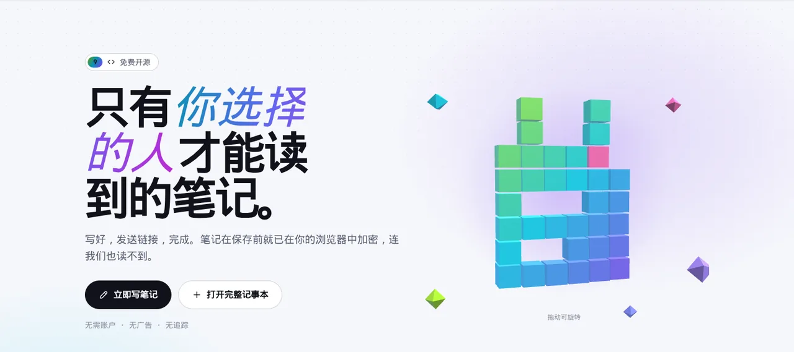

<p align="center">🌐 <a href="README.md">English</a> · <b>简体中文</b> · <a href="README.es.md">Español</a> · <a href="README.ar.md">العربية</a> · <a href="README.pt.md">Português</a> · <a href="README.fr.md">Français</a> · <a href="README.ja.md">日本語</a> · <a href="README.ru.md">Русский</a> · <a href="README.id.md">Bahasa Indonesia</a></p>

<p align="center"><picture><source media="(prefers-color-scheme: dark)" srcset="docs/readme/hero-zh-dark.webp"></picture></p>

<p align="center">
  <b>写下笔记，发送链接，搞定。<br>内容在保存之前就已在你的浏览器里加密，连服务器也读不到。</b>
</p>

<p align="center">
  <a href="https://note.hel.ink"><b>✍️ 在线试用</b></a> ·
  <a href="#run-your-own">自己部署</a> ·
  <a href="#features">功能</a> ·
  <a href="#faq">常见问题</a> ·
  <a href="docs/SELF-HOSTING.md">部署指南（英文）</a> ·
  <a href="docs/REFERENCE.md">参考文档（英文）</a> ·
  <a href="CHANGELOG.md">更新日志</a>
</p>

<p align="center"><sub>一个 Go 程序 + 一个 SQLite 文件 · 9 种语言 · 无广告、无追踪 · 免费开源（MIT）</sub></p>

> [!IMPORTANT]
> **密钥就在链接里。** 拿到链接的人就能读这条笔记；如果所有链接都丢了，就再也没人能打开它：你不能，服务器不能，我们也不能。只把链接发给你想给的人，并把所有者链接存在安全的地方。

---

## NoteHop 是什么？

把一条笔记想象成锁在盒子里的信。NoteHop **在你的浏览器里**把盒子锁上，把钥匙放进链接，然后才把盒子交给服务器。服务器保管着一个它打不开的盒子。你把链接给谁，谁就能在自己的浏览器里当场打开。

除此之外，一条笔记能做的远不止记事本：权限不同的链接（仅查看、可编辑、仅回复、仅勾选）、阅后即焚、实时一起写、勾选清单、投票、表单、代码，甚至能在封闭的框里运行的小网页。

**适合你，如果你：**
- 通过聊天发送密码、地址或私人笔记，又不想它们留在聊天记录里，
- 想分享购物清单、会议记录或报名表，又不想让每个人都注册账号，
- 想要一个能放在自己服务器上的 pastebin 或记事本，只需一个文件。

<p align="center"><picture><source media="(prefers-color-scheme: dark)" srcset="docs/readme/demo-dark.webp"></picture></p>

<details>
<summary><b>近看一下</b>（英文界面）</summary>

<p align="center"><picture><source media="(prefers-color-scheme: dark)" srcset="docs/readme/note-dark.webp"></picture></p>
<p align="center"><picture><source media="(prefers-color-scheme: dark)" srcset="docs/readme/share-dark.webp"></picture></p>
<p align="center"><picture><source media="(prefers-color-scheme: dark)" srcset="docs/readme/tour-dark.webp"></picture></p>
<p align="center"><picture><source media="(prefers-color-scheme: dark)" srcset="docs/readme/web-dark.webp"></picture></p>
<p align="center"><picture><source media="(prefers-color-scheme: dark)" srcset="docs/readme/phone-dark.webp"></picture></p>

</details>

## 服务器能看到什么，永远看不到什么

| 🙈 永远不会到达服务器 | 👀 服务器确实能看到的 |
|---|---|
| 笔记的标题和内容 | 乱码（密文）及其大小 |
| 密钥（在链接的 `#` 后面，浏览器从不发送这部分） | 笔记何时创建、修改、打开，以及打开次数 |
| 附件、聊天消息和一起写时的编辑（同样加密） | 用的是哪种链接（仅查看、可编辑……） |
| 你的账号密码和笔记列表 | 哪些复选框被勾选，以及回复的数量 |
| 你发给 AI 写作助手的文字（从你的浏览器直接发给你选的服务商） | 你的 IP 地址，用于频率限制 |

<a id="features"></a>

## 功能

- **🔒 在浏览器里加密。** AES-256-GCM，随机 256 位密钥只存在于链接里。还可以再加一个密码。
- **🔗 多个链接，不同权限。** 仅查看、可编辑、仅回复（像留言簿）或仅勾选（用于清单）。链接泄露了？关掉它，其他链接照常可用。
- **🔑 所有者链接。** 一个单独的链接，用来修改、分享、冻结或删除笔记。
- **🔥 阅后即焚。** 打开 1、3 或 10 次后销毁。聊天应用的链接预览机器人不会用掉次数。
- **⏳ 过期和时间胶囊。** 10 分钟到 30 天后消失，或锁到你选的日期才能打开。
- **🏷️ 自定义地址 + 二维码。** `/n/monday-meeting`，以及在浏览器里生成的二维码。
- **📌 固定副本和签名确认。** 冻结一个谁都改不了的版本，并让读者用自己的名字确认。
- **🧑‍🤝‍🧑 一起写。** 每个人的光标和名字实时可见，旁边有聊天，还能"跟随演示者"。服务器只转发加密数据。
- **✅ 智能区块。** 勾选清单、投票（每人一票）、表单、计算器、Mermaid 图表、根据标题生成的看板，以及需要 PIN 或会自毁的秘密区块。
- **📝 笔记类型。** 纯文本（像记事本）、文档（Markdown，带 `/` 菜单和右键格式菜单）、代码（行号、从不运行、下载为 `.txt`）和网页。
- **🌐 网页笔记。** 一条笔记里放 HTML、CSS 和 JS 文件，有运行按钮、结果和控制台。代码只在你浏览器里的封闭框中运行，没有网络、碰不到页面；运行别人的代码之前一定会先询问读者。
- **✨ 写作助手（可选）。** 总结、改写、翻译、纠正拼写。使用浏览器内置 AI（文字不离开你的设备）或你自己的 API 密钥（Claude、ChatGPT、Gemini、OpenRouter 或 Ollama）。NoteHop 永远看不到文字和密钥。
- **📎 附件。** 把文件或图片拖进笔记；同样加密，保存 24 小时。
- **👤 账号可选。** 有账号时，你的笔记列表用只有你的密码才能打开的密钥加密。忘记密码时可以用恢复码找回。
- **🕵️ 额外隐私。** 诱饵密码（打开一条假笔记）、仅限特定网络、告诉你哪个链接泄露的泄露追踪，以及带差异对比的历史记录。
- **📶 附近设备。** 把笔记或文件发给同一 Wi-Fi 下的设备，浏览器直连浏览器。
- **🧑‍💻 给开发者。** 给 curl 用的 `/raw`、在终端里加密的 `notehop` 命令行、用笔记里的 JSON 生成模拟 API、进出双向的 Webhook、SSH 和 Telegram 机器人。
- **🌍 9 种语言。** English、简体中文、Español、العربية（从右到左）、Português、Français、日本語、Русский 和 Bahasa Indonesia，根据浏览器自动选择。
- **🛡️ 默认严格。** 严格的内容安全策略（CSP）、没有第三方脚本、无广告、无追踪、`noindex`、频率限制。可安装为应用并离线使用（PWA）。

<a id="run-your-own"></a>

## 自己部署

NoteHop 就是**一个 Go 程序和一个 SQLite 文件**。不需要 Node，没有构建步骤，也不依赖其他服务。

**方式 1：在 VPS 上**（systemd + Caddy 或 nginx，每日备份）

```bash
git clone https://github.com/navi-crwn/NoteHop.git && cd NoteHop
sudo DOMAIN=note.example.com ./deploy/install.sh
```

完整指南（HTTPS、更新、备份和恢复）见 **[docs/SELF-HOSTING.md](docs/SELF-HOSTING.md)**（英文）。

**方式 2：在自己的电脑上**（需要 Go 1.27+）

```bash
go run ./cmd/notehop -addr 127.0.0.1:8090 -db data/dev.db
```

打开 http://127.0.0.1:8090。浏览器只在 **HTTPS 或 localhost** 下允许这种加密。

**方式 3：Docker**

```bash
docker build -t notehop .
docker run -d -p 127.0.0.1:8090:8080 -v notehop:/data -e NOTEHOP_BASE_URL=https://note.example.com notehop
```

所有设置都是环境变量（`NOTEHOP_*`），完整列表、加密模型和 API 都在 **[docs/REFERENCE.md](docs/REFERENCE.md)**。

## 你的第一条笔记

1. 打开首页，在框里输入，看看服务器会收到的乱码。
2. 选择谁能做什么：**仅查看**、**可编辑** 或 **可回复**。要发秘密就勾选 **只能看一次**。
3. 点 **创建链接** 并发送。就这样，不需要账号。
4. 想要更多（定时、额外隐私、一起写）？用 **打开完整记事本**，或在你拥有的笔记上点 **分享**。

<a id="faq"></a>

## 常见问题

**运营服务器的人能读我的笔记吗？**
不能。笔记在发送之前就在你的浏览器里加密，密钥在链接 `#` 后面的部分，浏览器从不把它发给服务器。服务器只有乱码。

**链接丢了怎么办？**
那这条笔记谁都打不开了。如果你有账号，笔记会列在 **我的笔记** 里，可以从那里打开。没有账号时，最近的笔记只记在这个浏览器里。

**"阅后即焚"会被链接预览用掉吗？**
不会。只打开页面不会显示内容，读者要先点一个按钮。聊天应用的预览机器人只拿到一张预览卡片，不算一次阅读。

**AI 会读我的笔记吗？**
在你选择之前，写作助手一直关闭。浏览器内置 AI 在你的设备上运行。使用自己的 API 密钥时，文字从你的浏览器直接发给该服务商，从不经过 NoteHop。服务器管理员可以用 `NOTEHOP_AI=off` 关闭 AI。

**笔记里的代码会攻击打开它的人吗？**
代码笔记从不运行：只作为文字显示，下载为 `.txt`。网页笔记只在封闭的框里运行，没有网络、没有 Cookie，也碰不到笔记页面或它的密钥，而且会先询问读者。

**能用自己的登录服务器吗？**
可以。NoteHop 有自己的账号，也可以通过你运营的账号服务器登录（单点登录）。见 [docs/REFERENCE.md](docs/REFERENCE.md) 里的 `NOTEHOP_SSO_*`。

**怎么备份？**
`notehop backup -db notehop.db copy.db` 可以在服务器运行时执行。VPS 安装脚本也会设置每日备份。备份里的笔记同样是加密的。

## 内部构成

| 文件夹 | 内容 |
|---|---|
| `cmd/notehop/` | 程序本体：服务器、设置，以及 `backup`、`new`、`get`、`takedown` 命令 |
| `internal/app/` | HTTP 处理、笔记功能、实时协作中继、SSH、Telegram、单点登录 |
| `internal/db/` | SQLite 结构和自动迁移 |
| `internal/client/` | 命令行的加密（与浏览器相同） |
| `internal/i18n/` | 加载 9 种语言，以及保持它们一致的测试 |
| `web/templates/`、`web/static/` | 页面、原生 JavaScript 和 CSS，无构建步骤。第三方库放在 `web/static/vendor/` |
| `web/i18n/` | 9 种语言的界面文字 |
| `deploy/` | 安装脚本、systemd 单元、备份、Caddy 和 nginx 示例 |
| `scripts/` | 浏览器测试（Playwright）：`./scripts/e2e-all.sh` 对一个全新的服务器运行全部测试 |

运行测试：`go test -race ./...` 和 `./scripts/e2e-all.sh`。

<a id="family"></a>

## Hop 家族

NoteHop 还有两个以同样方式打造的开源兄弟项目：免费、可自行部署、无追踪。

|  | 用途 | 试用 | 代码 |
|---|---|---|---|
| 🔗 **LinkHop** | 短链接和个人主页链接页：自定义名称、二维码、统计和 20 多种主页主题 | [hel.ink](https://hel.ink) | [GitHub](https://github.com/navi-crwn/LinkHop) |
| 🖼️ **PixelHop** | 一个 Go 程序搞定图片、视频和 PDF 托管：上传时去除 GPS、相册、ShareX，以及在浏览器里运行的修图工具 | [p.hel.ink](https://p.hel.ink) | [GitHub](https://github.com/navi-crwn/PixelHop) |
| 📝 **NoteHop** | 只有你选择的人才能读到的笔记 | [note.hel.ink](https://note.hel.ink) | 你在这里 |

---

<p align="center">MIT 许可证 · <a href="docs/REFERENCE.md">参考文档</a> · <a href="docs/SELF-HOSTING.md">自己部署</a> · <a href="CHANGELOG.md">更新日志</a><br><sub>HEL.ink 家族成员：<a href="https://github.com/navi-crwn/LinkHop">LinkHop</a>（短链接）· <a href="https://github.com/navi-crwn/PixelHop">PixelHop</a>（图片托管）· <a href="https://note.hel.ink">NoteHop</a></sub></p>
